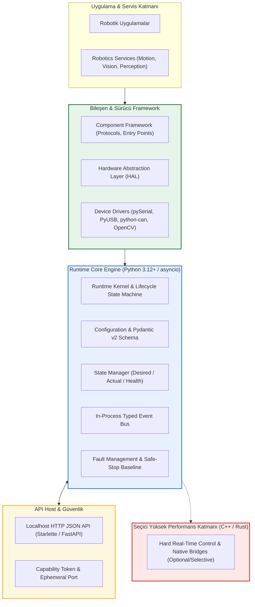

# HIYELX Runtime — Complete Engineering Specification & Software Architecture
**Document Reference: HIYELX-SPEC-RUNTIME-V1**  
**Classification: Core Architectural Specification**  
**Target Release: Runtime V1 (Foundation) → V1.5 (Expansion) → V2 (Platform)**

---

## 1. Mimari Prensipler ve Sistem Sınırları

HIYELX Runtime, heterojen robotik donanımları, yazılım bileşenlerini ve uygulamaları ortak bir yürütme altyapısı üzerinde birleştiren modüler bir **Robotics Execution Platform**'dur.

### 1.1. Üç Temel İlke
1. **Hardware Independence (Donanım Bağımsızlığı):** Uygulama mantığı donanım üreticisinin protokolünü (DYNAMIXEL, V4L2, CANopen) bilmez. Sadece HIYELX Donanım Soyutlama Katmanı (HAL) sözleşmelerini çağırır.
2. **Modularity (Genişletilebilirlik):** Yeni bir sürücü, bileşen veya servis eklemek Runtime Core'un kaynak kodunu değiştirmeyi gerektirmez.
3. **Execution Reliability (Çalışma Kararlılığı):** Runtime yalnızca cihazları tanımaz; bileşenlerin yaşam döngüsünü, bağımlılıklarını, olay akışını ve hata durumlarını deterministik olarak yönetir.

### 1.2. Studio ve Runtime Sınır Sözleşmesi
* **Tek Otorite:** Runtime donanıma erişen tek yetkili katmandır. Studio hiçbir zaman USB, Seri veya CAN portlarına doğrudan bağlanamaz.
* **Haberleşme:** Studio ve yerel istemciler, `127.0.0.1` ephemeral port üzerinde çalışan, URL fragment-to-memory capability token ile korunan tipli JSON HTTP API üzerinden konuşur.
* **Bağımsız Yaşam Döngüsü:** Runtime, Studio kapalıyken de robotu kesintisiz çalıştırmaya devam eder.

---

## 2. Yazılım Yığını (Recommended Software Stack)



### 2.1. Teknoloji Seçimleri ve Gerekçeleri

| Fonksiyon Alanı | Seçilen Teknoloji | Gerekçe & Kullanım Alanı |
|---|---|---|
| **Ana Dil (Core Language)** | **Python 3.12+** | Orkestrasyon, yaşam döngüsü, konfigürasyon, tip denetimi ve ROS 2 Jazzy (Ubuntu 24.04 LTS) uyumu. |
| **Asenkron Çalışma** | `asyncio` | I/O bağlı işlemler, olay akışları, periyodik kontrol döngüleri. |
| **Tip Sistemi** | `typing.Protocol` / ABC | Katı arayüz sözleşmeleri, bağımlılık enjeksiyonu. |
| **Veri Doğrulama** | Pydantic v2 | Konfigürasyon, telemetri, API modelleri ve manifest doğrulama. |
| **Konfigürasyon** | YAML + JSON Schema | İnsan tarafından okunabilir, versiyonlanabilir robot tanımları (`robot.yaml`). |
| **Süreç İçi Haberleşme** | Typed Event Bus | Hafif, sıfır ağ gecikmeli, süreç içi tipli olay ve mesaj dağıtımı. |
| **API Host** | Starlette / FastAPI | Ephemeral port üzerinde yerel `127.0.0.1` typed JSON API. |
| **Eklenti Dağıtımı** | Python `entry_points` + Wheel | Core'a dokunmadan harici sürücü ve bileşen paketleme. |
| **Donanım Sürücüleri** | `pySerial`, `python-can`, `OpenCV` | Seri motorlar, CANopen/SocketCAN, USB kameralar. |
| **Seçici Performans** | Rust / C++ | Yalnızca sert gerçek zamanlı (hard real-time) döngüler gerektiğinde izole C-ABI. |
| **Gözlemlenebilirlik** | `structlog` + OpenTelemetry | Yapılandırılmış loglama, dağıtık izleme (tracing) ve metrikler. |
| **Kalite Kapısı** | `pytest`, `ruff`, `pyright` (strict) | Sıfır linter/type hatası, deterministik birim/entegrasyon testleri. |

---

## 3. Sistem Haritası: 12 Ana Modülün Detaylı Teknik Kapsamı

### MODULE 01 — Runtime Kernel
* **Sorumluluk:** Sistemin merkezi başlatma (bootstrap), yürütme ve durdurma motorudur.
* **Bileşenler:** `BootstrapManager`, `RuntimeContext`, `LifecycleManager`, `DependencyResolver`, `ShutdownManager`.
* **Yaşam Döngüsü Durum Makinesi:**
  - `CREATED` ➔ `STARTING` ➔ `RUNNING` ➔ `STOPPING` ➔ `STOPPED`
  - Hata anında deterministik `FAILED` geçişi ve rollback.

### MODULE 02 — Configuration & Robot Description
* **Sorumluluk:** Robotun yazılım ve donanım topolojisini tek bir merkezde doğrular.
* **Bileşenler:** `ConfigLoader`, `ConfigSchema`, `ConfigValidator`, `ConfigResolver`, `ConfigMigrator`.
* **Şema Hiyerarşisi (`robot.yaml` v2):**
  - `robot:` Kimlik, model adı, sürüm.
  - `runtime:` Profil (`development`, `production`), log seviyesi.
  - `devices:` Fiziksel donanım portları (USB, Seri, CAN).
  - `components:` Sensör, eyleyici ve servis tanımları, bağımlılıklar (`depends_on`).
  - `applications:` Çalıştırılacak uygulama ve davranış tanımları.

### MODULE 03 — Component & Plugin Framework
* **Sorumluluk:** Genişletilebilir bileşen mimarisi ve harici paket yönetimi.
* **Bileşenler:** `ComponentBase`, `ComponentRegistry`, `ComponentFactory`, `PluginLoader`, `CapabilityRegistry`.
* **Bileşen Sözleşmesi (`Component` Protocol):**
  ```python
  class Component(Protocol):
      identity: ResourceIdentity
      category: ComponentCategory
      capabilities: frozenset[Capability]
      state: LifecycleState
      
      async def configure(self, settings: Mapping[str, object]) -> None: ...
      async def start(self) -> None: ...
      async def shutdown(self) -> None: ...
      async def safe_stop(self) -> None: ...
      def health(self) -> ResourceHealth: ...
  ```

### MODULE 04 — Device & Driver Framework
* **Sorumluluk:** Fiziksel donanımlarla bağlantıyı kurar ve donanım soyutlamasını (HAL) yönetir.
* **Bileşenler:** `DeviceRegistry`, `DeviceLockManager`, `DriverBase`, `DriverFactory`, `ConnectionManager`.
* **HAL Sözleşmeleri:** `MotorInterface`, `CameraInterface`, `IMUInterface`, `EncoderInterface`.
* **Kaynak Çakışma Denetimi:** Aynı seri port veya USB adresine iki farklı sürücünün bağlanmasını engeller.

### MODULE 05 — Communication & Data Infrastructure
* **Sorumluluk:** Bileşenler arası süreç içi veri ve olay akışını sağlar.
* **Bileşenler:** `EventBus`, `TopicRegistry`, `CommandDispatcher`, `QueueManager`, `QoSManager`.
* **Modeller:** Request/Response, Pub/Sub, State Events, Control Commands.

### MODULE 06 — Application & Execution Manager
* **Sorumluluk:** Birden fazla bileşeni ve servisi kullanarak robotik görevleri yürütür.
* **Bileşenler:** `ApplicationRegistry`, `ApplicationLifecycle`, `ExecutionSupervisor`, `ExecutionHistory`.
* **Yürütme Modelleri:** Süreç içi (in-process) görevler; ileride yönetilen alt süreçler (managed subprocess).

### MODULE 07 — Robotics Services Framework
* **Sorumluluk:** Alt seviye donanımları yüksek seviyeli robotik servislere dönüştürür.
* **Bileşenler:**
  - `MotionService`: Motor koordinasyonu, diferansiyel sürüş, hız sınırları.
  - `SensorService`: Sensör verisi toplama, kalibrasyon, birim dönüşümü.
  - `VisionService`: Kare yakalama, FPS denetimi, temel görüntü işleme.

### MODULE 08 — State, Resource & Health Management
* **Sorumluluk:** Sistemin anlık durumunu, kaynak tüketimini ve sağlığını izler.
* **Üçlü Durum Ayrımı:**
  1. `Desired State`: Talep edilen durum (ör. `RUNNING`, hedef hız 1.5 rad/s).
  2. `Actual State`: Fiziksel durum (ör. enkoderden okunan 1.48 rad/s).
  3. `Health State`: Operasyonel sağlık (`HEALTHY`, `DEGRADED`, `UNHEALTHY`).
* **Kaynak Yönetimi:** CPU, RAM, seri port ve süreç tanıtıcılarının izlenmesi.

### MODULE 09 — Fault Management & Safety Infrastructure
* **Sorumluluk:** Hataları yakalar, sınıflandırır ve belirlenen kurtarma politikalarını yürütür.
* **Bileşenler:** `FaultDetector`, `FaultClassifier`, `FaultPropagation`, `RecoveryManager`.
* **Kurtarma Politikaları:** Yeniden deneme (`retry`), bileşeni güvenli durdurma (`degrade`), kontrollü sistem duruşu (`safe_stop`).
* **Güvenlik Sınırı:** Yazılımsal `safe_stop` en iyi çaba esasıdır; sertifikalı acil durdurma fiziksel donanım devreleriyle sağlanır.

### MODULE 10 — API Host, Security & External Interfaces
* **Sorumluluk:** Dış istemciler (Studio, CLI) için güvenli yerel API sağlar.
* **Bileşenler:** `APIHost`, `RouteRegistry`, `SessionManager`, `SecurityManager`.
* **Endpoint Grupları:**
  - `/api/v1/system`: Runtime kimliği ve sürümü.
  - `/api/v1/health`: Sistem ve bileşen sağlık özeti.
  - `/api/v1/components`: Aktif bileşen listesi ve durumları.
  - `/api/v1/configuration`: Aktif konfigürasyon ve doğrulama raporu.
  - `/api/v1/commands`: Denetimli hareket komutları (yetkilendirme korumalı).
  - `/api/v1/events`: Olay geçmişi ve akışı.

### MODULE 11 — Observability & Diagnostics
* **Sorumluluk:** Sistemin iç dinamiklerini izlenebilir kılar.
* **Bileşenler:** `StructuredLogger`, `MetricsCollector`, `DiagnosticsReporter`.
* **İzleme (Tracing):** Komutun API ➔ Servis ➔ Bileşen ➔ Sürücü yolculuğunu takip eden `Correlation-ID`.

### MODULE 12 — Integration, Simulation & Ecosystem (V2 Scope)
* **Sorumluluk:** Harici ekosistemlerle (ROS 2, simülatörler, AI) adaptörler aracılığıyla köprü kurar.
* **Bileşenler:** `ROS2Adapter`, `GazeboBridge`, `MuJoCoBridge`, `ONNXInferenceAdapter`.

---

## 4. Yatay Sistemler (Horizontal Systems)

1. **Testing Infrastructure:**
   - Birim testleri (`tests/unit/`), Entegrasyon testleri (`tests/integration/`), Sözleşme testleri (`tests/contract/`), Donanım testleri (`tests/hardware/` opt-in).
2. **Developer SDK (`hiyelx.sdk`):**
   - Üçüncü taraf sürücü geliştiricileri için şablon üretici (`scaffold`) ve uyumluluk doğrulama paketi (`compliance suite`).
3. **CLI Interface (`hiyelx`):**
   - `hiyelx runtime start|stop|status`
   - `hiyelx config validate <file>`
   - `hiyelx component list|inspect <id>`
   - `hiyelx run <file>`
4. **Packaging & Deployment:**
   - Standart Python wheel paketlemesi (`hatchling`), offline kurulum desteği.
5. **Documentation System:**
   - `docs/` altında mimari kılavuzlar, API referansı ve ADR kayıtları.

---

## 5. Hedef Paket ve Dizin Yapısı

```text
hiyelx/
├── src/
│   └── hiyelx/
│       ├── core/               # Kernel, Context, Lifecycle, Component & Capability tabanı
│       ├── config/             # YAML yükleyici, Pydantic v2 şemaları ve doğrulayıcılar
│       ├── components/         # Temel bileşenler (Actuator, Vision, Spatial, Feedback)
│       │   └── mock/           # 4 kanonik sanal bileşen (Motor, Encoder, Camera, IMU)
│       ├── devices/            # Donanım kaynak kilitleme ve bağlantı yöneticisi
│       ├── drivers/            # Fiziksel donanım sürücüleri (Dynamixel, OpenCV vb.)
│       ├── communication/      # Süreç içi tipli Event Bus ve mesaj sözleşmeleri
│       ├── services/           # Robotik servisler (Motion, Sensor, Vision)
│       ├── execution/          # Uygulama yöneticisi ve çalışma denetimi
│       ├── state/              # Desired/Actual/Health durum yöneticisi
│       ├── faults/             # Hata sınıflandırma, yayılım ve safe_stop politikaları
│       ├── observability/      # Yapılandırılmış loglama, telemetri ve metrikler
│       ├── studio/             # Studio HTTP Host, ephemeral port ve güvenlik adaptörü
│       └── sdk/                # Harici sürücü geliştirme araçları ve uyumluluk testleri
├── studio/                     # Studio statik web varlıkları (HTML5/CSS/Vanilla JS)
├── tests/
│   ├── unit/                   # Çekirdek modül testleri
│   ├── integration/            # Uçtan uca sistem entegrasyon testleri
│   ├── studio/                 # Arayüz ve host güvenlik testleri
│   └── hardware/               # Opt-in fiziksel XL430 testleri
├── docs/
│   ├── architecture/           # Mimari kılavuzlar ve spesifikasyonlar
│   ├── decisions/              # Architecture Decision Records (ADR)
│   ├── development/            # Geliştirici kılavuzları
│   └── plans/                  # Yol haritaları ve ana planlar
└── pyproject.toml              # Paketleme ve bağımlılık tanımları
```

---

## 6. 14 Maddelik Mühendislik Uygulama Listesi (Backlog)

| No | Modül Grubu | İş Paketi | Hedef / Teslimat | Durum |
|---|---|---|---|---|
| **1** | ARCHITECTURE | Repository & Package Audit | Kod tabanı ve modül bağımlılık analizi | **TAMAMLANDI** |
| **2** | ARCHITECTURE | Studio API Sözleşme Uyumu | Ephemeral port + capability token uyumu | **TAMAMLANDI** |
| **3** | ARCHITECTURE | ADR-0001 Kabulü | Yazılım yığını ve 12 modül mimari kararı | **TAMAMLANDI** |
| **4** | ARCHITECTURE | Paket Sınırlarının Belirlenmesi | `src/hiyelx/` modül dizin planlaması | **TAMAMLANDI** |
| **5** | CORE | Çoklu Bileşen Yaşam Döngüsü | Genel `Component` sözleşmesi ve durum makinesi | **V0.1 Sıradaki** |
| **6** | CORE | Konfigürasyon Şeması v2 | `robot.yaml` Pydantic v2 modelleri | **V0.1 Sıradaki** |
| **7** | CORE | Component & Capability Registry | Kategori ve yetenek doğrulamalı kayıt sistemi | **V0.1 Sıradaki** |
| **8** | CORE | Çoklu Bileşen DAG Çözücü | Topolojik sıralama ve bağımlılık doğrulama | **V0.1 Sıradaki** |
| **9** | CORE | 4 Kanonik Sanal Cihaz | `MockMotor`, `MockEncoder`, `MockCamera`, `MockIMU` | **V0.1 Sıradaki** |
| **10** | CORE | Süreç İçi Tipli Event Bus | Hafif olay ve sağlık dağıtıcısı | **V0.1 Sıradaki** |
| **11** | INTEGRATION | Runtime API Host Genişletmesi | Çoklu bileşen durum endpoint'leri | **V1.0** |
| **12** | INTEGRATION | Studio Canlı Bağlantısı | Canlı `127.0.0.1` oturumunun Studio'ya yansıması | **V1.0** |
| **13** | HARDWARE | İlk Donanım Tezgah Kanıtı | XL430 fiziksel tork ve hareket doğrulaması (`HCA-1`) | **V1.0** |
| **14** | RELEASE | Otomatik Test & Paketleme | CI/CD, temiz wheel doğrulaması, sıfır açık hata | **Sürekli** |
