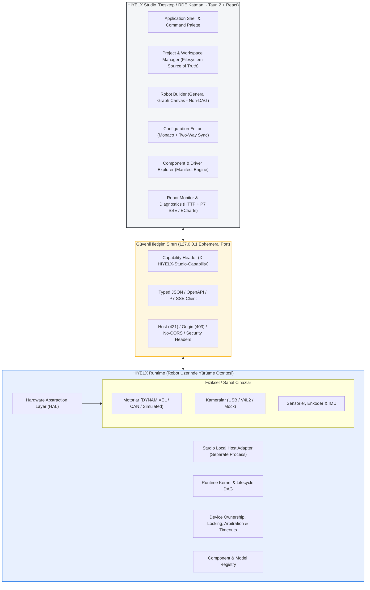
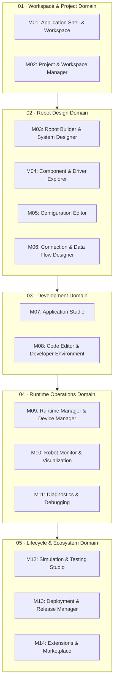
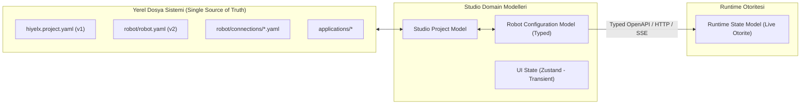
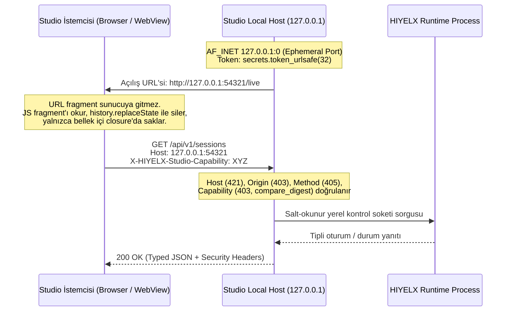
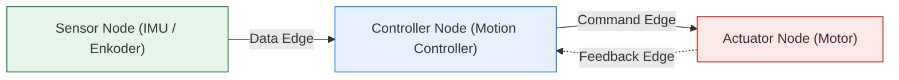

# HIYELX Studio — Complete Engineering Specification & Software Architecture
**Document Reference: HIYELX-SPEC-STUDIO-V1.1**  
**Classification: Core Developer Platform Specification**  
**Target Release: Studio V0.1 (Visual Foundation: P1–P3) → V1.0 (Robotics IDE: P4, P5, P7) → V1.5 (P6) → V2.0 (P8, P9)**  
**Normative Companion ADR:** [`docs/decisions/0002-studio-software-stack-and-architecture.md`](../decisions/0002-studio-software-stack-and-architecture.md) (v1.1)

---

## 1. Mimari Vizyon ve Temel İlkeler

HIYELX Studio, basit bir kontrol paneli veya telemetri ekranı değil; robotik sistemlerin sıfırdan tasarlandığı, yapılandırıldığı, geliştirildiği, test edildiği ve canlı izlendiği merkezi bir **Robotics Development Environment (RDE)**'dir.



### 1.1. Beş Ürün Prensibi
1. **Visual-first:** Robot mimarisi karmaşık konfigürasyon dosyaları elle yazılmadan önce görsel düğümler ve bağlantılar üzerinden tasarlanabilir.
2. **Developer-first:** Profesyonel robotik mühendislerinin ihtiyaç duyduğu kod navigasyonu, Monaco editörü, terminal ve hata ayıklama araçlarını sunar.
3. **Runtime-connected:** Tüm operasyonel eylemler ve donanım erişimi Runtime Core üzerinden yürütülür; sahte veya fikstür verisi ile canlı Runtime gerçekliği asla karıştırılmaz.
4. **Extensible:** Standart bileşen ve sürücü manifestleri (`hiyelx.manifest.yaml`) sayesinde yeni donanım veya servis eklemek çekirdek mimariyi bozmaz.
5. **Local-first & Air-gapped:** Tamamen yerel iş istasyonunda çalışır; internet, bulut veya Supabase bağlantısı zorunlu değildir.

---

## 2. Yazılım Yığını ve Süreç Sahipliği

| Katman | Teknoloji | Rol ve Tasarım Kararı |
|---|---|---|
| **Masaüstü Kabuğu** | **Tauri 2 (Rust)** | Yerel dosya sistemi erişimi, sistem WebView kullanımı, kontrollü masaüstü dağıtımı. Bellek tüketimi, açılış süresi ve paket boyutu sürüm benchmark'larıyla doğrulanır. |
| **Frontend Çatısı** | **React 18+** | Bileşen tabanlı modüler UI mimarisi. |
| **Programlama Dili** | **TypeScript (Strict)** | Uçtan uca tip güvenliği, sıfır `any` disiplini. |
| **Derleme Aracı** | **Vite** | Hızlı HMR ve optimize edilmiş masaüstü bundle üretimi. |
| **UI & Stil Sistemi** | **Tailwind CSS + Radix UI** | Erişilebilir (WAI-ARIA), karanlık tema öncelikli endüstriyel görsel dil. |
| **Durum Yönetimi** | **Zustand + TanStack Query** | Zustand: yalnızca geçici UI/editör durumu. TanStack Query: Runtime API durum önbelleği (tek otorite Runtime). Kalıcı proje verisinin kaynağı dosya sistemidir. |
| **Görsel Tuval** | **React Flow + ELK.js** | Genel graf (non-DAG) veri modeli. ELK.js yalnızca otomatik görsel yerleşim için kullanılır; yaşam döngüsü `depends_on` kenarları ayrı DAG denetimine tabidir. |
| **3D Görselleştirme** | **Three.js (Ertelendi)** | İlk sürümlerde zorunlu değildir; V1.5+/V2.0 (URDF / TF ağacı) aşamasına bırakılmıştır. |
| **Kod & YAML Editörü** | **Monaco Editor** | YAML şema doğrulama, sözdizimi vurgulama, iki yönlü görsel senkronizasyon. LSP, linter ve DAP debugger entegrasyonları P6'ya bırakılmıştır. |
| **Telemetri & Grafikler** | **Apache ECharts** | Yüksek frekanslı motor telemetrisi, akım, hız ve sensör zaman serisi. |
| **İkon Seti** | **Lucide Icons** | Minimalist ve tutarlı teknik ikonografi. |
| **Veri Doğrulama** | **Zod + Pydantic v2** | Frontend çalışma anı doğrulaması (Zod) + Runtime `RobotConfig` / OpenAPI tipli sözleşme eşleşmesi. |
| **Test Çerçevesi** | **Vitest + Testing Library + Playwright** | Birim, bileşen ve E2E testleri; Python tarafında `ruff`, strict `pyright` ve `pytest`. |

### 2.1. Süreç Sahipliği ve Güvenlik Sınırları
* **Tauri:** Studio masaüstü uygulamasının ve yerel çalışma alanı arayüzünün yaşam döngüsünü yönetir; asla doğrudan donanım sürücüsü veya Runtime yürütme katmanı haline gelmez.
* **Runtime Host:** Bağımsız bir işletim sistemi süreci olarak çalışır; CLI (`hiyelx runtime`, `hiyelx studio`) veya harici araçlar tarafından Studio UI'dan bağımsız olarak da çalıştırılabilir. Studio kapatıldığında çalışan Runtime sonlandırılmaz.
* **Runtime İç Otoritesi:** Donanım erişiminin Runtime tarafından merkezileştirilmesi Studio kaynaklı doğrudan port çakışmalarını önler; eşzamanlı erişim için Runtime kendi içinde **device ownership**, **resource locking**, **command arbitration**, **session lifecycle/lease**, **command timeout** (RB-1) ve best-effort **fault handling / `safe_stop`** (RB-2) uygular.
* **Terminal Güvenliği (P6+):** Entegre terminal kullanıcının açık onayıyla başlatılır, Runtime Host yetkilerinden ayrı izinlerle çalışır, eklentilere varsayılan olarak kapalıdır ve dosya sistemi erişimi çalışma alanı sınırında yetenek tabanlı izinlerle denetlenir.

---

## 3. Sistem Mimarisi: 5 Fonksiyonel Domain, 14 Modül ve 5 Ortak Servis



### 3.1. Ortak Platform Servisleri (Shared Foundation)
1. **Project Model Engine:** `hiyelx.project.yaml`, proje ağacı, şema sürümleme, şablonlar ve güvenli dosya yolu sınırı.
2. **Component Manifest Engine:** `hiyelx.manifest.yaml` ayrıştırma, bağımlılık çözümleme ve uyumluluk matrisi.
3. **Graph Engine:** Genel robot grafı (non-DAG) manipülasyonu, ELK.js yerleşimi ve yaşam döngüsü `depends_on` DAG doğrulaması.
4. **Configuration Engine:** `RobotConfig` v2 doğrulama, çift yönlü görsel/YAML senkronizasyonu, diff ve opt-in migration.
5. **Typed API & Stream Client:** Capability token yönetimi, tipli HTTP/JSON istemcisi ve P7 SSE akış yöneticisi.

### 3.2. Domain 01: Workspace & Project Domain
* **M01 — Application Shell & Workspace:** Global Command Palette, panel yöneticisi, sekmeler, tema ve yerleşim kalıcılığı (temel platform servisi).
* **M02 — Project & Workspace Manager:** Yerel dosya sistemi üzerindeki standart robot projesini, meta veriyi, şema sürümlemesini ve açık migration akışlarını yönetir.
  ```text
  my-robot/
  ├── hiyelx.project.yaml     # Studio Project Model (schema_version: "1")
  ├── robot/
  │   ├── robot.yaml          # Robot Configuration Model (schema_version: "2")
  │   ├── components/         # Özel bileşen tanımları ve manifestleri
  │   └── connections/        # Veri akış şemaları ve tuval yerleşim meta verisi
  ├── applications/
  │   ├── main.yaml
  │   └── tasks/
  ├── configs/                # Ortam profilleri (dev, sim, bench)
  ├── assets/
  │   ├── meshes/
  │   └── models/
  ├── tests/                  # Proje doğrulama testleri
  └── README.md
  ```

### 3.3. Domain 02: Robot Design Domain
* **M03 — Robot Builder & System Designer:** Robotun yapısal mimarisini genel graf tuvalinde tasarlar; kapalı geri besleme döngülerini destekler, yaşam döngüsü `depends_on` kenarlarını DAG olarak doğrular.
* **M04 — Component & Driver Explorer:** Kurulu bileşen ve sürücüleri `hiyelx.manifest.yaml` üzerinden listeler, bağımlılık çözümlemesi ve uyumluluk matrisi sunar.
* **M05 — Configuration Editor:** İki yönlü görsel form + Monaco YAML editörü. Fail-closed `RobotConfig` v2 şema doğrulaması, diff, migration ve YAML round-trip koruması.
* **M06 — Connection & Data Flow Designer:** M03'ten ayrı bir görünüm olarak `Data`, `Command`, `Feedback` ve `Dependency` kenar tiplerini, konu/arayüz eşlemelerini ve canlı frekans/gecikme katmanlarını yönetir.

### 3.4. Domain 03: Development Domain
* **M07 — Application Studio:** Çoklu bileşenli robotik iş akışlarını tasarlar; yürütme (execution) sorumluluğu kesinlikle Runtime'dadır.
* **M08 — Code Editor & Developer Environment (V1.5 / P6):** Monaco tabanlı kod navigasyonu, LSP/linter/DAP entegrasyonu ve yetki sınırlı entegre terminal.

### 3.5. Domain 04: Runtime Operations Domain
* **M09 — Runtime Manager & Device Manager:** Runtime oturum keşfi, süreç/oturum sahipliği, yaşam döngüsü ve cihaz sağlık durumları.
* **M10 — Robot Monitor & Visualization:** P2/P3'te HTTP/JSON single-flight izleme; P7'de SSE telemetri akışı, halka tampon, örnekleme ve 2D topoloji görünümü (3D görünüm V1.5+/V2.0).
* **M11 — Diagnostics & Debugging:** Yapılandırılmış loglar, `Correlation-ID` takibi, hata sınıflandırma taksonomisi ve kök neden analiz kartları.

### 3.6. Domain 05: Lifecycle & Ecosystem Domain (V2.0)
* **M12 — Simulation & Testing Studio:** Gazebo/MuJoCo'yu Studio'ya gömmeden simülasyon adaptör katmanı üzerinden test senaryoları koşturma.
* **M13 — Deployment & Release Manager:** Paketleme, sürüm manifesti, dağıtım doğrulaması ve geri alma (rollback).
* **M14 — Extensions, SDK & Marketplace:** İmzalı eklenti paketleri, sürümleme, yetenek tabanlı izinler ve uyumluluk matrisi.

---

## 4. Veri Mimarisi, Model Katmanları ve Şema Sürümleme



| Veri Modeli | Sorumluluk Alanı | Kalıcı Kaynak / Otorite |
|---|---|---|
| **Studio Project Model** | Proje kimliği, dosya ağacı, robot tasarımı yerleşimi, uygulamalar, testler | Yerel Dosya Sistemi (`hiyelx.project.yaml`) |
| **Robot Configuration Model** | Runtime'ın doğrulayıp yürüteceği robot topolojisi ve donanım ayarları | `robot/robot.yaml` (`RobotConfig` v2) |
| **Runtime State Model** | Çalışan robotun gerçek sağlık, cihaz ve telemetri durumu | **Yalnızca HIYELX Runtime** |
| **UI State Model** | Açık paneller, seçili düğümler, zoom/pan ve görsel tercihler | Zustand (Geçici bellek) |

### 4.1. Şema Sürümleme ve Migration Politikası
* Her kalıcı belge açık `schema_version` (`hiyelx.project.yaml`: `"1"`, `robot.yaml`: `"2"`) veya `manifest_version` (`"1.0"`) taşır.
* Bilinmeyen sürüm, fazla alan (`extra="forbid"`) veya tip uyuşmazlığı **fail-closed** reddedilir.
* Migration işlemleri otomatik/sessiz çalışmaz; kullanıcı onayı, önizleme diff'i ve geri alınabilir yedek gerektirir.

---

## 5. Güvenlik, İletişim ve Telemetri Spesifikasyonu



### 5.1. Güvenlik ve Hata Sözleşmesi (`src/hiyelx/studio/host.py` ile Birebir Uyumlu)
1. **Loopback Sınırı:** Host yalnızca `127.0.0.1` (`AF_INET`) ephemeral port üzerinde dinler; `0.0.0.0`, `::`, `::1` yasaktır.
2. **Capability Token:** En az 256-bit entropi (`secrets.token_urlsafe(32)`), oturuma bağlıdır; `#capability=<token>` fragment'ından okunup URL'den temizlenir ve `/api/v1/*` çağrılarında `X-HIYELX-Studio-Capability` başlığıyla gönderilir. Loglara, depolamaya veya `Referer`'a asla yazılmaz; host kapanınca geçersizleşir.
3. **Host Doğrulaması (`421 host_rejected`):** Yalnızca tam `127.0.0.1:<port>` kabul edilir; `localhost`, yanlış port veya `Forwarded` / `X-Forwarded-*` başlıkları `421 Misdirected Request` döner.
4. **Origin & CORS (`403 request_rejected` / `405 method_not_allowed`):** Mevcutsa `Origin` tam `http://127.0.0.1:<port>` olmalıdır; aksi `403` döner. `Access-Control-Allow-*` başlığı üretilmez, CORS preflight desteklenmez (`OPTIONS` → `405`).
5. **Token Reddi (`403 request_rejected`):** Eksik, hatalı biçimli, yinelenmiş veya yanlış token `403 Forbidden` döner.
6. **Güvenlik Başlıkları:** `Cache-Control: no-store, max-age=0`, katı `CSP`, `COOP: same-origin`, `CORP: same-origin`, `Permissions-Policy`, `Referrer-Policy: no-referrer`, `X-Content-Type-Options: nosniff`, `X-Frame-Options: DENY`.

### 5.2. Aşamalı İletişim ve P7 Telemetri Yaşam Döngüsü
* **P2–P3:** Tipli HTTP/JSON (`GET`/`HEAD`) + görünür sekmede 1 Hz single-flight polling, gizli sekmede duraklatma.
* **P4–P5:** Proje, konfigürasyon doğrulama ve manifest/katalog işlemleri için tipli HTTP/JSON.
* **P7:** Kontrollü **Server-Sent Events (SSE)** akışı (telemetri, yapılandırılmış log ve runtime olayları).
* **İleri Aşama:** İki yönlü yüksek frekanslı akış gerekirse ayrı güvenlik sözleşmesiyle WebSocket değerlendirilir.
* **P7 Telemetri Politikaları:** `timestamp`, monotonik `sequence_number`, `sampling_rate`, sınırlı `buffer_limit`, deterministik `backpressure` (drop-oldest/decimation), sınırlı `data_retention`, bounded backoff `reconnection` ve boşluk bildiren `missing_data_handling`.

---

## 6. Genel Robot Grafı Veri Modeli (Non-DAG) ve M03/M06 Ayrımı



* **Düğüm (Node) Kategorileri:** `Hardware`, `Sensor`, `Actuator`, `Controller`, `Runtime Component`, `Communication`, `Application`, `Safety`.
* **Kenar (Edge) Tipleri:**
  * `Data`: Sensörden kontrolcüye ölçüm akışı (döngü serbest).
  * `Command`: Kontrolcüden eyleyiciye komut akışı (döngü serbest).
  * `Feedback`: Eyleyiciden kontrolcüye durum geri beslemesi (kapalı döngü).
  * `Dependency`: Runtime yaşam döngüsü başlatma sırası kısıtı (`depends_on` — **kesin DAG** olarak doğrulanır).
  * `Physical Connection`: Fiziksel port veya bus bağlantısı (USB, CAN, Serial).
* **Görünüm Ayrımı:** M03 yapısal mimari ve bağımlılıkları; M06 veri/komut/geri-besleme akışlarını gösterir.

---

## 7. Standart Bileşen ve Sürücü Manifesti (`hiyelx.manifest.yaml`)

```yaml
manifest_version: "1.0"
id: hiyelx.motor.dynamixel.xl430
name: DYNAMIXEL XL430 Motor Driver
version: "0.1.0"
type: driver

runtime:
  min_version: "0.2.0a1"

capabilities:
  - can_set_velocity
  - has_angular_position
  - has_angular_velocity

interfaces:
  - name: command
    type: motor.command
  - name: state
    type: motor.state

configuration:
  schema: settings.schema.json
```

`manifest_version`, bileşen `version`, `runtime.min_version` ve `capabilities` birbirinden bağımsız alanlar olarak ele alınır; M03, M04, M05, Compatibility Checker ve Runtime Component Loader aynı sözleşmeyi paylaşır.

---

## 8. Faz Geliştirme Sırası, Kabul Kriterleri ve 7 Kategorili Test Kapısı


### 8.1. P3 Kabul Kriterleri (P4 Öncesi Zorunlu Kapı)
1. Kurulu Runtime wheel paketinin non-editable ortamda doğrulanması ve kaynak ağacı sızıntısı olmaması.
2. `127.0.0.1` host adaptörü üzerinden canlı Runtime oturumuna bağlanılması.
3. Gerçek oturum, sağlık ve bileşen/önizleme verilerinin canlı DOM arayüzünde gösterilmesi.
4. Runtime kapalıysa veya şema uyumsuzsa kontrollü hata/boş duruma geçilmesi.
5. Fixture modunun gerçek çalışma verisiyle yapısal olarak asla karıştırılmaması.
6. P1 statik fikstür SHA-256 testlerinde ve P2 güvenlik testlerinde sıfır regresyon.

### 8.2. 7 Kategorili Test Kapısı
| Kategori | Kapsam |
|---|---|
| **Unit** | Domain modelleri, graf/DAG doğrulama, manifest ve şema ayrıştırıcıları |
| **Component** | İzole UI bileşenleri, durum geçişleri ve erişilebilirlik |
| **Contract** | OpenAPI / Pydantic / Zod sözleşmeleri ve sabit hata üçlüleri |
| **Integration** | Gerçek Runtime Host bağlantısı, kurulu wheel ve süreç izolasyonu |
| **E2E** | Uçtan uca kullanıcı akışları |
| **Security** | Capability token, Host (`421`), Origin (`403`), CORS yasağı ve izin sınırları |
| **Regression** | Kabul edilmiş P1 SHA-256 ve P2 güvenlik/transport davranışlarının sürekli CI doğrulaması |
