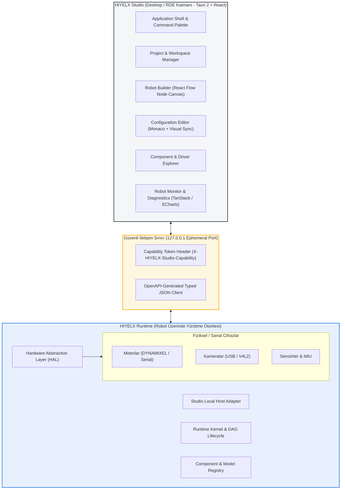
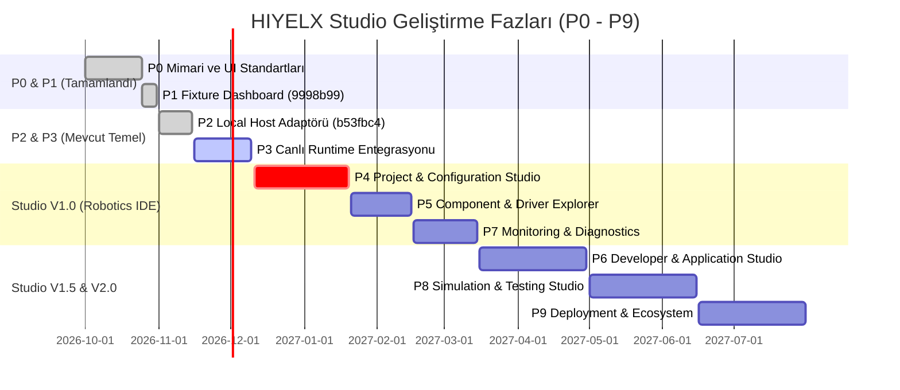

# HIYELX Studio — Complete Engineering Specification & Software Architecture
**Document Reference: HIYELX-SPEC-STUDIO-V1**  
**Classification: Core Developer Platform Specification**  
**Target Release: Studio V0.1 (Visual Foundation) → V1.0 (Robotics IDE) → V1.5 (DevEnv) → V2.0 (Platform)**

---

## 1. Mimari Vizyon ve Temel İlkeler

HIYELX Studio, basit bir kontrol paneli veya telemetri ekranı değil; robotik sistemlerin sıfırdan tasarlandığı, yapılandırıldığı, kodlandığı, test edildiği ve canlı izlendiği merkezi bir **Robotics Development Environment (RDE)**'dir.



### 1.1. Beş Ürün Prensibi
1. **Visual-first:** Robot mimarisi karmaşık konfigürasyon dosyaları elle yazılmadan önce görsel olarak tasarlanabilir.
2. **Developer-first:** Profesyonel robotik mühendislerinin ihtiyaç duyduğu kod navigasyonu, terminal ve hata ayıklama araçlarını sunar.
3. **Runtime-connected:** Tüm operasyonel eylemler Runtime Core üzerinden yürütülür; sahte durumlar ile fiziksel gerçeklik asla karıştırılmaz.
4. **Extensible:** Yeni donanım sürücüsü, servis veya uygulama eklentisi eklemek mimariyi bozmaz.
5. **Local-first & Air-gapped:** Tamamen yerel iş istasyonunda çalışır; internet veya bulut bağlantısı zorunlu değildir.

---

## 2. Yazılım Yığını (Recommended Studio Stack)

| Katman | Teknoloji | Kullanım Alanı ve Gerekçe |
|---|---|---|
| **Masaüstü Kabuğu** | **Tauri 2 (Rust Backend)** | Yerel dosya sistemi erişimi, düşük bellek (RAM) kullanımı, yerel süreç yönetimi ve hafif dağıtım. |
| **Frontend Çatısı** | **React 18+** | Bileşen tabanlı modüler UI mimarisi, zengin açık kaynak ekosistemi. |
| **Programlama Dili** | **TypeScript (Strict)** | Uçtan uca tip güvenliği, sıfır `any` disiplini, yeniden kullanılabilir sözleşmeler. |
| **Derleme Aracı** | **Vite** | Milisaniye seviyesinde HMR (Hot Module Replacement) ve optimize edilmiş bundle üretimi. |
| **UI & Stil Sistemi** | **Tailwind CSS + Radix UI** | Erişilebilir (WAI-ARIA), karanlık tema öncelikli, endüstriyel netlikte tasarım sistemi. |
| **Durum Yönetimi** | **Zustand + TanStack Query** | UI ve proje durumları için Zustand; Runtime API önbelleği ve veri eşitlemesi için TanStack Query. |
| **Diyagram / Node Canvas** | **React Flow / xyflow + ELK.js** | Robot topolojisi, DAG bağımlılıkları ve veri akışı tuvali; otomatik hiyerarşik yerleşim. |
| **Kod & YAML Editörü** | **Monaco Editor** | YAML, JSON, Python, C++ sözdizimi vurgulama, otomatik tamamlama ve şema doğrulama. |
| **Grafik & Telemetri** | **Apache ECharts** | Yüksek frekanslı motor hızı, akım, sıcaklık ve sensör zaman serisi grafikleri. |
| **İkon Seti** | **Lucide Icons** | Tutarlı, teknik ve minimalist ikonografik dil. |
| **Veri Doğrulama** | **Zod** | Form girişleri, proje dosyaları ve frontend şema doğrulaması. |
| **Test Çerçevesi** | **Vitest + Playwright** | Hızlı birim testleri (Vitest) ve uçtan uca arayüz testleri (Playwright). |

---

## 3. Sistem Haritası: 14 Ana Modülün Detaylı Teknik Kapsamı

### MODULE 01 — Application Shell & Workspace
* **Sorumluluk:** Ana uygulama iskeleti, gezinme, sekmeler, Command Palette ve kullanıcı tercihleri.
* **Bileşenler:** `PanelManager`, `TabManager`, `CommandPalette`, `ThemeManager`, `LayoutPersistence`.
* **Ekran Düzeni:** Sol Sidebar (Modül navigasyonu), Orta Çalışma Alanı (Canvas/Editor), Sağ Panel (Inspector), Alt Panel (Terminal/Logs/Problems).

### MODULE 02 — Project & Workspace Manager
* **Sorumluluk:** Robotik projelerin yerel dosya sisteminde organize edilmesi ve şablon yönetimi.
* **Bileşenler:** `ProjectRegistry`, `ProjectCreator`, `ProjectTemplates`, `FileExplorer`, `ProjectValidator`.
* **Proje Dizin Modeli:**
  ```text
  my-robot-project/
  ├── project.yaml            # Proje metadata ve aktif profil
  ├── robots/                 # robot.yaml tanımları
  ├── configurations/         # Geliştirme / test / üretim profilleri
  ├── components/             # Özel bileşen kodları
  ├── drivers/                # Özel donanım sürücüleri
  ├── applications/           # Robotik görev uygulamaları
  └── tests/                  # Proje testleri
  ```

### MODULE 03 — Robot Builder & System Designer
* **Sorumluluk:** Robot mimarisini sürükle-bırak düğümler (nodes) ve bağlantılar üzerinden tasarlamak.
* **Bileşenler:** `RobotDesignerCanvas`, `ComponentNode`, `ConnectionEdge`, `DAGValidator`, `ConfigGenerator`.
* **Çıktı:** Tasarlanan görsel grafiği geçerli ve doğrulanmış `robot.yaml` dosyasına dönüştürür.

### MODULE 04 — Component & Driver Explorer
* **Sorumluluk:** Kullanılabilir donanım sürücülerini, sensörleri ve servisleri listeler ve inceler.
* **Bileşenler:** `ComponentCatalog`, `DriverCatalog`, `CapabilityViewer`, `DependencyGraph`, `VersionChecker`.
* **Detay Görünümü:** Desteklenen kabiliyetler (`CAN_SET_VELOCITY`, `CAN_STREAM_FRAMES`), uyumlu sürücüler, bağlantı gereksinimleri.

### MODULE 05 — Configuration Editor
* **Sorumluluk:** Robot konfigürasyonunu görsel form veya Monaco YAML editörü üzerinden düzenler.
* **Bileşenler:** `VisualFormEditor`, `MonacoYamlEditor`, `SchemaValidator`, `ConfigDiffViewer`.
* **İki Yönlü Senkronizasyon (Two-Way Sync):** Görsel formda yapılan değişiklik anında YAML'a; YAML'daki değişiklik forma yansır.

### MODULE 06 — Connection & Data Flow Designer (V1.5+)
* **Sorumluluk:** Bileşenler arasındaki veri akışını, pub/sub konularını ve mesaj rotalarını görselleştirir.
* **Modlar:** Design Mode (Bağlantı tasarımı) ve Live Mode (Canlı mesaj akışı ve frekansı).

### MODULE 07 — Application Studio (V1.5+)
* **Sorumluluk:** Çoklu bileşenleri koşturan robotik görev ve iş akışlarını tasarlar (ör. Pick & Place, Otonom Navigasyon).
* **Kritik Kural:** Studio iş akışını tasarlar; yürütme Runtime `ExecutionManager` tarafından gerçekleştirilir.

### MODULE 08 — Code Editor & Developer Environment (V1.5+)
* **Sorumluluk:** Monaco tabanlı entegre kod düzenleyici, Python/C++ sözdizimi, terminal ve Git entegrasyonu.

### MODULE 09 — Runtime Manager & Device Manager
* **Sorumluluk:** Yerel Runtime oturumunu keşfeder, bağlanır, yaşam döngüsünü (`start`/`stop`) denetler.
* **Bağlantı Durumları:** `Disconnected`, `Connecting`, `Connected`, `Degraded`, `Unavailable`.
* **Cihaz Yönetimi:** Fiziksel port çakışmalarını ve bağlı donanımların atamalarını görüntüler.

### MODULE 10 — Robot Monitor & Visualization
* **Sorumluluk:** Aktif robotun anlık durumunu, motor hızlarını, sensör değerlerini ve sağlık metriklerini gösterir.
* **Bileşenler:** `TelemetryDashboard`, `MotorGaugeCard`, `SensorTimeSeriesChart`, `Robot2DVisualization` (V1) ve `3D URDF Viewer` (V1.5+).

### MODULE 11 — Diagnostics & Debugging
* **Sorumluluk:** Sistemdeki hataları, logları ve uyarıları izler, kök neden analizi sağlar.
* **Bileşenler:** `LiveLogViewer`, `EventTimeline`, `FaultExplorer`, `TraceViewer` (`Correlation-ID` takibi).

### MODULE 12 — Simulation & Testing Studio (V2)
* **Sorumluluk:** Sanal robot modeli ve simülatör adaptörleri (Gazebo / MuJoCo) üzerinden test senaryoları koşturur.

### MODULE 13 — Deployment & Release Manager (V2)
* **Sorumluluk:** Robotik projeyi derler, wheel olarak paketler ve hedef robota dağıtır.

### MODULE 14 — Extensions, SDK & Marketplace (V2)
* **Sorumluluk:** Üçüncü taraf sürücü ve bileşen paketlerini keşfeder, kurar ve yönetir.

---

## 4. Studio Geliştirme Yol Haritası (P0 – P9 Fazları)



### 4.1. Ürün Seviyeleri ve Sürüm Paketleri
1. **Studio V0.1 — Visual Foundation (P1 + P2 + P3):**
   - 11 durumlu fixture dashboard + `127.0.0.1` ephemeral port host + gerçek kurulu Runtime oturumuna canlı salt-okunur bağlanma.
2. **Studio V1.0 — Robotics IDE (P4 + P5 + P7):**
   - Proje yöneticisi + Visual Robot Builder (React Flow) + Monaco YAML konfigürasyon editörü + Bileşen/Sürücü kataloğu + Canlı telemetri ve log izleyici.
3. **Studio V1.5 — Developer Environment (P6):**
   - Dahili kod düzenleyici + iş akışı (workflow) tasarımcısı + entegre terminal + 2D/3D robot modeli.
4. **Studio V2.0 — Advanced Platform (P8 + P9):**
   - Simülasyon test koşucusu + paketleme/dağıtım yöneticisi + eklenti pazaryeri.

---

## 5. Pre-Seed Öncelikli İlk 5 Temel Özellik (Must Have Backlog)

| Sıra | Özellik | İlgili Modül | Teslimat & Çıktı |
|---|---|---|---|
| **1** | **Robot Project Workspace** | Module 02 | Yerel dosya sisteminde `my-robot/` proje ağacı açma, kaydetme ve şablonlardan başlatma. |
| **2** | **Visual Robot Builder** | Module 03 | React Flow tuvalinde Motor, Kamera, Sensör kartlarını sürükleyip bırakarak `robot.yaml` üretme. |
| **3** | **Component & Driver Explorer** | Module 04 | Mevcut kurulu sürücüleri (`motor.dynamixel.xl430`, `motor.simulated`) ve yeteneklerini listeleme. |
| **4** | **Live Runtime Monitor** | Module 10 | `127.0.0.1` üzerinden çalışan robottan 1 Hz periyotla açısal pozisyon, hız ve sağlık telemetrisi okuma. |
| **5** | **Configuration & Diagnostics** | Module 05 & 11 | İki yönlü görsel/YAML düzenleme ve hata durumunda olası nedenleri listeleyen hata paneli. |

---

## 6. Kalite ve Test Standartları

* **TypeScript Strictness:** Sıfır `any`, katı null denetimi, Zod tabanlı sınır doğrulaması.
* **Sözleşme Bütünlüğü (Byte-Identical Preservation):** P1 aşamasında kabul edilmiş statik fikstür varlıkları (`studio/fixtures.js`, `studio/studio.css`) byte-byte korunacak; canlı bağlantı kompozisyon hattı dinamik adaptör üzerinden sağlanacaktır.
* **Kritik Test Senaryoları:**
  1. Runtime çalışmıyorken Studio açıldığında temiz "Bağlantı Bekleniyor" durumuna geçmesi.
  2. Çalışma sırasında Runtime kapatıldığında arayüzün kilitlenmeden "Bağlantı Kesildi / Yeniden Deneniyor" moduna düşmesi.
  3. Geçersiz YAML girildiğinde anında görsel hata uyarısı üretmesi.
  4. Büyük bileşen grafiklerinde akıcı 60 FPS canvas kaydırma ve yakınlaştırma performansı.
