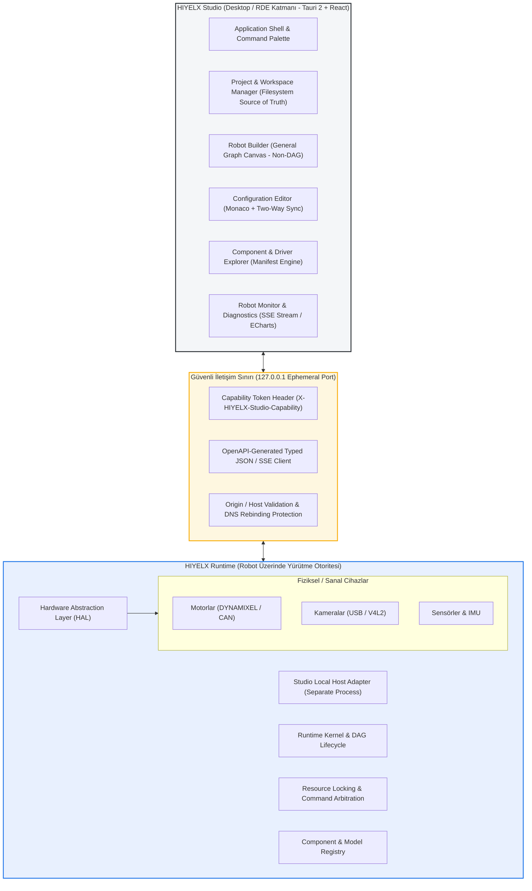
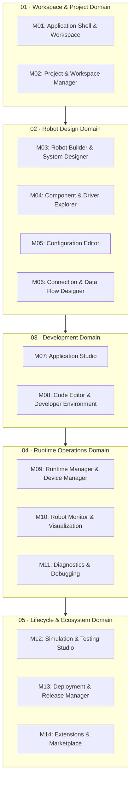
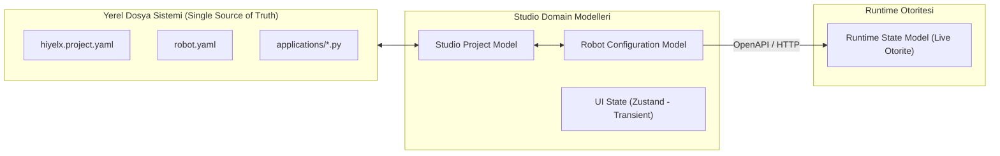
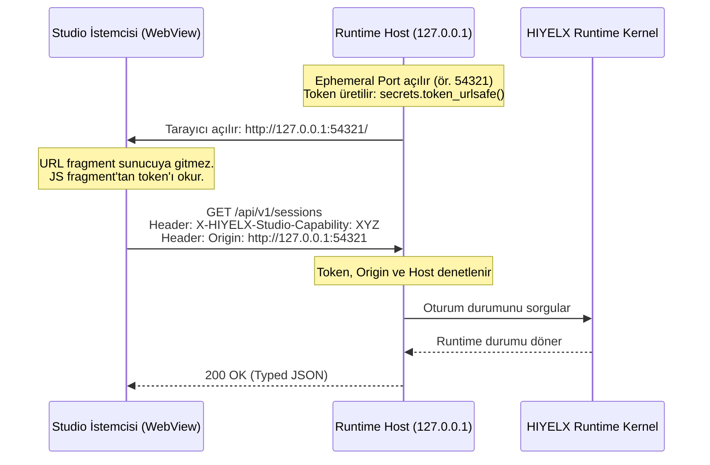
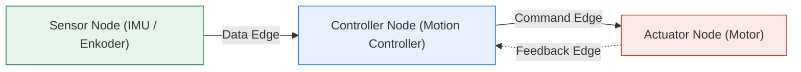
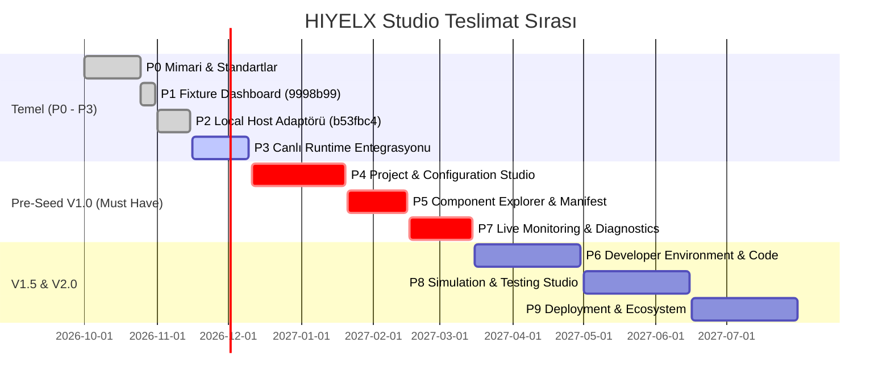

# HIYELX Studio — Complete Engineering Specification & Software Architecture
**Document Reference: HIYELX-SPEC-STUDIO-V1.1**  
**Classification: Core Developer Platform Specification**  
**Target Release: Studio V0.1 (Visual Foundation: P1–P3) → V1.0 (Robotics IDE: P4, P5, P7) → V1.5 (P6) → V2.0 (P8, P9)**

---

## 1. Mimari Vizyon ve Temel İlkeler

HIYELX Studio, basit bir kontrol paneli veya telemetri ekranı değil; robotik sistemlerin sıfırdan tasarlandığı, yapılandırıldığı, geliştirildiği, test edildiği ve canlı izlendiği merkezi bir **Robotics Development Environment (RDE)**'dir.



### 1.1. Beş Ürün Prensibi
1. **Visual-first:** Robot mimarisi karmaşık konfigürasyon dosyaları elle yazılmadan önce görsel düğümler ve bağlantılar üzerinden tasarlanabilir.
2. **Developer-first:** Profesyonel robotik mühendislerinin ihtiyaç duyduğu kod navigasyonu, Monaco editörü, terminal ve hata ayıklama araçlarını sunar.
3. **Runtime-connected:** Tüm operasyonel eylemler Runtime Core üzerinden yürütülür; sahte durumlar ile fiziksel gerçeklik asla karıştırılmaz.
4. **Extensible:** Standart bileşen ve sürücü manifestleri sayesinde yeni donanım veya servis eklemek çekirdek mimariyi bozmaz.
5. **Local-first & Air-gapped:** Tamamen yerel iş istasyonunda çalışır; internet veya bulut bağlantısı zorunlu değildir.

---

## 2. Yazılım Yığını ve Süreç Sahipliği

| Katman | Teknoloji | Rol ve Tasarım Kararı |
|---|---|---|
| **Masaüstü Kabuğu** | **Tauri 2 (Rust)** | Yerel dosya sistemi erişimi, sistem WebView kullanımı, kontrollü masaüstü dağıtımı. Açılış süresi ve bellek tüketimi sürüm benchmark'larıyla doğrulanır. |
| **Frontend Çatısı** | **React 18+** | Bileşen tabanlı modüler UI mimarisi. |
| **Programlama Dili** | **TypeScript (Strict)** | Uçtan uca tip güvenliği, sıfır `any` disiplini. |
| **Derleme Aracı** | **Vite** | Hızlı HMR ve optimize edilmiş masaüstü bundle üretimi. |
| **UI & Stil Sistemi** | **Tailwind CSS + Radix UI** | Erişilebilir (WAI-ARIA), karanlık tema öncelikli endüstriyel görsel dil. |
| **Durum Yönetimi** | **Zustand + TanStack Query** | Zustand: UI ve geçici editör durumu. TanStack Query: Runtime API durum önbelleği (tek otorite Runtime). |
| **Görsel Tuval** | **React Flow + ELK.js** | Genel graf (non-DAG) veri modeli. ELK.js yalnızca hiyerarşik görsel yerleşim için kullanılır. |
| **Kod & YAML Editörü**| **Monaco Editor** | YAML şema doğrulama, sözdizimi vurgulama, iki yönlü görsel senkronizasyon. (LSP ve debugger P6'ya ayrılmıştır). |
| **Telemetri & Grafikler**| **Apache ECharts** | Yüksek frekanslı motor telemetrisi, akım, hız ve sensör zaman serisi. |
| **İkon Seti** | **Lucide Icons** | Minimalist ve tutarlı teknik ikonografi. |
| **Veri Doğrulama** | **Zod** | Form girişleri, proje şemaları ve frontend çalışma anı doğrulaması. |
| **Test Çerçevesi** | **Vitest + Playwright** | Vitest (birim/bileşen testleri), Playwright (E2E tarayıcı testleri). |

### 2.1. Süreç Sahipliği Ayrımı
* **Tauri:** Studio masaüstü uygulamasının ve yerel arayüzün yaşam döngüsünü yönetir.
* **Runtime Host:** Bağımsız bir işletim sistemi süreci olarak çalışır; Studio'dan bağımsız olarak CLI tarafından da çalıştırılabilir. Tauri asla doğrudan donanım sürücüsü haline gelmez.
* **Terminal Güvenliği:** Entegre terminal kullanıcının açık onayıyla başlatılır, eklentilere kapalıdır ve dosya sistemi erişimi izinlerle sınırlandırılmıştır.

---

## 3. Sistem Mimarisi: 5 Fonksiyonel Domain ve 14 Modül



### 3.1. Domain 01: Workspace & Project Domain
* **M01 — Application Shell & Workspace:** Global Command Palette, panel yöneticisi, sekmeler, tema ve yerleşim kalıcılığı.
* **M02 — Project & Workspace Manager:** Yerel dosya sistemi üzerindeki standart robot projesini yönetir.
  ```text
  my-robot/
  ├── hiyelx.project.yaml     # Proje metadata, profiller, araç ayarları
  ├── robot/
  │   ├── robot.yaml          # Runtime tarafından icra edilen konfigürasyon
  │   ├── components/         # Özel bileşen tanımları
  │   └── connections/        # Veri akış şemaları
  ├── applications/           # Görev ve davranış kodları
  ├── configs/                # Ortam profilleri (dev, test, prod)
  ├── assets/                 # Mesh, URDF, 3D modeller
  └── tests/                  # Proje doğrulama testleri
  ```

### 3.2. Domain 02: Robot Design Domain
* **M03 — Robot Builder & System Designer:** Robot mimarisini görsel tuvalde tasarlar. Genel graf modelini temel alır; kapalı geri besleme döngülerini (feedback loops) destekler.
* **M04 — Component & Driver Explorer:** Kurulu bileşen ve sürücüleri manifest dosyaları üzerinden listeler, yeteneklerini denetler.
* **M05 — Configuration Editor:** İki yönlü görsel form + Monaco YAML editörü. Şema doğrulama, diff ve round-trip koruması.
* **M06 — Connection & Data Flow Designer:** Konular (topics), pub/sub, komut akışları ve veri haritalama.

### 3.3. Domain 03: Development Domain
* **M07 — Application Studio:** Çoklu bileşenleri koşturan robotik iş akışlarını tasarlar (Pick & Place vb.). İcra Runtime sorumluluğundadır.
* **M08 — Code Editor & Developer Environment (V1.5):** Monaco tabanlı kod navigasyonu, terminal ve hata ayıklama entegrasyonu.

### 3.4. Domain 04: Runtime Operations Domain
* **M09 — Runtime Manager & Device Manager:** Runtime oturum keşfi, tek sahipli oturum denetimi, cihaz durumları.
* **M10 — Robot Monitor & Visualization:** Canlı telemetri akışı, 2D topoloji görünümü (V1.0) ve 3D robot görünümü (V1.5+).
* **M11 — Diagnostics & Debugging:** Canlı log izleyici, hata sınıflandırma, `Correlation-ID` takibi ve kök neden analiz kartları.

### 3.5. Domain 05: Lifecycle & Ecosystem Domain (V2.0)
* **M12 — Simulation & Testing Studio:** Gazebo / MuJoCo adaptör köprüsü üzerinden sanal robot senaryoları koşturma.
* **M13 — Deployment & Release Manager:** Paketleme, wheel kurulumu, hedef robota aktarım ve geri alma (rollback).
* **M14 — Extensions, SDK & Marketplace:** İmzalı eklenti paketleri, uyumluluk matrisi ve pazaryeri.

---

## 4. Veri Mimarisi ve Model Katmanları



| Veri Modeli | Sorumluluk Alanı | Kalıcı Kaynak / Otorite |
|---|---|---|
| **Studio Project Model** | Proje kimliği, robot tasarımı, dosyalar, uygulamalar, testler | Yerel Dosya Sistemi (`hiyelx.project.yaml`) |
| **Robot Configuration Model** | Runtime'ın yürüteceği robot topolojisi ve donanım ayarları | `robot.yaml` Şeması |
| **Runtime State Model** | Çalışan robotun gerçek sağlık, telemetri ve cihaz durumu | **Yalnızca HIYELX Runtime** |
| **UI State Model** | Açık paneller, seçili düğümler, görsel tercihler | Zustand (Geçici bellek) |

---

## 5. Güvenlik ve İletişim Spesifikasyonu



### 5.1. Güvenlik Kuralları
1. **Loopback Bağlantı:** Host yalnızca `127.0.0.1` dinler; `0.0.0.0` yasaktır.
2. **Capability Token:** Kriptografik rastgelelikle üretilir, kısa ömürlüdür, oturuma bağlıdır. URL fragment'ından okunup `X-HIYELX-Studio-Capability` header'ı olarak gönderilir. Asla loglara yazılmaz.
3. **Web Güvenliği:** Katı `Origin` ve `Host` header doğrulaması yapılır; CORS kısıtlanır; DNS rebinding ve CSRF engellenir.
4. **Telemetri İletişimi:**
   - **P2–P5:** Tipli HTTP/JSON polling.
   - **P7:** Server-Sent Events (SSE) akışı. Zaman damgası, sıra numarası, örnekleme hızı, tampon limiti ve geri basınç (backpressure) uygulanır.

---

## 6. Genel Robot Grafı Veri Modeli (Non-DAG)



* **Düğüm (Node) Tipleri:** `Hardware`, `Sensor`, `Actuator`, `Controller`, `Runtime Component`, `Communication`, `Application`, `Safety`.
* **Kenar (Edge) Tipleri:**
  - `Data`: Sensörden kontrolcüye ölçüm akışı.
  - `Command`: Kontrolcüden eyleyiciye komut akışı.
  - `Feedback`: Eyleyiciden kontrolcüye durum geri beslemesi (kapalı döngü).
  - `Dependency`: Yaşam döngüsü başlatma sırası kısıtı.
  - `Physical Connection`: Fiziksel port veya bus bağlantısı (ör. USB, CAN).

---

## 7. Standart Bileşen ve Sürücü Manifesti (`hiyelx.manifest.yaml`)

```yaml
manifest_version: "1.0"
id: hiyelx.motor.dynamixel.xl430
name: DYNAMIXEL XL430 Motor Driver
version: "0.1.0"
type: driver

runtime:
  min_version: "0.1.0"

capabilities:
  - can_set_velocity
  - has_angular_position
  - has_angular_velocity

interfaces:
  - name: command
    type: motor.command
  - name: state
    type: motor.state

configuration:
  schema: settings.schema.json
```

---

## 8. Faz Geliştirme Sırası ve Kabul Kriterleri



### 8.1. P3 Kabul Kriterleri (Canlı Kompozisyon Doğrulaması)
1. Kurulu Runtime wheel paketinin dinamik olarak keşfedilmesi.
2. `127.0.0.1` host adaptörü üzerinden canlı oturuma bağlanılması.
3. Gerçek sağlık ve bileşen durumlarının okunması.
4. Runtime kapalıysa arayüzün kontrollü hata / bağlantı bekleniyor durumuna geçmesi.
5. Fixture modunun gerçek çalışma verisiyle asla karıştırılmaması.
6. P1 statik fikstür testlerinde sıfır regresyon (byte-identical hash doğrulaması).
