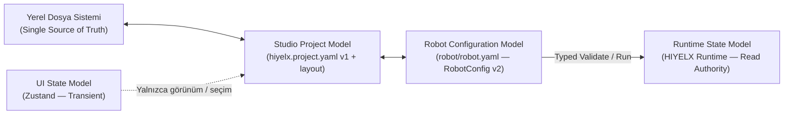
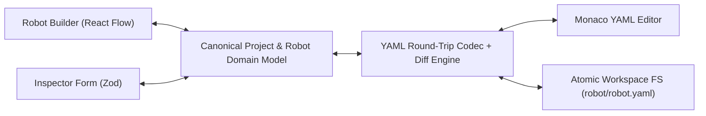

# HIYELX Studio P4 — Project & Configuration Studio Technical Design & Codex Task Plan

* **Document Reference:** `HIYELX-DESIGN-STUDIO-P4`
* **Status:** Proposed Technical Design (Gated on P3 Acceptance)
* **Date:** 2026-11-24
* **Target Milestone:** Studio V1.0 (Pre-Seed Core)
* **Normative Parents:**
  * [`ADR 0002 v1.1`](../decisions/0002-studio-software-stack-and-architecture.md)
  * [`Studio Engineering Specification v1.1`](studio-engineering-specification.md)
  * [`Studio P3 Live Runtime Composition`](studio-p3-live-composition.md) *(Zorunlu ön koşul)*

---

## 1. Amaç, Ön Koşul ve Sınırlar

P4 fazı, HIYELX Studio'yu salt-okunur bir gözlem ekranından (P1–P3), geliştiricinin gerçek bir robot projesini yerel diskte oluşturabildiği, bileşenleri **genel robot graf tuvali** üzerinde bağlayabildiği ve `robot/robot.yaml` (`RobotConfig` v2) konfigürasyonunu **fail-closed** doğrulayarak iki yönlü düzenleyebildiği bir **Project & Configuration Studio** ortamına dönüştürür.

* **Zorunlu Ön Koşul:** P3 kabul kriterleri tamamlanmadan P4 implementasyonuna geçilmez.
* **P1/P2/P3 İzolasyonu:** Yeni Tauri 2 + React + Vite uygulaması ayrı bir üst dizinde (`studio-app/`) konumlandırılır; mevcut `studio/` varlıklarına ve `tests/studio/test_p1_preservation.py` korumasına dokunulmaz.
* **Kapsam Dışı (P5 / P6 / P7'ye bırakılanlar):** Tam sürücü pazaryeri ve kapsamlı uyumluluk matrisi (P5), SSE canlı telemetri akışı ve log teşhisi (P7), LSP/DAP tam kod IDE'si ve entegre terminal (P6).

---

## 2. Veri Sahipliği ve 4 Katmanlı Domain Modeli

ADR 0002 v1.1 Karar 6 gereği dört veri modeli kesin sınırlarla ayrılır:



| Katman | Python (Pydantic v2) / TS (Zod) Sahipliği | Kalıcılık Kuralı |
|---|---|---|
| **Studio Project Model** | `ProjectManifest`, `WorkspaceLayout`, `RobotGraphDocument` | Yerel disk (`hiyelx.project.yaml`, `robot/connections/*.yaml`) — **Tek kaynak** |
| **Robot Configuration Model** | Mevcut `hiyelx.config.v2.models.RobotConfig` + Zod aynası | Yerel disk (`robot/robot.yaml`, `schema_version: "2"`) |
| **Runtime State Model** | Mevcut `SimulationPreviewSnapshot` / `/api/v1/*` | Yalnızca HIYELX Runtime (TanStack Query önbelleği) |
| **UI State Model** | Zustand store'ları (`panelStore`, `selectionStore`, `canvasUiStore`) | Geçici bellek (yalnızca tema/panel genişliği gibi UI tercihleri yerelde tutulabilir; proje verisi ASLA) |

---

## 3. Standart Proje Dizini ve `hiyelx.project.yaml` Şeması

### 3.1. Standart Dizin Yapısı
```text
my-robot/
├── hiyelx.project.yaml           # Studio Project Model (schema_version: "1")
├── robot/
│   ├── robot.yaml                # Runtime RobotConfig (schema_version: "2")
│   ├── components/               # Proje içi özel bileşen manifestleri / ayarları
│   └── connections/
│       ├── graph.yaml            # Genel robot grafı veri/komut/geri-besleme kenarları (schema_version: "1")
│       └── layout.yaml           # Yalnızca görsel tuval x/y koordinatları (Runtime'a gitmez)
├── applications/
│   ├── main.yaml
│   └── tasks/
├── configs/                      # Ortam profilleri (dev.yaml, sim.yaml, bench.yaml)
├── assets/
│   ├── meshes/
│   └── models/
├── tests/
└── README.md
```

### 3.2. `hiyelx.project.yaml` Kanonik Şeması (`schema_version: "1"`)
```yaml
schema_version: "1"

project:
  id: "my-rover-01"
  name: "HIYELX Canonical Rover"
  version: "0.1.0"
  description: "Four-component simulation rover project"
  template: "canonical-mock-rover"

workspace:
  robot_config: "robot/robot.yaml"
  graph_file: "robot/connections/graph.yaml"
  layout_file: "robot/connections/layout.yaml"
  default_profile: "sim"

profiles:
  sim:
    description: "Deterministic local simulation profile"
    overrides: "configs/sim.yaml"
  dev:
    description: "Developer local profile"
    overrides: "configs/dev.yaml"

runtime:
  min_version: "0.2.0a1"
  robot_schema_version: "2"
```

### 3.3. Dosya Sistemi Güvenlik ve Atomik Yazım Kuralları
* **Path Confinement:** Proje içi tüm göreli yollar (`robot_config`, `graph_file`, `overrides`) proje kök dizini dışına çıkamaz (`..`, mutlak yollar ve kök dışına çıkan symlink'ler fail-closed reddedilir).
* **Atomik Yazım:** Tüm YAML kayıtları aynı dizinde geçici dosya + `fsync` + `os.replace` ile atomik yapılır; beklenmedik kapanmada yarım kalmış/bozuk dosya oluşmaz.
* **Şema Sürümleme ve Migration:** Bilinmeyen `schema_version` veya tanınmayan alan (`extra="forbid"`) fail-closed reddedilir; migration asla sessiz çalışmaz (önce diff önizleme + yedek + kullanıcı onayı).
* **Başlangıç Şablonları (Templates):**
  1. `canonical-mock-rover`: Mevcut `examples/configs/mock-robot.yaml` ile birebir uyumlu 4 bileşenli (`wheel_encoder`, `drive_motor`, `base_imu`, `front_camera`) simülasyon şablonu.
  2. `single-sim-motor`: Minimal 1 motorlu hızlı başlangıç şablonu.
  3. `blank-robot`: Geçerli boş `hiyelx.project.yaml` + minimal `robot/robot.yaml`.

---

## 4. Genel Robot Grafı Modeli (Non-DAG) ve M03/M06 Ayrımı

### 4.1. Düğüm (Node) ve Kenar (Edge) Tipleri
```typescript
export type StudioNodeKind =
  | "hardware"
  | "sensor"
  | "actuator"
  | "controller"
  | "runtime_component"
  | "communication"
  | "application"
  | "safety";

export type RuntimeComponentCategory =
  | "actuator"
  | "vision"
  | "spatial"
  | "feedback"
  | "service";

export type StudioEdgeKind =
  | "data"
  | "command"
  | "feedback"
  | "dependency"
  | "physical_connection";
```

* **Runtime Eşleme Kuralı (`src/hiyelx/core/types.py` ile Birebir Uyum):**
  * `actuator` düğümleri → `ComponentCategory.ACTUATOR`
  * `sensor` düğümleri → manifest/model tipine göre `VISION` (`camera`), `SPATIAL` (`imu`), `FEEDBACK` (`encoder`)
  * `controller` / `runtime_component` / `communication` / `safety` → `ComponentCategory.SERVICE`
  * `hardware` ve `application` düğümleri yapısal tasarım katmanındadır; Runtime `components[]` dizisine yalnızca Runtime yürütülebilir bileşen düğümleri yansıtılır.

### 4.2. Çift Doğrulama Kuralı (General Graph vs. Lifecycle DAG)
1. **Genel Graf Serbestliği (`data`, `command`, `feedback`, `physical_connection`):**
   * Kapalı kontrol döngüleri (ör. `wheel_encoder --[data]--> motion_ctrl --[command]--> drive_motor -.-[feedback]--> motion_ctrl`) **geçerlidir ve birinci sınıf desteklenir**.
   * ELK.js yalnızca otomatik görsel yerleşim hesaplar; grafın döngüsel kenarlarını reddetmez.
2. **Yaşam Döngüsü Bağımlılık DAG Kuralı (`dependency` → `depends_on`):**
   * Yalnızca `kind === "dependency"` kenarları `robot/robot.yaml` içindeki `components[].depends_on` alanına projekte edilir.
   * Bu alt-graf `src/hiyelx/runtime/planning.py` ile uyumlu biçimde **kesin döngüsüz (DAG)** olarak doğrulanır; döngü tespit edildiğinde tam döngü zinciri (`a -> b -> c -> a`) ile fail-closed hata döner.
3. **M03 / M06 Görünüm Ayrımı:**
   * **M03 (Robot Builder — P4):** Yapısal düğümler, `dependency` ve `physical_connection` kenarları, bileşen ayar inceleyici ve `robot.yaml` üretimi.
   * **M06 (Data Flow — P6/V1.5 genişlemesi):** Aynı `graph.yaml` üzerindeki `data`, `command`, `feedback` kenarları için konu/mesaj tipi ve canlı akış katmanı (P4 veri modeli M06 kenarlarını şimdiden destekler; M06 ayrı görünüm olarak genişler).

---

## 5. Bileşen, Manifest ve Konfigürasyon İlişkisi

Bir kullanıcı Robot Builder'da (M03) yeni bir bileşen düğümü eklediğinde tek bir domain sözleşmesi çalışır:

```text
Component Registry / Manifest Hook (hiyelx.manifest.yaml | yerleşik model özeti)
   ├──> Robot Builder (M03): Varsayılan portlar, kategori ve düğüm kimliği üretir
   ├──> Configuration Editor (M05): settings şeması (JSON Schema / Zod) ile form alanlarını oluşturur
   └──> RobotConfig v2 Validator: robot/robot.yaml çıktısını Pydantic v2 kurallarıyla doğrular
```

* **P4 Sınırı:** P4, yerleşik Runtime modellerini (`mock.motor`, `mock.encoder`, `mock.imu`, `mock.camera`, `motor.simulated`, `motor.dynamixel.xl430`) ve manifest kancasını (`manifest_version: "1.0"`) destekler; harici sürücü keşif kataloğu ve tam uyumluluk matrisi P5'te genişletilir.
* **Runtime Şema Birebirliği:** Üretilen `robot/robot.yaml` doğrudan mevcut `hiyelx.config.v2.loader` ve `RobotConfig` (`src/hiyelx/config/v2/models.py`) ile doğrulanabilir olmak zorundadır:
  * `schema_version: "2"`
  * `robot: { id, name, version, description? }`
  * `runtime: { tick_rate_hz > 0, log_level, history_retention_days }`
  * `components: [{ id, category, model, driver?, settings, depends_on }]`
  * Katı kurallar: `extra="forbid"`, benzersiz `id`, kendine bağımlılık yasağı, bilinmeyen `depends_on` yasağı, döngüsüz `depends_on`.

---

## 6. YAML Serileştirme, Round-Trip Koruması ve Çift Yönlü Senkronizasyon



### 6.1. Çift Yönlü Senkronizasyon (Two-Way Sync) Kuralları
1. **Görsel → YAML:** Tuvalde düğüm ekleme/silme, `dependency` bağlama veya formda `settings` güncelleme işlemi kanonik modeli günceller, `RobotConfig` v2 doğrulamasından geçirir ve yorum/anahtar sırasını koruyan YAML yama katmanı üzerinden Monaco buffer'ını günceller.
2. **YAML → Görsel:** Monaco editöründe kullanıcı metni değiştirdiğinde (debounced 200 ms) ayrıştırıcı ve şema doğrulayıcı çalışır:
   * YAML geçerliyse kanonik model ve tuval güncellenir; mevcut düğümlerin `layout.yaml` koordinatları korunur, yeni düğümler ELK.js ile yerleştirilir.
   * YAML sözdizimi veya şeması **geçersizse** Monaco satır/sütun bazlı hata işaretleri gösterir; **tuval bozulmaz ve kullanıcının yazdığı metin asla otomatik ezilmez**.
3. **Diff ve Kaydetme:** Kullanıcı kaydetmeden önce "Diskteki Hali ↔ Çalışma Kopyası" yapısal/metinsel farkını (`DiffView`) görebilir. Kayıt yalnızca geçerli şema durumunda veya kullanıcının açık "taslak olarak metni kaydet (doğrulanmamış)" seçimiyle yapılır; doğrulanmamış konfigürasyon Runtime'a gönderilemez.

---

## 7. Studio Masaüstü UI Mimarisi (`studio-app/`)

### 7.1. Dizin ve Paket Yapısı
```text
studio-app/
├── package.json                  # Workspace root (pnpm / npm workspaces)
├── apps/
│   └── desktop/
│       ├── index.html
│       ├── vite.config.ts
│       ├── src/
│       │   ├── app/              # Shell layout, Command Palette (M01), Router, QueryClient
│       │   └── main.tsx
│       └── src-tauri/            # Tauri 2 Rust kabuğu (yalnızca workspace FS + kontrollü host bridge)
├── packages/
│   ├── ui/                       # Tailwind + Radix UI + Lucide primitifleri (karanlık tema)
│   ├── project-engine/           # hiyelx.project.yaml v1 Zod şeması, şablonlar, path guard
│   ├── graph-engine/             # Genel graf (non-DAG), depends_on DAG kontrolü, ELK.js layout
│   ├── config-engine/            # RobotConfig v2 Zod şeması, YAML round-trip codec, diff motoru
│   ├── api-client/               # P2/P3 tipli HTTP istemcisi + capability yönetimi
│   └── code-editor/              # Monaco YAML editör sarmalayıcısı + inline diagnostics
├── features/
│   ├── shell/                    # M01: Application Shell, sol sidebar, sağ inspector, alt problems paneli
│   ├── projects/                 # M02: Proje oluşturma, açma, dosya ağacı, profil seçici
│   ├── robot-builder/            # M03: React Flow tuvali, düğüm paleti, auto-layout, kenar bağlantıları
│   └── configuration/            # M05: Form ↔ Monaco YAML çift yönlü editör + Diff görünümü
└── tests/
    ├── unit/                     # Vitest (project-engine, graph-engine, config-engine)
    ├── component/                # Testing Library (M01, M02, M03, M05 bileşenleri)
    └── e2e/                      # Playwright (proje oluştur -> tuval düzenle -> YAML doğrula -> kaydet)
```

### 7.2. Tauri 2 Güvenlik ve Süreç Sınırı
* Rust kabuğu (`src-tauri/`) yalnızca şu dar IPC komutlarını sunar: `workspace_create`, `workspace_open`, `workspace_read_file`, `workspace_write_file_atomic`, `workspace_list_tree`.
* Tüm IPC komutları aktif çalışma alanı köküyle sınırlıdır (symlink escape ve traversal reddi).
* Rust kabuğu **asla** seri port, USB, CAN, GPIO açmaz ve donanım sürücüsü çalıştırmaz.
* Doğrulama ve canlı gözlem gerektiğinde bağımsız Python Runtime / Studio Host süreciyle tipli arayüz üzerinden haberleşir.

---

## 8. Küçük Doğrulanabilir Codex Görevleri (`P4.1` – `P4.7`)

### Görev `P4.1` — Python Tarafı Proje Modeli ve Çalışma Alanı Doğrulayıcısı
* **Oluşturulacak dosyalar:** `src/hiyelx/project/` (`__init__.py`, `models.py`, `loader.py`, `templates.py`, `errors.py`)
* **Sorumluluk:** Pydantic v2 `ProjectManifest` (`schema_version: "1"`, `extra="forbid"`), `RobotGraphDocument` (`schema_version: "1"`), `depends_on` DAG döngü denetçisi, path confinement, atomik yazım, 3 başlangıç şablonu ve mevcut `RobotConfig` v2 ile çapraz doğrulama.
* **Doğrulama:** `tests/unit/project/` (geçerli/bozuk şema, traversal/symlink reddi, kapalı feedback döngüsü kabul + `depends_on` döngü reddi, atomik yazım, şablon → `hiyelx.config.v2.loader` round-trip).

### Görev `P4.2` — `studio-app/` Workspace İskeleti ve Paylaşılan Motor Paketleri
* **Oluşturulacak dosyalar:** `studio-app/package.json`, `packages/project-engine/`, `packages/graph-engine/`, `packages/config-engine/`
* **Sorumluluk:** TypeScript strict (sıfır `any`) Zod şemaları (`hiyelx.project.yaml` v1 + `RobotConfig` v2), genel graf veri modeli + `depends_on` DAG kontrolü + ELK.js layout adaptörü, YAML round-trip codec ve yapısal diff motoru.
* **Doğrulama:** Vitest birim testleri + Python Pydantic ↔ TypeScript Zod sözleşme testleri (aynı fixture seti her iki tarafta aynı kabul/ret sonucunu vermelidir).

### Görev `P4.3` — Application Shell (M01) ve Project Workspace Manager (M02)
* **Oluşturulacak dosyalar:** `studio-app/packages/ui/`, `studio-app/features/shell/`, `studio-app/features/projects/`, `studio-app/apps/desktop/src/`
* **Sorumluluk:** Karanlık endüstriyel tasarım sistemi (Tailwind + Radix UI + Lucide), Command Palette, panel yöneticisi (Zustand geçici UI state), yeni proje oluşturma sihirbazı (3 şablon), proje açma, dosya ağacı ve bozuk `hiyelx.project.yaml` kurtarma ekranı.
* **Doğrulama:** Testing Library bileşen testleri + erişilebilirlik denetimleri.

### Görev `P4.4` — Temel Visual Robot Builder (M03)
* **Oluşturulacak dosyalar:** `studio-app/features/robot-builder/`
* **Sorumluluk:** React Flow genel graf tuvali, düğüm ekleme/silme paleti, 5 kenar tipi (`data`, `command`, `feedback`, `dependency`, `physical_connection`), kapalı geri besleme döngüsü desteği, canlı `depends_on` DAG hata işaretlemesi, ELK.js auto-layout ve `layout.yaml` ayrımı.
* **Doğrulama:** Unit + component testleri (döngüsel feedback izinli, döngüsel `dependency` bloklu, 50+ düğümde performans/sanallaştırma kontrolü).

### Görev `P4.5` — Configuration Editor (M05): Monaco YAML + Form İki Yönlü Senkronizasyon ve Diff
* **Oluşturulacak dosyalar:** `studio-app/packages/code-editor/`, `studio-app/features/configuration/`
* **Sorumluluk:** Monaco YAML editörü, satır/sütun bazlı fail-closed şema hata işaretleri, görsel inspector formu ↔ YAML çift yönlü senkronizasyon, YAML yorum koruması, geçersiz YAML'da tuvalin ezilmemesi ve disk-çalışma kopyası Diff görünümü.
* **Doğrulama:** YAML round-trip testleri (yorum + sıralama koruması), geçersiz YAML koruma testleri, component testleri.

### Görev `P4.6` — Tauri 2 Masaüstü Kabuğu ve İzin Sınırlı Workspace IPC
* **Oluşturulacak dosyalar:** `studio-app/apps/desktop/src-tauri/`
* **Sorumluluk:** Tauri 2 projesi, capability-scoped dosya sistemi IPC komutları (kök dışına çıkma/symlink engeli, atomik yazım), bağımsız Runtime Host bağlantı köprüsü (donanım erişimi yok).
* **Doğrulama:** Rust birim testleri (path confinement + atomik yazım) + masaüstü duman testi + açılış/bellek benchmark ölçümü.

### Görev `P4.7` — P4 Uçtan Uca Kabul ve Regresyon Kapısı
* **Oluşturulacak dosyalar:** `studio-app/tests/e2e/` + CI iş akışı entegrasyonu
* **Sorumluluk:** Uçtan uca Playwright akışı: yeni proje oluştur (`canonical-mock-rover`) → tuvalde bileşen ekle ve bağla → `depends_on` döngü hatasını yakala ve düzelt → Monaco'da YAML düzenle → Diff incele → kaydet → Python `hiyelx validate-config` / `RobotConfig` v2 ile doğrula.
* **Doğrulama:** Tüm 7 test kategorisi + Python `ruff`, `pyright`, `pytest` (P1/P2/P3 sıfır regresyon).

---

## 9. P4 Kabul Kriterleri ve 7 Kategorili Test Matrisi

P4 yalnızca aşağıdaki kriterlerin tamamı doğrulandığında kabul edilir:
1. Kullanıcı şablondan geçerli bir `my-robot/` projesi (`hiyelx.project.yaml` v1 + `robot/robot.yaml` v2) oluşturabilir, açabilir ve atomik olarak kaydedebilir.
2. Bozuk veya desteklenmeyen `schema_version` taşıyan proje/robot dosyaları sessiz onarım yapılmadan fail-closed hata ekranıyla yakalanır.
3. Robot Builder (M03) kapalı geri besleme döngülerini (`feedback`) desteklerken döngüsel başlatma bağımlılıklarını (`dependency` → `depends_on`) açık döngü zinciriyle reddeder.
4. Görsel tuval ve Monaco YAML editörü aynı kanonik modele bağlıdır; YAML yorumları round-trip sırasında korunur ve geçersiz YAML metni otomatik ezilmez.
5. Studio'dan dışa aktarılan/kaydedilen `robot/robot.yaml`, HIYELX Runtime `RobotConfig` v2 doğrulayıcısından (`hiyelx run` / `RobotConfig`) değişiklik gerektirmeden geçer.
6. Zustand yalnızca geçici UI durumunu tutar; disk proje verisinin tek kaynağıdır.
7. P1 SHA-256 koruması, P2 güvenlik testleri ve P3 canlı kompozisyon testlerinde sıfır regresyon vardır.

| Test Kategorisi | P4 Kanıt Hedefi |
|---|---|
| **Unit** | `ProjectManifest`, `RobotGraphDocument`, `depends_on` DAG denetimi, YAML round-trip, diff |
| **Component** | M01 Shell, M02 Proje Gezgini, M03 Robot Builder tuvali, M05 Form + Monaco editör |
| **Contract** | Python Pydantic v2 (`RobotConfig` + `ProjectManifest`) ↔ TypeScript Zod birebir fixture paritesi |
| **Integration** | Üretilen `robot/robot.yaml`'ın gerçek Python Runtime v2 yükleyici ve planlayıcısından geçmesi |
| **E2E** | Playwright: Proje oluştur → graf düzenle → doğrulama hatasını çöz → Diff gör → kaydet |
| **Security** | Workspace path traversal / symlink escape reddi, Tauri capability sınırları, sıfır doğrudan donanım erişimi |
| **Regression** | P1 SHA-256 + P2 Host güvenliği + P3 canlı kompozisyon testlerinin CI'da kesintisiz geçişi |
