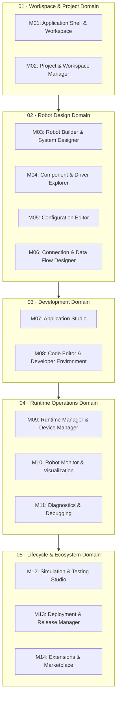

# ADR 0002 v1.1: HIYELX Studio Software Stack, Domain-Driven Architecture, Security, and Runtime Boundary

* **Status:** Accepted (v1.1 Final Architecture Decision)
* **Date:** 2026-11-24 (v1.0: 2026-11-22)
* **Authors:** HIYELX Core Architecture Team
* **Target Release:** Studio V0.1 (Visual Foundation: P1–P3) → V1.0 (Robotics IDE: P4, P5, P7) → V1.5 (P6) → V2.0 (P8, P9)
* **Synchronized Companion Documents:**
  * [`docs/architecture/studio-engineering-specification.md`](../architecture/studio-engineering-specification.md) (v1.1)
  * [`docs/plans/STUDIO_ROADMAP.md`](../plans/STUDIO_ROADMAP.md) (v1.1)
  * [`docs/architecture/studio-local-host.md`](../architecture/studio-local-host.md) (P2 frozen host contract)
  * [`docs/architecture/studio-p3-live-composition.md`](../architecture/studio-p3-live-composition.md) (P3 technical design)
  * [`docs/architecture/studio-p4-project-and-config-studio.md`](../architecture/studio-p4-project-and-config-studio.md) (P4 technical design)

---

## Context

Robotik sistem geliştiricileri; robot mimarisini tasarlamak, konfigürasyon dosyalarını yazmak, donanım sürücülerini seçmek ve telemetriyi izlemek için dağınık ve birbirinden kopuk araçlar kullanmaktadır.

HIYELX Studio'nun temel amacı, yalnızca pasif bir robot kontrol paneli veya telemetri ekranı olmak değil; robotik sistemlerin sıfırdan tasarlandığı, konfigüre edildiği, geliştirildiği, test edildiği ve canlı izlendiği merkezi bir **Robotics Development Environment (RDE)** sunmaktır.

Bu mimari karar kaydı (ADR), Studio'nun ürün vizyonunu, yazılım yığınını, 5 domain / 14 modül yapısını, veri sahipliğini, yerel API güvenlik ve telemetri sözleşmesini, genel robot graf modelini, manifest standardını ve kalite/kabul kapılarını kesinleştirmektedir.

---

## Decisions

### 1. Ürün Rolü ve Sorumluluk Sınırı (Single Authority Principle)
* **Tek Otorite İlkesi:** Studio hiçbir zaman USB, Seri, CAN veya GPIO portlarına doğrudan erişmez. Tüm donanım okuma, başlatma ve komut yönetimi HIYELX Runtime üzerinden akar.
* **Merkezi Yürütme Otoritesi:** Donanım erişiminin Runtime tarafından merkezileştirilmesi, Studio kaynaklı doğrudan port çakışmalarını ve kontrol otoritesi belirsizliğini önler. Runtime; **device ownership**, **resource locking**, **command arbitration**, **session lifecycle/lease**, **command timeout** (RB-1 operasyon teslim tarihleri) ve **fault handling / best-effort `safe_stop`** (RB-2) politikalarını kendi içinde yönetmekle sorumludur.
* **Güvenlik Sınırı Beyanı:** Yazılımsal `safe_stop` ve hata yönetimi en iyi çaba (best-effort) mühendislik tabanıdır; sertifikalı fonksiyonel güvenlik (functional safety) veya sessiz otomatik kurtarma (silent automatic recovery) iddiası taşımaz.
* **Local-First & Air-Gapped:** Studio tamamen kullanıcının yerel iş istasyonunda çalışır; internet, bulut servisi veya Supabase bağlantısı zorunlu değildir.

### 2. Yazılım Yığını (Recommended Studio Stack)
* **Desktop Shell: Tauri 2 (Rust Backend)**
  * Studio; yerel dosya sistemine erişim, proje dizinlerini yönetme ve kontrollü yerel entegrasyon için Tauri 2 kullanacaktır.
  * Sistem WebView'ını kullanarak daha hafif bir masaüstü dağıtımı hedefler; bellek tüketimi, açılış süresi ve paket boyutu release benchmark'larıyla doğrulanacaktır.
  * Mevcut P1/P2 statik web varlıkları (`studio/`) korunacak, yeni Tauri/React uygulaması bu kabul edilmiş varlıkları bozmadan ayrı bir geliştirme yüzeyi olarak konumlandırılacaktır.
* **Frontend Framework & Dil:** React 18+ ve TypeScript (Strict mode, sıfır `any`).
* **Build Aracı:** Vite (hızlı HMR ve optimize edilmiş bundle üretimi).
* **Durum Yönetimi (State Management):**
  * **UI State:** Zustand (açık paneller, aktif sekmeler, seçili düğüm, görünüm tercihleri — yalnızca geçici durum).
  * **Server / Runtime State:** TanStack Query (Runtime sağlık durumu, oturum ve canlı telemetri önbelleği; tek otorite Runtime).
* **Görsel Mühendislik & Grafik Editörü:**
  * **Robot Builder / Node Canvas:** React Flow / xyflow + ELK.js (ELK.js yalnızca otomatik yerleşim algoritması olarak çalışır; grafın kendisi DAG ile sınırlandırılmaz).
  * **3D Görselleştirme:** Three.js ilk sürümlerde zorunlu tutulmamış, V1.5+/V2.0 (URDF / TF ağacı) aşamasına ertelenmiştir.
* **Kod ve Konfigürasyon Editörü:** Monaco Editor (YAML, JSON ve P6'da kod düzenleme). Dil sunucusu (LSP), formatter, linter ve debugger (DAP) entegrasyonları P6 kapsamına bırakılmıştır.
* **Telemetri & Grafikler:** Apache ECharts (yüksek frekanslı motor ve sensör zaman serisi).
* **Tasarım Sistemi & UI Bileşenleri:** Tailwind CSS + Radix UI erişilebilir primitifler + Lucide ikonları (karanlık tema öncelikli, endüstriyel netlikte görsel dil).
* **Veri Doğrulama:** Zod (frontend form ve proje/konfigürasyon şema denetimleri) + Runtime Pydantic/OpenAPI modellerinden üretilen tipli API istemcisi.
* **Test Altyapısı:** Vitest (birim testleri), Testing Library (bileşen testleri), Playwright (E2E) + Python tarafında `ruff`, strict `pyright` ve `pytest`.

### 3. Süreç Sahipliği ve Masaüstü Kabuğu Ayrımı (Tauri vs. Runtime Host)
* **Bağımsız Yaşam Döngüsü:**
  * Tauri, Studio masaüstü uygulamasının ve yerel çalışma alanı (workspace) arayüzünün yaşam döngüsünü yönetir.
  * Runtime Host, bağımsız bir işletim sistemi süreci olarak çalışır; başlatılması ve durdurulması kontrollü bir yaşam döngüsü üzerinden yapılır.
  * Runtime Host, Studio UI'dan bağımsız olarak CLI (`hiyelx runtime`, `hiyelx studio`) veya başka bir istemci tarafından da çalıştırılabilir olmalıdır. Studio kapatıldığında çalışan Runtime oturumu sonlandırılmaz.
  * Tauri hiçbir zaman doğrudan donanım sürücüsü veya Runtime yürütme (execution) katmanı haline gelmez.
* **Terminal Güvenlik Sınırları (P6 ve sonrası):**
  * Entegre terminal yalnızca kullanıcının açıkça başlattığı bir özellik olacaktır.
  * Terminal komutları Runtime Host yetkilerinden ayrı işletim sistemi izinleriyle çalışacaktır.
  * Eklentiler (extensions) varsayılan olarak terminale erişemez.
  * Dosya sistemi erişimi yetenek tabanlı (capability-based) izinlerle çalışma alanı (workspace) sınırına hapsedilecektir; komut yürütme ve dosya değişiklikleri kullanıcıya görünür olacaktır.

### 4. 14 Modülün 5 Ortak Domain Alanında Yapılandırılması
14 modül bağımsız ürünler olarak değil, ortak domain modellerini ve platform servislerini paylaşan 5 fonksiyonel alan olarak organize edilmiştir:



### 5. Ortak Platform Servisleri (Shared Foundation)
Modüller tek tek yalıtılmış silolar yerine aşağıdaki 5 ortak altyapı servisi üzerine kurulacaktır:
1. **Project Model Engine:** Yerel dosya sistemi üzerindeki proje ağacını, `hiyelx.project.yaml` meta verisini, şema sürümlemesini ve şablonları yönetir.
2. **Component Manifest Engine:** Sürücü ve bileşenlerin `hiyelx.manifest.yaml` sözleşmesini, bağımlılık çözümlemesini ve uyumluluk matrisini standartlaştırır.
3. **Graph Engine:** React Flow + ELK.js tabanlı genel graf (non-DAG) düğüm/kenar manipülasyonu ile yaşam döngüsü bağımlılık DAG doğrulamasını yönetir.
4. **Configuration Engine:** `RobotConfig` şema doğrulaması, çift yönlü görsel/YAML senkronizasyonu, diff ve açık (opt-in) migration akışlarını sağlar.
5. **Typed API & Stream Client:** Runtime Host ile tipli OpenAPI/JSON iletişimini, capability token yönetimini ve P7 SSE telemetri akışını yürütür.

### 6. Veri Modeli Katmanları, Veri Sahipliği ve Şema Sürümleme (Data Ownership)
Studio içerisinde dört veri modeli kesin sınırlarla ayrılmıştır ve birbirinin yerine kullanılmaz:

| Model Katmanı | Sorumluluk | Kalıcı Kaynak / Otorite |
|---|---|---|
| **Studio Project Model** | Proje kimliği, dosya ağacı, robot tasarımı yerleşim verisi, uygulamalar, testler, ortam profilleri | Yerel Dosya Sistemi (`hiyelx.project.yaml` ve proje dizini) |
| **Robot Configuration Model** | Runtime'ın doğrulayıp çalıştırabileceği robot topolojisi ve bileşen ayarları | `robot/robot.yaml` (`RobotConfig` v2 şeması) |
| **Runtime State Model** | Çalışan robotun gerçek yaşam döngüsü, sağlık, cihaz ve telemetri durumu | **Yalnızca HIYELX Runtime** |
| **UI State Model** | Açık paneller, aktif sekmeler, seçili düğüm, zoom/pan ve görünüm tercihleri | **Zustand** (yalnızca geçici bellek / yerel UI tercihi) |

* **Tek Kaynak Kuralları:**
  * Proje verisinin kalıcı tek kaynağı yerel dosya sistemidir; Zustand asla kalıcı proje verisinin kaynağı yapılamaz.
  * Runtime State'in tek otoritesi Runtime'dır; Studio sahte veya bayat veriyi canlı gerçeklik gibi sunamaz.
  * Studio, Runtime konfigürasyonlarını (`robot.yaml`) yalnızca tipli sözleşme (Pydantic v2 `RobotConfig` / JSON Schema / Zod) üzerinden okuyacak ve yazacaktır.
  * Görsel düzenleme (Robot Builder) ve metin düzenleme (Monaco YAML) aynı kanonik domain modeline dayanacaktır.
* **Standart Proje Dizini:**
  ```text
  my-robot/
  ├── hiyelx.project.yaml     # Studio Project Model (schema_version: "1")
  ├── robot/
  │   ├── robot.yaml          # Robot Configuration Model (schema_version: "2")
  │   ├── components/         # Özel bileşen tanımları ve manifestleri
  │   └── connections/        # Veri/komut/geri-besleme bağlantı ve tuval yerleşim dosyaları
  ├── applications/
  │   ├── main.yaml
  │   └── tasks/
  ├── configs/                # Ortam profilleri (dev, sim, bench)
  ├── assets/
  │   ├── meshes/
  │   └── models/
  ├── tests/
  └── README.md
  ```
* **Şema Sürümleme ve Migration Politikası:**
  * Tüm kalıcı dosyalar açık `schema_version` alanı taşır (`hiyelx.project.yaml`: `"1"`, `robot.yaml`: `"2"`, `hiyelx.manifest.yaml`: `manifest_version: "1.0"`).
  * Bilinmeyen veya desteklenmeyen şema sürümleri **fail-closed** reddedilir; sessiz veri dönüştürme, sessiz alan düşürme veya otomatik dosya onarımı yasaktır.
  * Sürüm geçişleri (migration) yalnızca kullanıcının açık onayıyla (explicit opt-in), önizleme farkı (diff) gösterilerek ve geri döndürülebilir yedek oluşturularak çalıştırılır.

### 7. Runtime İletişim, Güvenlik ve Telemetri Sözleşmesi (Security & Transport)
* **Ağ Sınırı (Loopback-Only):**
  * Runtime Host **yalnızca `127.0.0.1` (`AF_INET`)** üzerinde ve işletim sistemince atanan ephemeral port (`port=0`) ile dinler. `0.0.0.0`, harici ağ arayüzleri, `::` ve `::1` varsayılan olarak kesinlikle yasaktır.
  * Loopback üzerinde çalışmak tek başına güvenlik garantisi kabul edilmez; tüm katmanlı kontroller birlikte uygulanır.
* **Capability Token Sözleşmesi (`host.py` & `studio-local-host.md` ile uyumlu):**
  * Her Runtime Host oturumu başlatıldığında kriptografik olarak güvenli en az 256-bit rastgelelik (`secrets.token_urlsafe(32)`, 43 karakter base64url) ile tekil oturum token'ı üretilir.
  * Başlatma URL'si `http://127.0.0.1:<port>/<entry>#capability=<token>` biçimindedir. URL fragment (`#...`) HTTP istekleriyle sunucuya gönderilmediğinden Studio istemcisi açılışta fragment'ı bir kez okur, `history.replaceState` ile URL'den ve tarayıcı geçmişinden derhal siler, yalnızca bellek içi kapalı kapsamda (in-memory closure) tutar ve her `/api/v1/*` isteğinde `X-HIYELX-Studio-Capability` başlığıyla gönderir.
  * Token sabit zamanlı karşılaştırmayla (`secrets.compare_digest`) doğrulanır; asla sorgu parametresine, çerezlere, `localStorage`/`sessionStorage`'a, IndexedDB'ye, loglara, telemetriye, hata raporlarına veya `Referer` başlığına yazılmaz.
  * Runtime Host kapandığında oturum token'ı anında geçersizleşir.
* **Host, Origin, CORS ve Hata Sözleşmesi:**
  * **Host Doğrulaması (`421 Misdirected Request` — `host_rejected`):** İstekler tam olarak bir `Host: 127.0.0.1:<assigned-port>` başlığı taşımalıdır. `localhost`, farklı port, alternatif IP yazımları veya herhangi bir `Forwarded` / `X-Forwarded-*` başlığı yönlendirmeden önce `421` ile reddedilir (DNS rebinding koruması).
  * **Origin Doğrulaması (`403 Forbidden` — `request_rejected`):** Doğrudan same-origin gezintide `Origin` başlığı bulunmayabilir; mevcutsa tam olarak bir adet ve `http://127.0.0.1:<assigned-port>` değerinde olmalıdır. `null`, farklı şema/host/port veya çoklu `Origin` başlığı `403` ile reddedilir (CSRF koruması).
  * **CORS Politikası:** Host hiçbir `Access-Control-Allow-*` başlığı üretmez ve CORS preflight desteklemez; `OPTIONS` dahil izin verilmeyen yöntemler `405 Method Not Allowed` (`Allow: GET, HEAD` — salt-okunur P2/P3 rotalarında) ile reddedilir.
  * **Token Reddi (`403 Forbidden` — `request_rejected`):** Eksik, hatalı biçimli, yinelenmiş veya geçersiz/süresi dolmuş capability başlığı `403` ile reddedilir.
  * **Zorunlu Güvenlik Başlıkları:** Tüm yanıtlar `Cache-Control: no-store, max-age=0`, katı `Content-Security-Policy` (`default-src 'self'`), `Cross-Origin-Opener-Policy: same-origin`, `Cross-Origin-Resource-Policy: same-origin`, `Permissions-Policy: camera=(), geolocation=(), microphone=(), serial=(), usb=()`, `Referrer-Policy: no-referrer`, `X-Content-Type-Options: nosniff` ve `X-Frame-Options: DENY` başlıklarını taşır.
* **Aşamalı İletişim ve Telemetri Yaşam Döngüsü:**
  * **P2–P3:** Salt-okunur tipli HTTP/JSON (`GET`/`HEAD`); istemcide görünür sekmede 1 Hz single-flight polling, gizli sekmede duraklatma.
  * **P4–P5:** Proje, doğrulama, bileşen kataloğu ve manifest işlemleri için tipli HTTP/JSON.
  * **P7 (Canlı Telemetri & Olaylar):** Kontrollü **Server-Sent Events (SSE)** akışı (telemetri, yapılandırılmış log ve runtime olayları).
  * **İleri Aşama (V1.5+/V2.0):** Yalnızca çift yönlü yüksek frekanslı iletişim gerektiğinde ayrı güvenlik sözleşmesiyle WebSocket değerlendirilir; erken aşamalarda zorunlu tutulmaz.
  * **P7 Telemetri Sözleşmesi Zorunlu Politikaları:**
    * `timestamp`: Monotonik saat + duvar saati meta verisi.
    * `sequence_number`: Akış başına tekdüze artan sıra numarası.
    * `sampling_rate`: Kaynak/kanal bazlı açık örnekleme ve seyreltme (decimation) sınırı.
    * `buffer_limit`: Hem Runtime hem Studio UI tarafında sınırlı halka tampon (bounded ring buffer).
    * `backpressure`: Sınırsız bellek büyümesi yerine deterministik en-eskiyi-düşür (drop-oldest) veya seyreltme politikası.
    * `data_retention`: Sınırlı yerel saklama; otomatik sınırsız biriktirme yasaktır.
    * `reconnection`: Sınırlı geri çekilmeli (bounded backoff) yeniden bağlanma ve arayüzde açık `stale` / `disconnected` gösterimi.
    * `missing_data_handling`: `sequence_number` boşluklarının tespit edilip operatöre açıkça gösterilmesi; eksik verinin sessizce enterpole edilmemesi.

### 8. Genel Robot Grafı, M03/M06 Ayrımı ve Konfigürasyon Modeli
* **Genel Graf Veri Modeli (Non-DAG):** Gerçek robot mimarileri sensör → kontrolcü → eyleyici → geri besleme biçiminde kapalı döngüler (feedback loops) içerir. Robot Builder'ın veri modeli **genel bir graf** olacaktır; veri ve geri besleme kenarları için DAG kısıtı uygulanmaz.
* **Yaşam Döngüsü DAG Ayrımı:** Graf içindeki `Data`, `Command` ve `Feedback` kenarları döngü içerebilirken; Runtime'ın deterministik başlatma/durdurma planlayıcısına (`src/hiyelx/runtime/planning.py`) yansıtılan **`Dependency` (`depends_on`) kenarları kesinlikle döngüsüz (DAG)** olmak zorundadır ve döngü tespitinde doğrulama fail-closed hata verir.
* **ELK.js Rolü:** ELK.js veri kısıtı değil, yalnızca otomatik görsel yerleşim (auto-layout) motorudur; görsel koordinatlar Runtime `robot.yaml` dosyasına değil Studio yerleşim meta verisine yazılır.
* **Düğüm (Node) Kategorileri:** `Hardware`, `Sensor`, `Actuator`, `Controller`, `Runtime Component`, `Communication`, `Application`, `Safety` (Runtime `ComponentCategory` değerleriyle — `actuator`, `vision`, `spatial`, `feedback`, `service` — açık eşleme tablosu üzerinden bağlanır).
* **Kenar (Edge) Tipleri:** `Data`, `Command`, `Feedback`, `Dependency`, `Physical Connection`.
* **M03 vs. M06 Görünüm Ayrımı:**
  * **M03 (Robot Builder & System Designer):** Robotun yapısal mimarisi (donanım, bileşenler, fiziksel bağlantılar ve başlatma bağımlılıkları).
  * **M06 (Connection & Data Flow Designer):** Bileşenler arası veri, komut ve geri besleme akışları (konular, mesaj şemaları, frekans/gecikme katmanları).
* **Şema Doğrulama ve Çift Yönlü Senkronizasyon:** Robot Builder'ın ürettiği konfigürasyon, Runtime'ın kabul ettiği kanonik şemaya (`RobotConfig` v2, `extra="forbid"`, strict types) göre doğrulanır. Görsel tuval ve Monaco YAML editörü aynı kanonik domain modeline bağlıdır.

### 9. Bileşen ve Sürücü Manifest Standardı (`hiyelx.manifest.yaml`)
Her bileşen ve sürücü standart bir manifest taşır; dört kavram birbirinden açıkça ayrılır: **manifest şema sürümü** (`manifest_version`), **bileşen/sürücü sürümü** (`version`), **Runtime uyumluluk sınırı** (`runtime.min_version`) ve **davranışsal yetenekler** (`capabilities` — `src/hiyelx/core/capabilities.py` `ComponentCapability` taksonomisiyle uyumlu):

```yaml
manifest_version: "1.0"
id: hiyelx.motor.dynamixel.xl430
name: DYNAMIXEL XL430 Motor Driver
version: "0.1.0"
type: driver

runtime:
  min_version: "0.2.0a1"

capabilities:
  - can_set_velocity
  - has_angular_position
  - has_angular_velocity

interfaces:
  - name: command
    type: motor.command
  - name: state
    type: motor.state

configuration:
  schema: settings.schema.json
```

Bu manifest; **Component Explorer (M04)**, **Robot Builder (M03)**, **Configuration Editor (M05)**, **Compatibility Checker** ve **Runtime Component Loader** tarafından ortak sözleşme olarak kullanılır.

### 10. Kalite ve Sürüm Kabul Kapıları (Quality & Release Gates)
* **Kabul Edilmiş Fazların Korunması:**
  * **P1 Koruması (Commit `9998b99`):** 11 durumlu statik fikstür varlıkları (`studio/index.html`, `studio/studio.css`, `studio/fixtures.js`, `studio/app.js`) `tests/studio/test_p1_preservation.py` SHA-256 doğrulamasıyla byte-byte korunur.
  * **P2 Koruması (Commit `b53fbc4`):** `127.0.0.1` ephemeral port host adaptörü, fragment-to-memory capability akışı, `421`/`403` güvenlik reddi ve salt-okunur oturum keşfi korunur.
* **P3 Kabul Kriterleri (Canlı Kompozisyon Doğrulaması — P4'e geçmeden zorunlu kapı):**
  1. Kurulu Runtime paketinin (non-editable wheel) başarıyla keşfedilmesi ve kaynak ağacı sızıntısı olmaması.
  2. Gerçek Runtime Host (`127.0.0.1`) ile canlı bağlantı kurulması.
  3. Gerçek oturum, sağlık ve bileşen/önizleme verilerinin okunması.
  4. Runtime kapalıysa veya şema/sürüm uyumsuzsa kontrollü ve açık hata/boş duruma geçilmesi.
  5. Fixture modunun gerçek Runtime verisiyle yapısal olarak asla karıştırılmaması.
  6. P1 byte-identity ve P2 güvenlik testlerinde sıfır regresyon.
* **7 Kategorili Zorunlu Test Kapısı:**
  Her fazın ölçülebilir kabul kriterleri ve aşağıdaki 7 kategoride test kanıtı bulunacaktır; önceki kabul edilmiş fazların (özellikle P1/P2) regresyon testleri CI içinde sürekli çalışacaktır:

| Test Kategorisi | Sorumluluk ve Kapsam |
|---|---|
| **Unit** | Domain modelleri, graf/DAG doğrulama, şema ve manifest ayrıştırma mantığı |
| **Component** | İzole UI bileşenleri, durum geçişleri ve erişilebilirlik (WAI-ARIA) |
| **Contract** | Studio–Runtime API şemaları (OpenAPI / Pydantic / Zod) ve hata üçlüleri |
| **Integration** | Gerçek Runtime Host bağlantısı, kurulu wheel keşfi ve süreç izolasyonu |
| **E2E** | Uçtan uca kullanıcı iş akışları (proje oluşturma → doğrulama → canlı izleme) |
| **Security** | Capability token tüketimi/sızıntısızlığı, Host (`421`), Origin (`403`), CORS ve izin sınırları |
| **Regression** | Kabul edilmiş P1 SHA-256 varlık koruması ve P2 güvenlik/transport davranışlarının CI'da korunması |

### 11. Pre-Seed Ürün Odaklanması (Studio V1.0 Hedefi)
Pre-seed aşamasında 14 modülün tamamını eşzamanlı bitirmek yerine, bir geliştiricinin gerçek bir robot projesi oluşturup, bileşenlerini görsel olarak yapılandırıp doğrulayabildiği ve çalışan Runtime'ı canlı izleyebildiği uçtan uca **Studio V1.0** hedeflenmiştir:
* **Geliştirme Öncelik Sırası (faz numaralarını değiştirmeden):**
  1. **P0:** Domain modelleri, API sözleşmeleri ve güvenlik tabanı *(Tamamlandı)*.
  2. **P1:** Kabul edilmiş statik Studio *(Tamamlandı — `9998b99`)*.
  3. **P2:** Kabul edilmiş Local Runtime Host ve foreground launcher *(Tamamlandı — `b53fbc4`)*.
  4. **P3:** Gerçek Runtime entegrasyonunun ve canlı DOM kompozisyonunun doğrulanması *(Aktif Faz — P4 öncesi zorunlu kapı)*.
  5. **P4:** Project Workspace + Configuration Studio + Temel Robot Builder *(V1.0 Must Have)*.
  6. **P5:** Component Explorer + Driver Manifest & Compatibility Checker *(V1.0 Must Have)*.
  7. **P7:** Live Telemetry Monitor (SSE) + Structured Logs & Diagnostics *(V1.0 Must Have)*.
  8. **P6:** Application Studio + Developer Environment / LSP / Terminal *(V1.5 — V1.0 sonrası)*.
  9. **P8:** Simulation & Testing Studio (Adapter Architecture) *(V2.0)*.
  10. **P9:** Deployment, Release Manager & Extensions Marketplace *(V2.0)*.

---

## Consequences

### Pozitif Sonuçlar
* **Geliştirici Ergonomisi:** Robotik geliştirici dağınık YAML dosyaları yerine görsel, doğrulanabilir ve kod odaklı hibrit bir geliştirme ortamı (RDE) kazanır.
* **Otorite Netliği:** Donanım erişiminin Runtime tarafından merkezileştirilmesi, Studio kaynaklı doğrudan port çakışmalarını ve kontrol otoritesi belirsizliğini önler.
* **Esnek ve Doğru Graf Modeli:** Veri/geri-besleme akışları için genel graf, başlatma bağımlılıkları için katı DAG ayrımı hem kapalı döngü robotik tasarımı hem de deterministik yaşam döngüsünü birlikte sağlar.
* **Temiz Süreç İzolasyonu:** Runtime Host ve Studio UI'ın ayrı süreçlerde çalışması bağımsız test edilebilirliği, kararlılığı ve çoklu istemci (CLI + Studio) desteğini güvenceye alır.

### Riskler ve Alınan Mimari Önlemler
| Risk Alanı | Potansiyel Sorun | Mimari Çözüm & Kontrol Mekanizması |
|---|---|---|
| **Eşzamanlı Erişim & Yarış Durumları** | Birden fazla Studio istemcisi, sürücü çakışması veya eşzamanlı komut çakışması | Runtime kendi içinde **device ownership**, **resource locking**, **command arbitration**, **session lease**, **command timeout** (RB-1) ve best-effort **fault handling / `safe_stop`** (RB-2) politikalarını uygular. |
| **API Sözleşme Uyumsuzluğu** | Studio modeli ile Runtime Pydantic modelleri arasındaki sürüm kayması | OpenAPI/JSON Schema'dan türetilen tipli istemci, Zod doğrulaması, açık `schema_version` fail-closed kontrolü ve CI sözleşme testleri. |
| **Telemetri Yoğunluğu & Veri Kaybı** | Yüksek frekanslı sensör akışında arayüz donması veya sessiz paket kaybı | Örnekleme hızı (`sampling_rate`), sınırlı tampon (`buffer_limit`), backpressure, `sequence_number` boşluk tespiti (`missing_data_handling`) ve kontrollü yeniden bağlanma. |
| **YAML Round-Trip Kaybı** | Görsel düzenlemede YAML yorumlarının ve biçimlendirmesinin kaybolması | Kanonik domain modeli ve yorum/biçim korumalı YAML serileştirme + round-trip testleri. |
| **Bileşen & Sürücü Uyumsuzluğu** | Runtime sürümüyle veya arayüz tipleriyle uyumsuz bileşen seçilmesi | Standart `hiyelx.manifest.yaml` (`manifest_version`, `version`, `runtime.min_version`, `capabilities`) ve Compatibility Checker doğrulaması. |
| **Yerel API Güvenliği** | Loopback üzerinden DNS rebinding, CSRF veya token sızıntısı | IPv4 loopback-only dinleme (`127.0.0.1`), 256-bit fragment-to-memory capability token (`403`), katı `Host` (`421`) ve `Origin` (`403`) doğrulaması, CORS yasağı. |
| **Masaüstü Terminal & Eklenti Yetkileri** | Kötü niyetli eklentilerin veya yetkisiz komutların yerel sisteme sızması | Kullanıcı onaylı oturum, capability-based dosya sistemi sınırı, eklentilere varsayılan terminal yasağı. |
| **Simülasyon Entegrasyon Karmaşıklığı** | Gazebo/MuJoCo bağımlılıklarının Studio çekirdeğini kilitlemesi | Harici simülatörleri Studio'ya gömmemek; adaptör katmanı (Adapter Architecture) üzerinden Runtime/Simulation sınırı kurmak. |
| **Büyük Projelerde Performans** | 50+ düğümlü robot projelerinde tuval ve doğrulama gecikmesi | Lazy loading, React Flow graf sanallaştırma (virtualization) ve artımlı (incremental) şema doğrulama. |
