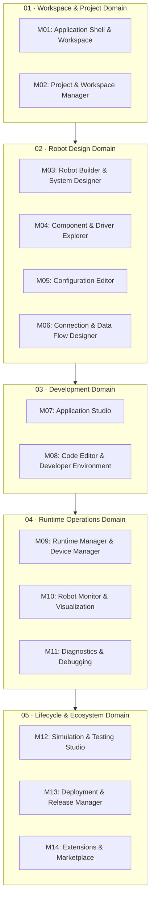

# ADR 0002 v1.1: HIYELX Studio Software Stack, Domain-Driven Architecture, Security, and Runtime Boundary

* **Status:** Accepted (v1.1 Revision)
* **Date:** 2026-11-23 (v1.0: 2026-11-22)
* **Authors:** HIYELX Core Architecture Team
* **Target Release:** Studio V0.1 (Visual Foundation: P1–P3) → V1.0 (Robotics IDE: P4, P5, P7) → V1.5 (P6) → V2.0 (P8, P9)

---

## Context

Robotik sistem geliştiricileri; robot mimarisini tasarlamak, konfigürasyon dosyalarını yazmak, donanım sürücülerini seçmek ve telemetriyi izlemek için dağınık ve birbirinden kopuk araçlar kullanmaktadır.

HIYELX Studio'nun temel amacı, yalnızca pasif bir robot kontrol paneli veya telemetri ekranı olmak değil; robotik sistemlerin sıfırdan tasarlandığı, konfigüre edildiği, geliştirildiği, test edildiği ve canlı izlendiği merkezi bir **Robotics Development Environment (RDE)** sunmaktır.

Bu mimari karar kaydı (ADR), Studio'nun ürün vizyonunu, teknik mimarisini, güvenlik sınırlarını ve geliştirme ilkelerini kesinleştirmektedir.

---

## Decisions

### 1. Ürün Rolü ve Sorumluluk Sınırı (Single Authority Principle)
* **Tek Otorite İlkesi:** Studio hiçbir zaman USB, Seri, CAN veya GPIO portlarına doğrudan erişmez. Tüm donanım okuma, başlatma ve komut yönetimi Runtime üzerinden akar.
* **Merkezi Yürütme Otoritesi:** Donanım erişiminin Runtime tarafından merkezileştirilmesi, Studio kaynaklı doğrudan port çakışmalarını ve kontrol otoritesi belirsizliğini önler.
* **Local-First & Air-Gapped:** Studio ilk aşamada tamamen kullanıcının yerel iş istasyonunda çalışır; internet veya bulut bağlantısı zorunlu değildir.

### 2. Yazılım Yığını (Recommended Studio Stack)
* **Desktop Shell: Tauri 2 (Rust Backend)**
  * Studio; yerel dosya sistemine erişim, proje dizinlerini yönetme ve kontrollü yerel entegrasyon için Tauri 2 kullanacaktır.
  * Sistem WebView'ını kullanarak daha hafif bir masaüstü dağıtımı hedefler; bellek tüketimi, açılış süresi ve paket boyutu release benchmark'larıyla doğrulanacaktır.
  * Mevcut P1/P2 statik web varlıkları (`studio/`) korunacak, masaüstü kabuğu bu varlıkları bozmadan kademeli olarak saracaktır.
* **Frontend Framework & Dil:** React 18+ ve TypeScript (Strict mode, sıfır `any`).
* **Build Aracı:** Vite (hızlı HMR ve optimize edilmiş bundle üretimi).
* **Durum Yönetimi (State Management):**
  * **UI State:** Zustand (Açık paneller, aktif sekmeler, görünüm tercihleri).
  * **Server / Runtime State:** TanStack Query (Runtime sağlık durumu, canlı telemetri önbelleği; tek otorite Runtime).
* **Görsel Mühendislik & Grafik Editörü:**
  * **Robot Builder / Node Canvas:** React Flow / xyflow + ELK.js (ELK.js yalnızca otomatik yerleşim algoritması olarak çalışır; grafın kendisi DAG ile sınırlandırılmaz).
  * **3D Görselleştirme:** Three.js ilk sürümlerde zorunlu tutulmamış, V1.5+ (URDF / TF ağacı) aşamasına ertelenmiştir.
* **Kod ve Konfigürasyon Editörü:** Monaco Editor (YAML, JSON ve P6'da kod düzenleme). Dil sunucusu (LSP), linter ve debugger entegrasyonları P6 kapsamına bırakılmıştır.
* **Tasarım Sistemi & UI Bileşenleri:** Tailwind CSS + Radix UI erişilebilir primitifler + Lucide ikonları (Karanlık tema öncelikli, endüstriyel netlikte görsel dil).
* **Veri Doğrulama:** Zod (Frontend form ve şema denetimleri) + Runtime OpenAPI modellerinden üretilen tipli API istemcisi.
* **Test Altyapısı:** Vitest (Birim testleri), Testing Library (Bileşen testleri), Playwright (E2E).

### 3. Süreç Sahipliği ve Masaüstü Kabuğu Ayrımı (Tauri vs. Runtime Host)
* **Bağımsız Yaşam Döngüsü:**
  - Tauri, Studio masaüstü uygulamasının yaşam döngüsünü yönetir.
  - Runtime Host, bağımsız bir işletim sistemi süreci olarak çalışır.
  - Runtime Host, Studio UI'dan bağımsız olarak CLI veya harici araçlar tarafından da çalıştırılabilir olmalıdır.
  - Tauri doğrudan donanım sürücüsü veya Runtime execution katmanı haline gelmemelidir.
* **Terminal Güvenlik Sınırları:**
  - Entegre terminal kullanıcının açıkça başlattığı bir özellik olacaktır.
  - Komutlar Runtime Host yetkilerinden ayrı işletim sistemi izinleriyle çalışacaktır.
  - Eklentiler (extensions) varsayılan olarak terminale erişemez; dosya sistemi erişimi izinlerle sınırlandırılacaktır.

### 4. 14 Modülün 5 Ortak Domain Alanında Yapılandırılması
14 modül bağımsız ürünler olarak değil, ortak domain servislerini paylaşan 5 fonksiyonel alan olarak organize edilmiştir:



### 5. Ortak Platform Servisleri (Shared Foundation)
Tüm modüllerin doğrudan erişebileceği 5 ortak altyapı servisi tanımlanmıştır:
1. **Project Model Engine:** Proje dosyalarını, ağaç yapısını ve meta veriyi yönetir.
2. **Component Manifest Standard:** Sürücü ve bileşenlerin yetenek/arayüz sözleşmesini standartlaştırır.
3. **Graph Engine:** React Flow tabanlı düğüm ve kenar manipülasyonunu yönetir.
4. **Configuration Engine:** Şema doğrulaması, çift yönlü senkronizasyon ve migration sağlar.
5. **Typed API Client:** Runtime Host ile tipli OpenAPI iletişimini yürütür.

### 6. Veri Modeli Katmanları ve Veri Sahipliği (Data Ownership)
Studio içerisinde dört farklı veri modeli kesin sınırlarla ayrılmıştır:
* **Studio Project Model:** Proje kimliği, robot tasarımı, uygulamalar, testler ve proje meta verisi. Kalıcı kaynağı **yerel dosya sistemidir** (`hiyelx.project.yaml`, `robot/`, `applications/`, `assets/`, `configs/`).
* **Robot Configuration Model:** Runtime'ın çalıştırabileceği geçerli `robot.yaml` şeması.
* **Runtime State Model:** Çalışan sistemin gerçek anlık durumu. Tek otoritesi **Runtime'dır**.
* **UI State Model:** Açık paneller, seçili düğümler ve görünüm tercihleri. **Zustand** tarafından yalnızca geçici olarak tutulur; kalıcı proje verisinin kaynağı yapılamaz.

### 7. Runtime İletişim ve Güvenlik Modeli (Security Specification)
* **Ağ Sınırı:**
  - Runtime Host **yalnızca `127.0.0.1` (loopback)** üzerinde dinler. `0.0.0.0` varsayılan olarak kesinlikle yasaktır.
  - Ephemeral port tahsisi kullanılır.
* **Capability Token Sözleşmesi:**
  - Token kriptografik olarak güvenli rastgelelik (`secrets.token_urlsafe`) ile üretilir ve Runtime oturumuna bağlanır.
  - URL fragment'ı (`#...`) HTTP istekleriyle sunucuya gönderilmediğinden; Studio istemcisi fragment'taki token'ı okur ve API isteklerine `X-HIYELX-Studio-Capability` header'ı olarak ekler.
  - Token asla loglara, telemetriye veya hata raporlarına yazılmaz.
  - Runtime Host sonlandığında oturum token'ı derhal geçersiz kılınır.
* **Web & Ağ Güvenliği:**
  - Her API isteğinde capability header'ı doğrulanır.
  - DNS rebinding ve CSRF risklerine karşı sıkı `Origin` ve `Host` header doğrulaması uygulanır.
  - Hatalı veya süresi dolmuş token istekleri `403 Forbidden` ile reddedilir.
* **Canlı İletişim Stratejisi:**
  - **P2 / P3 / P4 / P5:** Tipli HTTP / JSON (Read-only, health, status, discovery).
  - **P7 (Canlı Telemetri):** Server-Sent Events (SSE) veya eşdeğer kontrollü event stream. Zaman damgası (timestamp), sıra numarası (sequence number), örnekleme hızı (sampling rate), tampon limiti (buffer limit) ve geri basınç (backpressure) kontrolleri uygulanacaktır.

### 8. Genel Robot Grafı ve Konfigürasyon Modeli (General Graph Model)
* **Döngü Kısıtının Kaldırılması:** Gerçek robot mimarileri sensör-kontrolcü-eyleyici arasında kapalı geri besleme döngüleri (feedback loops) içerir. Robot Builder'ın veri modeli **genel bir graph** olacaktır; DAG ile sınırlandırılmayacaktır.
* **ELK.js Rolü:** ELK.js bir veri kısıtı değil, yalnızca görsel yerleşim (auto-layout) algoritması olarak kullanılacaktır.
* **Düğüm Kategorileri:** `Hardware`, `Sensor`, `Actuator`, `Controller`, `Runtime Component`, `Communication`, `Application`, `Safety`.
* **Kenar (Edge) Tipleri:** `Data`, `Command`, `Feedback`, `Dependency`, `Physical Connection`.
* **Çift Yönlü Eşitleme (Two-Way Sync):** Görsel tuvaldeki değişiklik anında `robot.yaml`'a; YAML'daki değişiklik tuvale aktarılır.

### 9. Bileşen ve Sürücü Manifest Standardı (Component/Driver Manifest)
Her bileşen ve sürücü standart bir manifest dosyası (`hiyelx.manifest.yaml`) taşır:
```yaml
manifest_version: "1.0"
id: hiyelx.motor.dynamixel.xl430
name: DYNAMIXEL XL430 Motor Driver
version: "0.1.0"
type: driver
runtime:
  min_version: "0.1.0"
capabilities:
  - can_set_velocity
  - has_angular_position
  - has_angular_velocity
interfaces:
  - name: command
    type: motor.command
  - name: state
    type: motor.state
configuration:
  schema: settings.schema.json
```
Bu manifest Component Explorer, Robot Builder, Configuration Editor ve Runtime Component Loader tarafından ortaklaşa kullanılır.

### 10. Kalite ve Sürüm Kabul Kapıları (Quality & Release Gates)
* **P1 Kabulünün Korunması:** Commit `9998b99` ile kabul edilen 11 durumlu statik fikstür varlıkları (`studio/fixtures.js`, `studio/studio.css`, `studio/app.js`, `studio/index.html`) byte-byte korunacak ve test edilecektir.
* **P2 Kabulünün Korunması:** Commit `b53fbc4` ile kabul edilen `127.0.0.1` ephemeral port host adaptörü korunacaktır.
* **P3 Kabul Kriterleri (Canlı Kompozisyon Doğrulaması):**
  1. Kurulu Runtime paketinin (wheel) başarıyla keşfedilmesi.
  2. Gerçek Runtime Host ile bağlantı kurulması.
  3. Gerçek sağlık ve bileşen verisinin okunabilmesi.
  4. Runtime yoksa veya uyumsuzsa kontrollü hata durumuna geçilmesi.
  5. Fixture modunun gerçek Runtime verisiyle asla karıştırılmaması.
  6. P1 fixture testlerinin hiçbir regresyona uğramaması.

### 11. Pre-Seed Ürün Odaklanması (Studio V1.0 Hedefi)
Pre-seed döneminde 14 modülün tamamını bitirmek yerine, geliştiricinin gerçek bir robot projesi oluşturup, yapılandırıp, çalışan robotu canlı izleyebileceği **Studio V1.0** hedeflenmiştir:
* **Öncelik Sırası:**
  1. **P3:** Gerçek Runtime Entegrasyonunun Doğrulanması (Aktif).
  2. **P4:** Project Workspace + Configuration Editor + Temel Robot Builder.
  3. **P5:** Component Explorer + Driver Manifest Sistemi.
  4. **P7:** Live Telemetry Monitor + Diagnostics.
  5. **P6:** Application Studio + Kod Editörü (P7 sonrasına planlanmıştır).
  6. **P8 & P9:** Simülasyon, Dağıtım ve Pazaryeri (V2.0).

---

## Consequences

### Pozitif Sonuçlar
* **Geliştirici Ergonomisi:** Robotik geliştirici dağınık YAML dosyaları yerine görsel, doğrulanabilir ve kod odaklı hibrit bir geliştirme ortamı (RDE) kazanır.
* **Otorite Netliği:** Donanım erişiminin Runtime tarafından merkezileştirilmesi, Studio kaynaklı doğrudan port çakışmalarını ve kontrol otoritesi belirsizliğini tamamen önler.
* **Esnek Mimari:** Genel graf modeli sayesinde robotik sistemlerin doğal geri besleme döngüleri görselleştirilebilir.
* **Temiz Süreç İzolasyonu:** Runtime Host ve Studio UI'ın ayrı süreçlerde çalışması bağımsız test edilebilirliği ve kararlılığı artırır.

### Riskler ve Alınan Mimari Önlemler
| Risk Alanı | Potansiyel Sorun | Mimari Çözüm & Kontrol Mekanizması |
|---|---|---|
| **Eşzamanlı Erişim & Yarış Durumları** | Birden fazla Studio istemcisi veya eşzamanlı komut çakışması | Runtime kendi içinde **device ownership, resource locking, command arbitration** ve **session lease** politikaları uygulayacaktır. |
| **API Sözleşme Uyumsuzluğu** | Studio modeli ile Runtime modeli arasındaki sürüm uyumsuzlukları | OpenAPI'den üretilen tekil tipli TypeScript istemcisi, Zod şemaları ve CI sözleşme testleri (contract tests). |
| **Telemetri Yoğunluğu** | Yüksek frekanslı sensör verisinde arayüz donması | Örnekleme hızı (sampling rate), tampon limiti (buffer limit) ve kontrollü SSE geri basınç (backpressure) modeli. |
| **YAML Round-Trip Kaybı** | Görsel düzenlemede YAML yorumlarının ve biçimlendirmesinin kaybolması | Kanonik domain modeli ve AST/serialization korumalı ayrıştırma testleri. |
| **Yerel API Güvenliği** | Loopback üzerinden DNS rebinding veya CSRF saldırıları | Loopback-only dinleme, kriptografik capability token, katı `Origin` ve `Host` header kontrolleri. |
| **Masaüstü Terminal Yetkileri** | Kötü niyetli eklentilerin terminal üzerinden sisteme sızması | Kullanıcı onaylı oturum, capability-based izin modeli, eklentilere terminal yasağı. |
