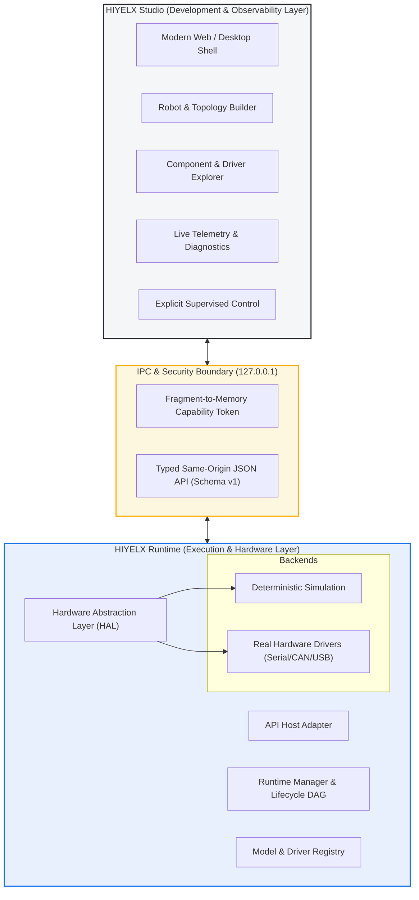
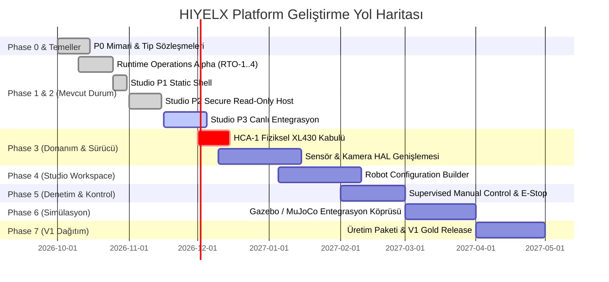
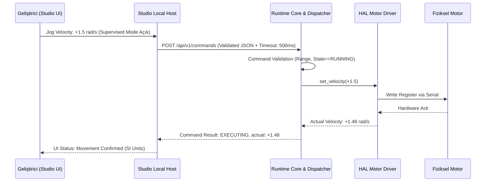

# HIYELX Platform Değerlendirmesi ve Kapsamlı Mühendislik Yol Haritası (Master Roadmap)

Bu doküman; **HIYELX Studio & HIYELX Runtime Ürün Kapsamı ve Geliştirme Yol Haritası** vizyonunu, mevcut kod tabanının (`hiyelx` repository) mimari gerçeklerini, kabul edilmiş sözleşmelerini (PRESEED, RTO, SIM, HCA, Studio P0–P2) ve teknik sınırlarını sentezleyerek dondurulmuş kapsamlı bir mühendislik yol haritasıdır.

---

## 1. Projenin Yorumlanması ve Stratejik Değerlendirme

### 1.1. Temel Tez: *"Change the hardware, not the application"*
Robotik ekosistemi günümüzde iki uç kutup arasında sıkışmış durumdadır:
1. **ROS / ROS2 Ekosistemi:** Geniş bir açık kaynak kütüphanesine sahip olsa da; katı sözleşmelerden uzak, paket bağımlılık cehennemi barındıran, deterministik simülasyon ve gerçek donanım geçişinde uygulama katmanını yeniden yazmayı gerektiren karmaşık bir yapıdadır.
2. **Kapalı / Dikey Sistemler (Viam vb.):** Bulut bağımlılığı yüksek, yerel-özerk (air-gapped/local-first) çalışmada zorlanan, satıcı bağımlılığı (vendor lock-in) yaratan çözümlerdir.

HIYELX'in benimsediği **"Donanımı değiştir, uygulamayı değil"** ilkesi; robotik uygulamasını fiziksel cihaz detaylarından tamamen soyutlayarak, **Donanım Soyutlama Katmanı (HAL)** ve **Topoloji Olarak Konfigürasyon** temeli üzerine oturtur. Bir motorun `motor.simulated` modelinden fiziksel bir `motor.dynamixel.xl430` modeline geçişi, uygulamanın kodunu tek satır değiştirmeden yalnızca bir YAML topoloji değişikliği ile gerçekleşmelidir.

### 1.2. İki Ürün, Tek Platform: Studio ve Runtime Simetrisi
Metinde vurgulanan en kritik ayrım şudur: **"Studio robotu yönetir ve geliştirir. Runtime robotu gerçekten çalıştırır."**



* **Tek Yetkili Kapı (Single Authority):** Studio hiçbir zaman donanım portlarına (USB, Serial, CAN, GPIO) doğrudan erişen ikinci bir kontrolör olamaz. Tüm okuma, çalıştırma ve donanım yönetimi Runtime üzerinden akar.
* **Bağımsız Yaşam Döngüsü:** 
  * Runtime, Studio kapalıyken veya çöktüğünde robot görevini aksatmadan yürütmeye devam edebilmelidir.
  * Studio, Runtime çalışmıyorken statik fikstürler veya simülasyon oturumları ile konfigürasyon tasarlayabilmelidir.

---

## 2. Mevcut Repository Durumu ve Doğrulama Gerçekliği

Kod tabanı üzerinde yapılan denetim sonuçları:

### 2.1. Tamamlanan ve Kabul Edilen Aşamalar (DONE)
1. **Pre-Seed Resource Core & HAL:** Kaynak kimliği, deterministik yaşam döngüsü (`ResourceIdentity`), `Motor` API'si ve loopback gRPC sınırları tamamlandı.
2. **Model Registry & DAG Tabanlı Runtime Manager:** YAML/JSON topolojisi üzerinden bağımlılık grafiği (DAG) doğrulama, sıralı başlatma (ordered startup), hata anında geri alma (rollback) ve ters sırada güvenli kapatma (reverse shutdown) işliyor.
3. **RTO-1..RTO-4 (Runtime Operations Alpha):**
   * Kullanıcıya özel Unix domain soketi üzerinden tek sahipli (single-owner) lokal kontrol.
   * `RuntimeOperations` façade, SQLite tabanlı yerel olay (events) ve çalıştırma geçmişi (runs history), deterministik budama (pruning).
   * Kurulabilir wheel (`hiyelx-0.2.0a1`) ile hem Ubuntu hem macOS üzerinde doğrulanmış kalite kapısı.
4. **SIM-P0..SIM-P3 (Simulation Preview Alpha):**
   * `SimulationPreviewSnapshot` (Schema v1) donduruldu.
   * Deterministik açısal pozisyon (rad), hız (rad/s), simülasyon zamanı (s) ve mutasyon sayacı (`revision`) desteği.
   * Kurucu onayı (Founder Attestation) ile kabul edildi.
5. **Modüler Sürücü SDK (HCA-SDK):**
   * Çekirdeği değiştirmeden harici motor sürücüsü geliştirme iskelesi (`hiyelx scaffold motor-driver`) ve uyumluluk doğrulayıcısı tamamlandı.
6. **Studio P1 (Statik Shell):**
   * `studio/` altında 11 durumlu fixture dashboard kabul edildi (Commit `9998b99`).
7. **Studio P2 (Güvenli Yerel Host Adaptörü):**
   * `main` dalında birleştirildi (`b53fbc4`).
   * `127.0.0.1` ephemeral port, URL fragment-to-memory güvenlik belirteci (`X-HIYELX-Studio-Capability`), DNS rebinding koruması ve katı HTTP başlıkları uygulandı.
   * `hiyelx studio` paketlenmiş foreground başlatıcısı entegre edildi.

### 2.2. Tespit Edilen Kritik Geliştirme Durumu ve Düzeltmeler
1. **Git Senkronizasyonu:**
   * `main` dalı `b53fbc4` commit'ine fast-forward edilerek P2 ve launcher ile tam eşitlendi.
   * 830 testlik suite (829 passed, 1 opt-in physical skipped) ve sıfır linter/typechecker hatası ile temiz ana dal korundu.
2. **Studio P3 (Canlı Entegrasyon):**
   * `feat/studio-p3-live` dalında devam eden canlı önizleme ve DOM kompozisyon çalışmaları güvenle donduruldu/yedeklendi.
   * P1 statik sözleşmesi `main` üzerinde byte-identical olarak muhafaza edildi.
3. **Fiziksel Donanım Doğrulaması (HCA-1 / XL430):**
   * DYNAMIXEL XL430 referans sürücüsünün yazılımsal hazır oluşu (`HCA-HW-0`) tamamlanmış ancak fiziksel bench testi henüz icra edilmemiştir. Yazılım doğrulaması ile fiziksel kabul ayrı tutulmaktadır.

---

## 3. Temel Mimari Prensipler ve Sistem Sınırları

HIYELX mimarisinin korunması gereken altı kırmızı çizgisi:

1. **Local-First & Air-Gapped Çalışma:**
   * Runtime hiçbir koşulda çalışmak için internet bağlantısına, bulut aboneliğine veya harici bir kontrol paneline ihtiyaç duyamaz. Supabase veya bulut filo yönetimi gelecekte yalnızca isteğe bağlı bir eklenti (telemetri/yedekleme) olabilir.
2. **Kabiliyet Tabanlı Donanım Soyutlaması (Capability-Based Abstraction):**
   * "Tüm motorlar aynıdır" yanılgısına düşülmemelidir. Her cihaz desteklediği kabiliyetleri bir bayrak kümesi olarak beyan eder:
     * `CAN_POSITION_CONTROL`, `CAN_VELOCITY_CONTROL`, `CAN_TORQUE_CONTROL`, `HAS_ENCODER_FEEDBACK`, `HAS_THERMAL_MONITOR`.
   * Uygulama katmanı desteklenmeyen bir komut gönderdiğinde Runtime bunu donanıma iletmeden önce **fail-closed** prensibiyle reddeder.
3. **Üçlü Durum Ayrımı (Desired vs. Actual vs. Health):**
   * **Desired State:** Kullanıcının veya algoritmanın istediği (ör. "Motor 120 rad/s ile dönsün").
   * **Actual State:** Enkoderden okunan fiziksel gerçeklik (ör. "Motor 114 rad/s ile dönüyor").
   * **Health State:** Cihazın operasyonel sağlığı (ör. "Aşırı ısınma uyarısı, sıcaklık 68°C").
   * Bu üç kavram telemetride asla tek bir alana indirgenemez.
4. **Gerçek Zamanlılık (Real-Time Control) Sınırı:**
   * Python (asyncio) 1 kHz sert gerçek zamanlı (hard real-time) PID servo kontrolü yapamaz. HIYELX Runtime üst seviye orkestrasyon, planlama, durum izleme ve telemetriyi yönetir. Sert gerçek zaman gerektiren döngüler alt seviye mikrodenetleyicilerde (STM32, ESP32) veya C/Rust HAL katmanında koşar.
5. **İzolasyon ve Çökme Dayanıklılığı (Process Isolation Path):**
   * Sürücüler ilk etapta asyncio task olarak çalışsa da, arayüz sözleşmeleri ileride bir sürücünün ayrı bir OS process veya IPC worker olarak çalıştırılmasına izin verecek şekilde tasarlanmıştır. Bir sürücünün çökmesi Runtime Core'u çökertmemelidir.
6. **Güvenlik ve E-Stop Sınırı:**
   * HIYELX ilk aşamada ISO 13849 veya IEC 61508 sertifikalı bir güvenlik PLC'si değildir. Yazılımsal acil durdurma (safe-stop) en iyi çaba (best-effort) esasıyla çalışır; fiziksel güvenlik daima donanımsal acil durdurma butonları ve güç kesicilerle sağlanmalıdır.

---

## 4. Kapsamlı 8 Fazlı Yol Haritası (Master Roadmap)

Geliştirme programı 3 paralel çalışma hattı üzerinden yürütülür:
* **Workstream A (Runtime):** Core → Lifecycle → Drivers → Control → Engine
* **Workstream B (Studio):** Static Shell → Host Adapter → Live Composition → Workspace/Builder → Control UI
* **Workstream C (Integration & Validation):** API Contracts → Hardware Proof → Simulation → Packaging



---

### PHASE 0 — Architecture & Foundation (Sözleşmeler ve Tip Bütünlüğü)
* **Amaç:** Studio ve Runtime arasındaki çift taraflı bağımsızlığı garanti eden katı tip sözleşmelerini ve hata modellerini sabitlemek.
* **Mevcut Durum:** Tamamlandı (Schema v1 Preview ve RTO modelleri mevcut).

| ID | İş Paketi | Sorumluluk / Fonksiyon | Çıktı / Sözleşme |
|---|---|---|---|
| **F0.1** | Boundary Definition | Studio (İzleme/Yönetim) vs. Runtime (Yürütme) sınırlarını dondurmak. | Mimari kılavuz dokümanı. |
| **F0.2** | Core Architecture | Runtime yaşam döngüsü durum makinesi (`CREATED`, `INITIALIZING`, `READY`, `RUNNING`, `STOPPING`, `STOPPED`, `FAULTED`). | State Machine spesifikasyonu. |
| **F0.3** | Component Trait Model | Kabiliyet deklarasyonu (`capabilities: list[str]`). | Pydantic model & JSON Schema. |
| **F0.4** | Configuration Schema v2 | Topoloji, cihaz portları, baudrate ve kaynak bağımlılıkları. | `robot.yaml` format standardı. |
| **F0.5** | Typed JSON REST/RPC Contract | Sistem, sağlık, telemetri ve komut endpoint'lerinin kesin tanımları. | OpenAPI / JSON Schema v1. |
| **F0.6** | Error & Fault Taxonomy | Hata sınıfları (`COMMUNICATION_LOST`, `DRIVER_TIMEOUT`, `HARDWARE_FAULT`). | Hata kodları rehberi. |
| **F0.7** | Branch & Git Hygiene | Yerel ve uzak `main` senkronizasyonu, P1/P2/P3 varlık ayrımı. | Temizlenmiş git geçmişi. |

* **Kabul Kriteri:** Hem Studio arayüzü hem de Runtime arka ucu, mock nesneler üzerinden aynı JSON şemasını tek bir tip hatası üretmeden ayrıştırabilmelidir (`pyright` 0 hata).

---

### PHASE 1 — HIYELX Runtime Core (Genişletilmiş Çekirdek ve Servisler)
* **Amaç:** Motor haricindeki robotik bileşenleri (Kamera, IMU, Sensör) yönetebilen, donanımdan bağımsız bir orkestrasyon motoru oluşturmak.

| ID | İş Paketi | Sorumluluk / Fonksiyon | Arayüz / Model |
|---|---|---|---|
| **R1.1** | Component Lifecycle Engine | Sıralı başlatma, durum denetimi ve kontrollü kapatma. | `RuntimeManager` genişletmesi. |
| **R1.2** | Multi-Resource Registry | `motor`, `camera`, `sensor`, `imu`, `gripper` ailelerinin kaydı. | `ModelRegistry` genişletmesi. |
| **R1.3** | Health & Watchdog Service | Periyodik heartbeat kontrolü, yanıt vermeyen bileşenleri işaretleme. | `HealthMonitor` servisi. |
| **R1.4** | Fault Propagation | Alt seviye donanım hatasında tüm bağımlı kaynakları `SAFE_STOP` moduna alma. | `FaultManager`. |
| **R1.5** | Unified Event Pipeline | Durum değişikliklerini ve alarmları SQLite / bellek içi kuyrukta toplama. | `RuntimeEvents` v2. |
| **R1.6** | In-Memory Mock Fleet | Fiziksel cihaz olmadan 1 Kamera, 2 Motor, 1 IMU'dan oluşan sanal robot çalıştırma. | `MockRobotFixture`. |

* **Kabul Kriteri:** Sanal bir diferansiyel sürüşlü robot topolojisi (2 Motor + 1 IMU + 1 Kamera) Runtime tarafından yüklenmeli, DAG sırasına göre başlatılmalı, bir bileşen arızalandığında zincirleme olarak güvenli duruşa geçmelidir.

---

### PHASE 2 — HIYELX Studio Foundation & Live Integration (P1, P2, P3 Birleşimi)
* **Amaç:** Studio'nun gerçek, kurulu HIYELX paketiyle sorunsuz canlı iletişim kurmasını sağlamak.
* **Mevcut Durum:** P1 (Tamam), P2 (Tamam), P3 (`feat/studio-p3-live` dalında devam ediyor).

| ID | İş Paketi | Sorumluluk / Fonksiyon |
|---|---|---|
| **P3.1** | Branch Alignment | `feat/studio-p3-live` dalını `main` üzerindeki P2 (`b53fbc4`) ile hizalamak. |
| **P3.2** | Clean Asset Composition | `studio/index.html` ve `studio/app.js`'i P1 uyumluluğunu bozmadan dinamik bağlantıya açmak. |
| **P3.3** | Live CLI Integration | `hiyelx studio` komutu ile arka planda Runtime'ı veya aktif oturumu tarayıcıda otomatik başlatmak. |
| **P3.4** | Multi-Session Discovery | Lokal soket taramasıyla aktif çalışan oturumları listeleme ve anlık geçiş yapabilme. |
| **P3.5** | Stale / Disconnect UX | Runtime kapatıldığında arayüzün kilitlenmeden net "Bağlantı Kesildi / Yeniden Deneniyor" durumuna geçmesi. |

* **Kabul Kriteri:** Temiz bir sanal ortamda `pip install .` sonrası terminalden `hiyelx runtime start ...` ve başka bir sekmeden `hiyelx studio` çalıştırıldığında, simüle edilen motor verileri (radyan, hız, revizyon) tarayıcıda 1 saniyelik stabil periyotlarla akıcı şekilde gözlemlenmelidir.

---

### PHASE 3 — Hardware & Driver Framework (HAL ve İlk Donanım Kanıtı)
* **Amaç:** Runtime'ı fiziksel donanımlarla buluşturmak ve harici sürücü geliştirme SDK'sını sahada test etmek.

| ID | İş Paketi | Sorumluluk / Fonksiyon | Hedef Donanım |
|---|---|---|---|
| **H3.1** | Reference Motor Acceptance | XL430-W250-T opt-in fiziksel tezgah doğrulamasını icra etmek (`HCA-1`). | DYNAMIXEL XL430 + U2D2 |
| **H3.2** | Vision HAL & Driver | OpenCV / V4L2 tabanlı standart USB webcam sürücüsü. | Standart USB Kamera |
| **H3.3** | Spatial / IMU HAL | Serial/USB üzerinden 6-eksen / 9-eksen IMU oryantasyon okuma. | MPU6050 / BNO055 (Serial) |
| **H3.4** | Serial Transport Adapter | Donanım portu kopmalarını (unplug/disconnect) anında yakalayan dayanıklı port yöneticisi. | USB-Serial köprüleri |
| **H3.5** | Hardware Preflight Harness | Tork verilmeden önce voltaj, bağlantı hızı ve ID doğrulayan güvenlik ön testi. | `hiyelx hardware preflight` |

* **Kabul Kriteri:** Fiziksel XL430 motoruna ve bir USB kameraya bağlı sistem başlatıldığında, Runtime her iki cihazın durumunu raporlamalı; motor torku güvenle açılıp torksuz konuma döndürülebilmeli ve kamera FPS telemetrisi Studio'da akmalıdır.

---

### PHASE 4 — Studio Development Environment (Workspace & Robot Builder)
* **Amaç:** Studio'yu yalnızca "izleme ekranı" olmaktan çıkarıp, uçtan uca konfigürasyon geliştirme ortamı haline getirmek.

```text
Kullanıcı Yolculuğu:
[New Robot] -> [Robot Metadata] -> [Add Components: Motor, Camera, IMU] -> 
[Set Ports & Topology DAG] -> [Validate Config] -> [Deploy to Local Runtime]
```

| ID | İş Paketi | Sorumluluk / Fonksiyon |
|---|---|---|
| **S4.1** | Workspace Manager | Proje dizini açma, kaydetme, şablonlardan (`templates/diff-drive`, `templates/arm`) başlatma. |
| **S4.2** | Visual Robot Builder | Form ve kart tabanlı bileşen ekleme, bağımlılıkları (`depends_on`) seçme arayüzü. |
| **S4.3** | Live Schema Validation | Kullanıcı yanlış port girdiğinde veya döngüsel bağımlılık kurduğunda anında uyarı verme. |
| **S4.4** | Driver & Catalog Explorer | Yüklü sürücüleri, destekledikleri kabiliyetleri ve ayar şemalarını listeleyen katalog. |
| **S4.5** | Export / Sync Engine | Oluşturulan konfigürasyonu standart `robot.yaml` dosyası olarak kaydetme ve Runtime'a iletme. |

* **Kabul Kriteri:** Bir geliştirici hiçbir terminal komutu yazmadan, Studio Builder üzerinden 2 motor ve 1 kameradan oluşan bir konfigürasyon dosyası üretebilmeli; konfigürasyon doğrulama testinden (Validation Gate) yeşil ışık almalıdır.

---

### PHASE 5 — Live Monitoring & Supervised Control (Canlı Kontrol ve Telemetri)
* **Amaç:** Gerçek robotu veya simülasyonu kontrollü, onaylı ve güvenli bir arayüzden yönetmek.



| ID | İş Paketi | Sorumluluk / Fonksiyon |
|---|---|---|
| **C5.1** | Command Dispatcher & Auth | Her komuta süre aşımı (deadline), oturum yetkisi ve sınır kontrolü uygulama. |
| **C5.2** | Motor Jog & Manual Control | Slider ve butonlarla pozisyon/hız komutları; butondan el çekildiğinde durma (dead-man switch). |
| **C5.3** | Safe Emergency Stop UI | Tüm ekranlardan erişilebilen global yazılımsal Acil Durdurma butonu. |
| **C5.4** | Telemetry Streaming | Motor akımı, hızı, pozisyonu ve sıcaklığını gösteren hafif grafik/gösterge panelleri. |
| **C5.5** | Diagnostic Log Explorer | Runtime loglarını seviye bazında (`INFO`, `WARN`, `ERROR`) filtreleme ve arama. |

* **Kabul Kriteri:** Komut gönderildiğinde, komutun kabul edilmesi (`ACCEPTED`) ile fiziksel hareketin doğrulanması (`FEEDBACK_RECEIVED`) arayüzde açıkça ayırt edilmeli; bağlantı koptuğunda arayüz otomatik olarak torku sıfırlama talebi üretmelidir.

---

### PHASE 6 — Simulation & Validation (Doğrulama ve Sanal Robotlar)
* **Amaç:** Gerçek donanıma çıkmadan önce tüm senaryoları simülasyonda koşmak ve harici simülatörlere köprü açmak.

| ID | İş Paketi | Sorumluluk / Fonksiyon |
|---|---|---|
| **M6.1** | Deterministic Step Engine | Simülasyon zamanını adım adım (`step()`) ilerletebilen deterministik zaman yöneticisi. |
| **M6.2** | External Sim Bridge (Spike) | Gazebo Transport veya MuJoCo soket köprüsü için ortak adaptör arayüzü. |
| **M6.3** | Automated Regression Suite | Aynı kontrol senaryosunun hem sanal modelde hem de donanım mock'unda çalıştırılıp karşılaştırılması. |
| **M6.4** | Sensor Noise Injector | Gerçek dünya testleri için enkoder ve IMU verisine ayarlanabilir gürültü ekleme yeteneği. |

* **Kabul Kriteri:** Bir robotik uygulama betiği, arkasındaki motor sürücüsü `motor.simulated` olduğunda da, `motor.dynamixel.xl430` olduğunda da aynı başarı kriteriyle testi tamamlamalıdır.

---

### PHASE 7 — Production Readiness & V1 Release (Ürünleştirme)
* **Amaç:** HIYELX'in harici bir geliştirici makinesine 5 dakikada kurulabilen, güvenli ve belgelenmiş bir platform haline gelmesi.

| ID | İş Paketi | Sorumluluk / Fonksiyon |
|---|---|---|
| **R7.1** | Reproducible Packaging | `pip install hiyelx` ile hem CLI, hem Runtime, hem Studio statik varlıklarının hatasız kurulması. |
| **R7.2** | Cross-Platform Testing | Ubuntu 22.04/24.04 LTS ve macOS (Intel + Apple Silicon) üzerinde tam kalite kapısı geçişi. |
| **R7.3** | Security Hardening | Ephemeral port bağlama, katı CORS/Origin, güvenli izin kontrolleri (`0600` soket izinleri). |
| **R7.4** | Developer Documentation | "Getting Started in 10 Minutes", Driver Authoring Guide ve API referans kılavuzları. |
| **R7.5** | Out-of-the-Box Demo | `hiyelx demo mobile-robot` ile tek komutta simülasyon ve Studio arayüzünü ayağa kaldıran deneyim. |

---

## 5. Kilometre Taşları ve Kabul Matrisi (Milestones M0 – M7)

Her kilometre taşı için **Kod**, **Test**, **Dokümantasyon** ve **Demonstrasyon** olmak üzere 4 temel çıktı zorunludur:

| Kilometre Taşı | Odak Kapsamı | Doğrulama & Çıktı Kriteri |
|---|---|---|
| **M0** | Architecture & Type Contract | Sözleşmeler donduruldu, git senkronizasyonu sağlandı. |
| **M1** | Runtime Core & Studio Fixtures | Sanal DAG çalışıyor, Studio 11 durumu fikstürle gösteriyor. |
| **M2** | Studio Local Host Integration | Studio tarayıcıda canlı `127.0.0.1` Runtime oturumunu izliyor. |
| **M3** | Physical Reference Hardware Proof | XL430 motoru gerçek tezgahta tork alıp hareket ediyor (`HCA-1`). |
| **M4** | Studio Configuration Builder | Kullanıcı Studio'dan robot tasarlayıp konfigürasyonu Runtime'a yüklüyor. |
| **M5** | Supervised Live Control | Studio'dan motora güvenli hız/pozisyon komutu gönderilip telemetri alınıyor. |
| **M6** | Automated Simulation & Parity | Senaryolar hem simülasyonda hem fiziksel tezgaha birebir aynı API ile koşuyor. |
| **M7 (V1)** | General Commercial Alpha | Temiz makinede tek satır kurulum, tam dokümantasyon, sıfır açık hata. |

---

## 6. HIYELX V1 Kapsam Sınırları (Scope Boundary)

###  V1 Kapsamında OLANLAR (In Scope)
* **Runtime:** Core Lifecycle (DAG), Local Domain Socket, SQLite Event History, Model Registry, HAL (Motor, Kamera, IMU), Katı Hata Yönetimi.
* **Studio:** Tek Sayfa Canlı İzleme (Snapshot v1), Robot Configuration Builder (YAML üretici/doğrulayıcı), Component & Driver Explorer, Güvenli Manuel Kontrol Paneli (Dead-man switch / E-stop), Log İzleyici.
* **Donanım:** 1 Referans Akıllı Servo Motor (DYNAMIXEL XL430), 1 Standart USB Webcam, 1 Seri IMU, Deterministik Sanal Donanımlar.
* **Dağıtım:** Python 3.12 wheel, local-first CLI (`hiyelx`), tarayıcı tabanlı yerel Studio arayüzü.

### ⛔ V1 Kapsamında KESİNLİKLE OLMAYANLAR (Out of Scope)
* Sıfırdan yapay zeka (Physical AI) temel modeli veya görme-dil-eylem (VLA) modeli eğitmek.
* Özel fizik simülasyon motoru yazmak (Simülasyon köprüleri kullanılacaktır).
* Bulut tabanlı filo yönetimi (Fleet Management SaaS / Multi-tenant Cloud).
* Herkese açık genel eklenti pazaryeri (Public Driver Marketplace).
* 100+ farklı donanım üreticisini aynı anda desteklemeye çalışmak.
* Sertifikalı endüstriyel fonksiyonel güvenlik (Functional Safety SIL3/PLe) iddiasında bulunmak.
* Python kullanıcı alanında 1 kHz mikrosaniye seviyesinde sert gerçek zamanlı (hard real-time) kontrol döngüsü koşmak.

---

## 7. Hedef Dizin Yapısı ve Geçiş Stratejisi

```text
hiyelx/
├── src/
│   └── hiyelx/
│       ├── core/               # Yaşam döngüsü, DAG, süreç yönetimi, olaylar
│       ├── hal/                # Donanım soyutlama (Motor, Camera, IMU arayüzleri)
│       ├── drivers/            # Resmi donanım sürücüleri (Dynamixel, OpenCV vb.)
│       ├── simulation/         # Deterministik simülasyon ve sanal cihazlar
│       ├── config/             # Pydantic v2 topoloji şemaları ve yükleyiciler
│       ├── runtime/            # Runtime Operations, soket IPC, çalıştırma geçmişi
│       ├── studio/             # Studio HTTP host, yetkilendirme, statik varlık dağıtıcı
│       └── sdk/                # Harici sürücü geliştirme araçları (Scaffold, Compliance)
├── studio/                     # Studio Frontend (HTML5, Vanilla ES6 / Hafif SPA)
│   ├── index.html              # Canlı gözlem ve yönetim arayüzü
│   ├── studio.css              # Endüstriyel netlikte tasarım sistemi
│   ├── app.js                  # Canlı denetleyici bağlayıcısı
│   ├── host-client.js          # Güvenli JSON API istemcisi
│   └── fixtures.js             # Bağımsız test için statik fikstürler
├── tests/
│   ├── unit/                   # Çekirdek birim testleri
│   ├── integration/            # gRPC, IPC ve soket entegrasyon testleri
│   ├── studio/                 # Arayüz ve host güvenlik testleri
│   └── hardware/               # Opt-in fiziksel donanım testleri
└── docs/                       # Mimari sözleşmeler, kararlar ve kılavuzlar
```

---

## 8. İlk İcra Adımları (Next Immediate Actions)

1. **Git Senkronizasyonu ve P1 Koruma Düzeltmesi:**
   * `main` dalı `b53fbc4` (P2 host + launcher) ile eşitlendi; test suite 830 test ile yeşilde.
   * `feat/studio-p3-live` dalı P1 statik varlıklarını bozmadan ayrı bir kompozisyon hattında geliştirilmek üzere güvenceye alındı.
2. **GitHub Repository Kurulumu:**
   * `ulasusakli/hiyelx` reposu GitHub üzerinde oluşturulacak ve ana dallar ile commit geçmişi uzak depoya itilecek.
3. **STUDIO-P3 Canlı Dashboard Doğrulaması:**
   * `hiyelx studio` komutu çalıştırıldığında, aktif `hiyelx runtime start` oturumuna bağlanarak canlı motor verilerini gösteren test paketi tamamlanacak.
4. **HCA-1 Fiziksel Donanım Kabulü:**
   * Hazır olan DYNAMIXEL XL430 tezgahında opt-in donanım testi çalıştırılacak ve `docs/evidence/` altına fiziksel kabul kanıtı eklenecek.
