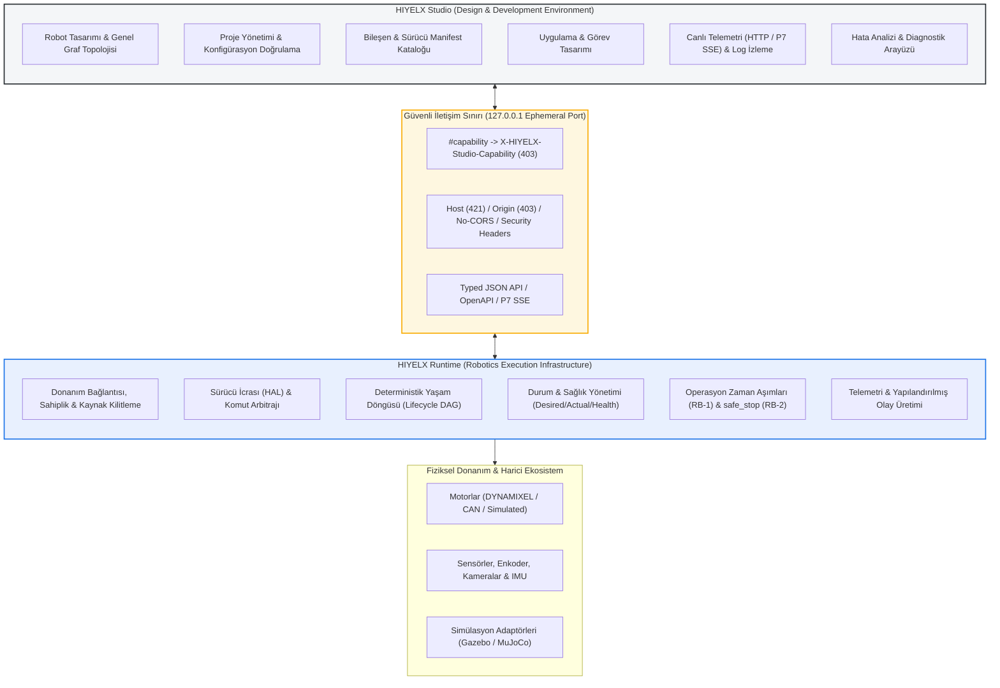
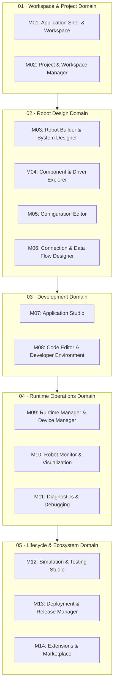
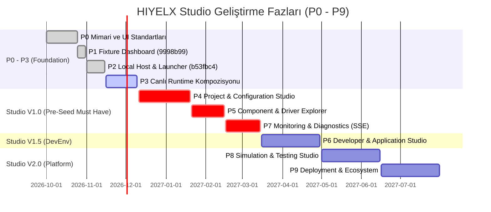

# HIYELX Studio — Kapsamlı Ürün Mimarisi ve Geliştirme Yol Haritası (P0–P9)
**Belge Kodu: HIYELX-PLAN-STUDIO-V1.1**  
**Sınıflandırma: Core Developer Platform & Robotics Development Environment (RDE) Roadmap**  
**Hedef Sürümler: Studio V0.1 (Visual Foundation: P1–P3) → V1.0 (Robotics IDE: P4, P5, P7) → V1.5 (P6) → V2.0 (P8, P9)**  
**Normatif Referanslar:** [`ADR 0002 v1.1`](../decisions/0002-studio-software-stack-and-architecture.md) · [`Studio Engineering Specification v1.1`](../architecture/studio-engineering-specification.md)

---

## 1. Yönetici Özeti ve Temel Ürün Vizyonu

HIYELX Studio; yalnızca basit bir robot izleme göstergesi veya telemetri paneli değildir. Studio, robotik sistemlerin sıfırdan tasarlandığı, konfigüre edildiği, geliştirildiği, simüle edilip test edildiği, çalıştırıldığı ve gözlemlendiği merkezi bir **Robotics Development Environment (RDE)** olarak konumlandırılmıştır.

* **HIYELX Studio:** Ekosistemin geliştiriciye bakan yüzüdür. Robot mimarisi, konfigürasyonu, uygulama kodu, görsel topoloji ve sistem teşhisi Studio üzerinde yürütülür.
* **HIYELX Runtime:** Arka plandaki yetkili yürütme (execution) altyapısıdır. Donanıma bağlanır, sürücüleri koşturur, cihaz sahipliğini, kaynak kilitlemeyi, komut arbitrajını, yaşam döngüsünü ve en iyi çaba (best-effort) güvenli duruşu (`safe_stop`) yönetir.

### 1.1. Beş Temel Ürün Prensibi
1. **Visual-first:** Robotik sistemler yalnızca metin tabanlı konfigürasyonlarla değil; görsel düğümler (nodes), bağlantılar ve akış şemalarıyla tasarlanabilir.
2. **Developer-first:** Profesyonel robotik mühendislerinin ihtiyaç duyduğu kod navigasyonu, Monaco editörü, entegre terminal ve hata ayıklama araçlarını sunar.
3. **Runtime-connected:** Tüm gerçek durum verisi ve eylemler Runtime Core üzerinden yürütülür; sahte veya fikstür durumları ile fiziksel/canlı gerçeklik asla karıştırılmaz.
4. **Extensible:** Standart manifest (`hiyelx.manifest.yaml`) sayesinde yeni bileşen, donanım sürücüsü ve robotik servis eklemek çekirdek mimariyi bozmaz.
5. **Local-first & Air-gapped:** Tamamen kullanıcının yerel iş istasyonunda çalışır; internet, bulut veya Supabase bağımlılığı yoktur.

---

## 2. Studio ve Runtime Arasındaki Mimari Sınır



### 2.1. Sorumluluk Matrisi
| Sorumluluk Alanı | Studio | Runtime | Sınır İlkesi |
|---|---|---|---|
| **Proje & Robot Tasarımı** | Sahip | - | Studio `hiyelx.project.yaml` ve `robot/robot.yaml` üretir. |
| **Konfigürasyon Düzenleme** | Sahip | Doğrular & Uygular | Studio tipli sözleşmeyle doğrular; Runtime çalışma anında uygular. |
| **Sürücü Geliştirme** | Şablon & Manifest | Sürücüyü çalıştırır | Studio şablon açar ve uyumluluk denetler; Runtime donanıma bağlar. |
| **Donanım Erişimi (USB/Serial/CAN)** | **Erişemez** | **Tek Yetkili** | **Studio asla fiziksel portlara doğrudan dokunmaz.** |
| **Eşzamanlılık & Arbitraj** | - | Sahip | Runtime cihaz sahipliği, kilit, komut sırası ve zaman aşımını yönetir. |
| **Bileşen İcrası (Execution)** | - | Sahip | Runtime yaşam döngüsünü (`STARTING` → `RUNNING`) yönetir. |
| **Uygulama Tasarımı** | Tasarlar | Çalıştırır | Studio iş akışını tasarlar; yürütme Runtime sorumluluğundadır. |
| **Simülasyon Tasarımı** | Senaryo tasarlar | Adaptör sağlar | Simülatörler Studio'ya gömülmez; adaptör katmanıyla bağlanır. |
| **Canlı İzleme & Teşhis** | Görselleştirir | Veri üretir | Runtime telemetri/olay üretir; Studio render eder. |

---

## 3. Sistem Mimarisi: 5 Fonksiyonel Domain ve 14 Modül

14 modül bağımsız ürün siloları değil, ADR 0002 v1.1'de tanımlanan 5 ortak platform servisini paylaşan 5 fonksiyonel domain alanıdır:



### 3.1. Domain ve Modül Detayları

#### Domain 01 · Workspace & Project Domain
* **MODULE 01 — Application Shell & Workspace (V0.1 Foundation / Platform Servisi):** Ana uygulama iskeleti, Command Palette, panel yöneticisi, sekmeler, bildirimler, tema ve yerleşim kalıcılığı.
* **MODULE 02 — Project & Workspace Manager (V1.0 Core / P4):** Yerel dosya sistemi üzerindeki standart robot projesini, `hiyelx.project.yaml` meta verisini, şema sürümlemesini ve açık (opt-in) migration akışlarını yönetir.
  ```text
  my-robot/
  ├── hiyelx.project.yaml     # Studio Project Model (schema_version: "1")
  ├── robot/
  │   ├── robot.yaml          # Robot Configuration Model (schema_version: "2")
  │   ├── components/         # Özel bileşen tanımları ve manifestleri
  │   └── connections/        # Veri akış ve görsel tuval yerleşim meta verisi
  ├── applications/
  │   ├── main.yaml
  │   └── tasks/
  ├── configs/                # Ortam profilleri (dev, sim, bench)
  ├── assets/
  │   ├── meshes/
  │   └── models/
  ├── tests/                  # Proje doğrulama testleri
  └── README.md
  ```

#### Domain 02 · Robot Design Domain
* **MODULE 03 — Robot Builder & System Designer (V1.0 Core / P4):** Robotun yapısal mimarisini React Flow üzerinde **genel graf (non-DAG)** modeliyle tasarlar; kapalı geri besleme döngülerini destekler. ELK.js yalnızca otomatik yerleşim algoritmasıdır; yaşam döngüsü `Dependency` (`depends_on`) kenarları Runtime için ayrı DAG doğrulamasından geçer.
* **MODULE 04 — Component & Driver Explorer (V1.0 Core / P5):** Kurulu bileşenleri ve sürücüleri `hiyelx.manifest.yaml` üzerinden listeler; yetenek (`ComponentCapability`), bağımlılık çözümleme ve uyumluluk matrisi sunar.
* **MODULE 05 — Configuration Editor (V1.0 Core / P4):** Görsel form ↔ Monaco YAML çift yönlü senkronizasyonu, fail-closed `RobotConfig` v2 şema doğrulaması, opt-in migration, diff ve YAML round-trip koruması.
* **MODULE 06 — Connection & Data Flow Designer (V1.5 Expansion):** M03'ten ayrı görünüm olarak `Data`, `Command`, `Feedback` ve `Dependency` kenar tiplerini, konu/arayüz eşlemelerini ve canlı frekans/gecikme katmanlarını yönetir.

#### Domain 03 · Development Domain
* **MODULE 07 — Application Studio (V1.5 Expansion / P6):** Çoklu bileşenli robotik iş akışlarını tasarlar. Workflow yürütme motoru Studio'nun değil Runtime'ın sorumluluğundadır.
* **MODULE 08 — Code Editor & Developer Environment (V1.5 Expansion / P6):** Monaco tabanlı kod düzenleme, LSP/formatter/linter/DAP entegrasyonu ve kullanıcı onaylı, eklentilere kapalı, yetki sınırlı entegre terminal.

#### Domain 04 · Runtime Operations Domain
* **MODULE 09 — Runtime Manager & Device Manager (V0.1 Core / P2–P3):** Runtime oturum keşfi, süreç/oturum sahipliği, bağımsız yaşam döngüsü ve cihaz port durumları (`Disconnected`, `Connecting`, `Connected`, `Degraded`, `Unavailable`).
* **MODULE 10 — Robot Monitor & Visualization (V1.0 Core / P7):** P2–P3'te HTTP/JSON single-flight izleme; P7'de SSE telemetri akışı (`timestamp`, `sequence_number`, `sampling_rate`, `buffer_limit`, `backpressure`, `reconnection`, `missing_data_handling`) ve ECharts/2D topoloji. 3D URDF görünümü V1.5+/V2.0'a ertelenmiştir.
* **MODULE 11 — Diagnostics & Debugging (V1.0 Core / P7):** Yapılandırılmış loglar, `Correlation-ID` takibi, hata taksonomisi ve kök neden analiz kartları.

#### Domain 05 · Lifecycle & Ecosystem Domain
* **MODULE 12 — Simulation & Testing Studio (V2.0 / P8):** Gazebo/MuJoCo'yu Studio'ya gömmeden simülasyon adaptör katmanı üzerinden senaryo testleri.
* **MODULE 13 — Deployment & Release Manager (V2.0 / P9):** Artifact paketleme, sürüm manifesti, dağıtım doğrulaması ve geri alma (rollback).
* **MODULE 14 — Extensions, SDK & Marketplace (V2.0 / P9):** İmzalı eklenti paketleri, sürümleme, yetenek tabanlı izinler ve uyumluluk denetimi.

---

## 4. Yazılım Yığını (ADR 0002 v1.1 ile Senkronize)

| Katman | Seçilen Teknoloji | Seçim Gerekçesi ve Sınır |
|---|---|---|
| **Masaüstü Kabuğu** | **Tauri 2 (Rust)** | Sistem WebView ile daha hafif dağıtım hedefler; bellek, açılış süresi ve paket boyutu release benchmark'larıyla doğrulanır. Runtime Host ayrı süreçtir. |
| **Frontend Çatısı** | **React 18+ / TypeScript (Strict)** | Bileşen tabanlı modüler UI, sıfır `any` disiplini. |
| **Derleme & Paketleme** | **Vite** | Hızlı HMR ve optimize edilmiş bundle üretimi. |
| **Durum Yönetimi** | **Zustand + TanStack Query** | **Zustand:** yalnızca geçici UI/editör durumu (proje verisinin kalıcı kaynağı dosya sistemidir). **TanStack Query:** Runtime API durum önbelleği. |
| **Görsel Tuval / Graph** | **React Flow / xyflow + ELK.js** | Genel graf (non-DAG) veri modeli; ELK.js yalnızca otomatik görsel yerleşim içindir. |
| **3D Görselleştirme** | **Three.js (Ertelendi)** | İlk sürümlerde zorunlu değildir; V1.5+/V2.0 aşamasına bırakılmıştır. |
| **Kod & YAML Editörü** | **Monaco Editor** | YAML/JSON düzenleme ve şema doğrulama; LSP/linter/DAP P6 kapsamındadır. |
| **Grafik & Telemetri** | **Apache ECharts** | Yüksek frekanslı motor ve sensör zaman serisi. |
| **Tasarım Sistemi** | **Tailwind CSS + Radix UI + Lucide** | Erişilebilir primitifler, karanlık tema öncelikli endüstriyel dil. |
| **Veri Doğrulama** | **Zod + Pydantic v2** | Fail-closed çalışma anı doğrulaması ve OpenAPI tipli istemci uyumu. |
| **Test Çerçevesi** | **Vitest + Testing Library + Playwright** | Birim, bileşen ve E2E testleri; Python tarafında `ruff`, `pyright`, `pytest`. |

---

## 5. Frontend Katmanlı Mimarisi ve Dizin Yapısı

Kabul edilmiş P1/P2 statik varlıkları (`studio/`) korunarak, P4+ masaüstü uygulaması ortak platform servislerini merkeze alan katmanlı bir çalışma alanında konumlandırılır:

```text
studio/                           # Korunan P1/P2/P3 statik ve canlı web varlıkları (wheel-packaged)
studio-app/                       # P4+ Tauri 2 + React + Vite RDE uygulaması
├── apps/
│   └── desktop/                  # Tauri 2 masaüstü kabuğu
│       ├── src/
│       │   ├── app/              # Router, Provider'lar ve ana layout
│       │   └── main.tsx
│       └── src-tauri/            # Rust masaüstü kabuğu (workspace FS & controlled process spawn)
│
├── packages/                     # 5 Ortak Platform Servisi + UI
│   ├── ui/                       # Radix UI + Tailwind ortak tasarım bileşenleri
│   ├── project-engine/           # Project Model Engine (hiyelx.project.yaml & FS)
│   ├── manifest-engine/          # Component Manifest Engine (hiyelx.manifest.yaml & uyumluluk)
│   ├── graph-engine/             # Genel graf motoru (non-DAG) + ELK.js layout + depends_on DAG kontrolü
│   ├── config-engine/            # RobotConfig v2 doğrulama, YAML round-trip, diff & migration
│   ├── api-client/               # OpenAPI tipli HTTP + P7 SSE istemcisi & capability yönetimi
│   ├── code-editor/              # Monaco entegrasyonu
│   └── telemetry/                # ECharts zaman serisi ve halka tampon bileşenleri
│
├── features/                     # 5 Domain altındaki 14 modül görünümü
│   ├── shell/                    # M01: Application Shell & Command Palette
│   ├── projects/                 # M02: Project & Workspace Manager
│   ├── robot-builder/            # M03: Visual Robot Builder
│   ├── explorer/                 # M04: Component & Driver Explorer
│   ├── configuration/            # M05: Configuration Editor (Form + Monaco YAML)
│   ├── data-flow/                # M06: Connection & Data Flow Designer
│   ├── runtime-manager/          # M09: Runtime & Device Manager
│   ├── monitor/                  # M10: Live Monitor & Telemetry
│   └── diagnostics/              # M11: Logs, Faults & Diagnostics
│
└── tests/
    ├── unit/                     # Vitest birim testleri
    ├── component/                # Testing Library bileşen testleri
    └── e2e/                      # Playwright uçtan uca testleri
```

---

## 6. Geliştirme Yol Haritası ve Öncelik Sırası (P0 – P9)

Faz numaraları korunur; Pre-Seed V1.0 önceliği gereği **P7, P6'dan önce** uygulanır:



### 6.1. Faz İş Paketleri Dağılımı

#### PHASE P0 — Architecture & Foundation (Tamamlandı)
* Domain modelleri, Studio/Runtime sınır sözleşmesi, 4 katmanlı veri sahipliği, güvenlik spesifikasyonu ve kalite kapıları.

#### PHASE P1 — Fixture-based Studio (Kabul Edildi — Commit `9998b99`)
* 11 durumlu statik UI dashboard'u (`studio/index.html`, `studio/studio.css`, `studio/fixtures.js`, `studio/app.js`).
* `tests/studio/test_p1_preservation.py` ile byte-byte SHA-256 korumasındadır.

#### PHASE P2 — Local Runtime Host & Launcher (Kabul Edildi — Commit `b53fbc4`)
* `127.0.0.1` ephemeral port dinleyen `StudioHost` (`src/hiyelx/studio/host.py`), fragment-to-memory capability akışı (`#capability=` → `X-HIYELX-Studio-Capability`), `421`/`403`/`405` güvenlik kontrolleri, `hiyelx studio` foreground launcher (`src/hiyelx/studio/launcher.py`), wheel içi paketlenmiş varlıklar ve DOM-bağımsız `studio/host-client.js`.
* Kapsam: `/api/v1/meta`, `/api/v1/sessions`, `/api/v1/sessions/{session}/preview`.

#### PHASE P3 — Live Runtime Composition (Aktif Faz — P4 Öncesi Zorunlu Kapı)
* Detaylı teknik tasarım ve Codex görevleri: [`docs/architecture/studio-p3-live-composition.md`](../architecture/studio-p3-live-composition.md).
* İş paketleri:
  * `P3.01:` P1 varlıklarını byte-byte koruyan ayrı canlı giriş kompozisyonu (`/live` + `studio/live.html` + `studio/live-app.js`).
  * `P3.02:` `StudioHost` / `launcher` / `pyproject.toml` canlı rota ve wheel paketleme entegrasyonu.
  * `P3.03:` Salt-okunur Runtime paket/sağlık/bileşen keşif sözleşmesi (`/api/v1/runtime/info` veya eşdeğer v1 uyumlu uç).
  * `P3.04:` Canlı DOM adaptöründe tüm degraded/error durumlarının (`no_sessions`, `stale`, `unavailable`, `schema_unsupported`, `host_disconnected`, `capability_error`) fikstür karışması olmadan bağlanması.
  * `P3.05:` Kurulu (non-editable) wheel ile uçtan uca canlı entegrasyon ve P1/P2 regresyon kabul testi.

#### PHASE P4 — Project & Configuration Studio (V1.0 Milestone)
* Detaylı teknik tasarım ve Codex görevleri: [`docs/architecture/studio-p4-project-and-config-studio.md`](../architecture/studio-p4-project-and-config-studio.md).
* İş paketleri:
  * `P4.01:` `hiyelx.project.yaml` (v1) domain modeli, şema sürümleme, güvenli çalışma alanı FS servisi ve şablonlar.
  * `P4.02:` Genel robot grafı (non-DAG) veri modeli + yaşam döngüsü `depends_on` DAG doğrulayıcı + `RobotConfig` v2 eşleme.
  * `P4.03:` YAML round-trip koruyucu serileştirme, fail-closed doğrulama ve diff motoru.
  * `P4.04:` Tauri 2 + React + Vite uygulama iskeleti (`studio-app/`) ve M01/M02 proje gezgini.
  * `P4.05:` React Flow + ELK.js temel Robot Builder tuvali (M03).
  * `P4.06:` Monaco YAML editörü + görsel form çift yönlü senkronizasyon (M05).
  * `P4.07:` P4 E2E ve kabul testi paketi.

#### PHASE P5 — Component & Driver Ecosystem (V1.0 Milestone)
* `P5.01:` `hiyelx.manifest.yaml` (v1.0) ayrıştırıcı ve şema doğrulayıcı.
* `P5.02:` Component & Driver Explorer (M04), `ComponentCapability` filtreleme.
* `P5.03:` Bağımlılık çözümleme ve Runtime sürüm uyumluluk denetçisi (Compatibility Checker).
* `P5.04:` Mevcut `hiyelx scaffold motor-driver` akışıyla uyumlu sürücü şablon görüntüleyici.

#### PHASE P7 — Monitoring, Diagnostics & Visualization (V1.0 Milestone — P6'dan Önce)
* `P7.01:` Kontrollü SSE telemetri akışı (`timestamp`, `sequence_number`, `sampling_rate`, `buffer_limit`, `backpressure`, `missing_data_handling`).
* `P7.02:` ECharts canlı telemetri paneli ve 2D topoloji görünümü (M10).
* `P7.03:` Yapılandırılmış log izleyici, `Correlation-ID` takibi ve hata taksonomisi / kök neden kartları (M11).
* `P7.04:` Olay zaman tüneli ve yeniden bağlanma (`stale` → `fresh`) kabul testleri.

#### PHASE P6 — Developer & Application Studio (V1.5 Milestone — V1.0 Sonrası)
* `P6.01:` Monaco tam kod editörü + LSP, formatter, linter entegrasyonu (M08).
* `P6.02:` Kullanıcı onaylı, yetki sınırlı, eklentilere kapalı entegre terminal.
* `P6.03:` Robotik iş akışı tasarımcısı (M07 — icra Runtime sorumluluğunda).
* `P6.04:` Debug Adapter Protocol (DAP) entegrasyonu ve M06 canlı veri akış katmanı.

#### PHASE P8 — Simulation & Testing Studio (V2.0 Milestone)
* `P8.01:` Simülasyon adaptör arayüzü (Gazebo / MuJoCo Studio'ya gömülmeden).
* `P8.02:` Senaryo tasarımcısı ve otomatik regresyon test koşucusu.
* `P8.03:` Three.js tabanlı 3D URDF ve TF ağacı görselleştirmesi.

#### PHASE P9 — Deployment, Extensions & Ecosystem (V2.0 Milestone)
* `P9.01:` Paket derleyici, sürüm manifesti ve dağıtım doğrulaması (M13).
* `P9.02:` Yerel hedef cihaza dağıtım ve geri alma (rollback).
* `P9.03:` İmzalı eklenti paketleri, izin modeli ve pazaryeri (M14).

---

## 7. Pre-Seed V1.0 Ürün Hedefi ve Kabul Kriteri (Must Have)

Pre-Seed V1.0 hedefi, bir geliştiricinin tek bir uçtan uca akışla gerçek bir robot projesini Studio'da oluşturup Runtime üzerinden canlı gözlemleyebilmesidir:

1. **Yeni robot projesi oluşturma** (`hiyelx.project.yaml` + `robot/robot.yaml` — P4 / M02).
2. **Bileşen ve sürücü ekleme** (`hiyelx.manifest.yaml` uyumluluk kontrolüyle — P5 / M04).
3. **Bileşen bağlantılarını görsel olarak tanımlama** (genel graf tuvali + `depends_on` DAG denetimi — P4 / M03).
4. **Konfigürasyonu fail-closed doğrulama** (iki yönlü görsel/YAML + diff — P4 / M05).
5. **Gerçek Runtime'a bağlanıp sağlık, log ve canlı telemetri verilerini izleme** (P3 HTTP + P7 SSE — M09/M10/M11).

---

## 8. Kalite Güvencesi, 7 Test Kapısı ve 10 Kritik Senaryo

### 8.1. 7 Kategorili Test Kapısı (ADR 0002 v1.1)
| Kategori | Sorumluluk |
|---|---|
| **Unit** | Domain modelleri, graf/DAG doğrulama, YAML/manifest ayrıştırma |
| **Component** | UI bileşenleri ve erişilebilirlik |
| **Contract** | Studio–Runtime OpenAPI / Pydantic / Zod sözleşmeleri ve hata üçlüleri |
| **Integration** | Gerçek Runtime Host bağlantısı ve kurulu wheel izolasyonu |
| **E2E** | Uçtan uca kullanıcı iş akışları |
| **Security** | Capability token, Host (`421`), Origin (`403`), CORS yasağı ve dosya sistemi sınırları |
| **Regression** | Kabul edilmiş P1 SHA-256 ve P2 güvenlik/transport testlerinin sürekli CI çalışması |

### 8.2. 10 Kritik Dayanıklılık Senaryosu
1. **Bağlantı Öncesi:** Runtime çalışmıyorken Studio açıldığında fikstüre düşmeden temiz "Oturum yok / Bağlantı bekleniyor" durumuna geçmesi.
2. **Bağlantı Kopması:** Runtime süreci aniden sonlandırıldığında arayüzün kilitlenmeden `stale` → `unavailable` / `host_disconnected` geçişini göstermesi.
3. **Yeniden Başlatma:** Runtime yeniden ayağa kalktığında Studio'nun oturumu kullanıcı verisini bozmadan yeniden algılaması.
4. **Geçersiz Konfigürasyon:** `RobotConfig` v2 şemasına uymayan YAML veya döngüsel `depends_on` girildiğinde satır/alan bazında fail-closed hata vermesi.
5. **Bilinmeyen Bileşen:** Runtime kayıt defterinde olmayan bir bileşen modeli seçildiğinde açık uyumluluk uyarısı üretmesi.
6. **Sürücü Versiyon Uyuşmazlığı:** `runtime.min_version` koşulunu sağlamayan sürücü manifesti için açık uyumluluk reddi göstermesi.
7. **Bozuk Proje Dosyası:** Eksik veya hasarlı `hiyelx.project.yaml` dosyalarında sessiz onarım yapmadan güvenli hata ve kurtarma rehberi göstermesi.
8. **Büyük Robot Grafiği:** 50+ düğümlü genel robot graf tuvalinde sanallaştırma ile akıcı kaydırma ve yakınlaştırma performansı.
9. **Beklenmedik Kapanma:** Studio beklenmedik biçimde kapandığında dosya sistemindeki proje verisinin atomik yazım sayesinde bozulmaması; yalnızca UI yerleşiminin geri yüklenmesi.
10. **Şema Sürüm Uyumsuzluğu:** Desteklenmeyen API veya dosya `schema_version` değerinde sessiz uyarlama yapılmadan `schema_unsupported` (fail-closed) gösterilmesi.
