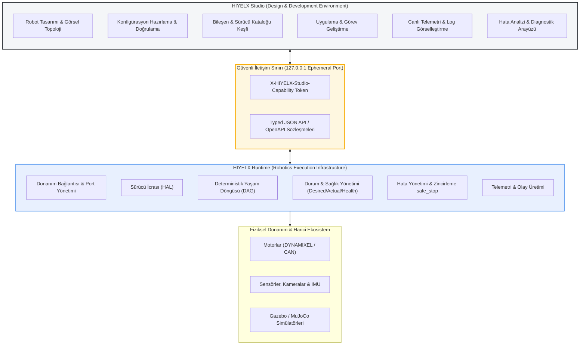
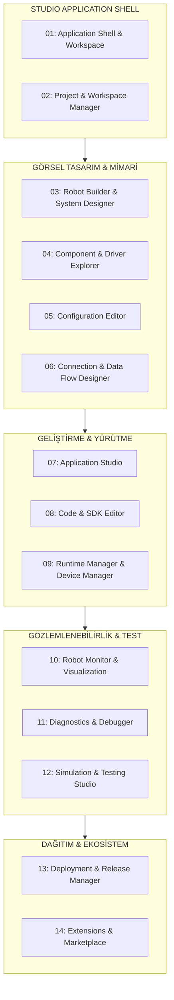
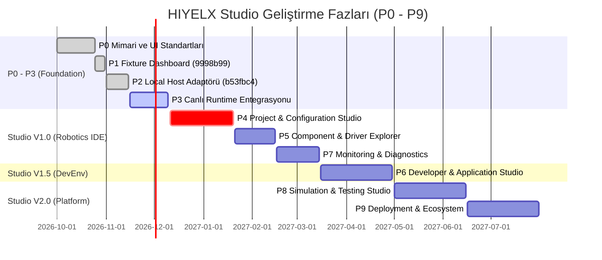

# HIYELX Studio — Kapsamlı Ürün Mimarisi ve Geliştirme Yol Haritası (P0–P9)
**Belge Kodu: HIYELX-PLAN-STUDIO-V1**  
**Sınıflandırma: Core Developer Platform & Robotics Development Environment (RDE) Roadmap**  
**Hedef Sürümler: Studio V0.1 (Visual Foundation) → V1.0 (Robotics IDE) → V1.5 (DevEnv) → V2.0 (Platform)**

---

## 1. Yönetici Özeti ve Temel Ürün Vizyonu

HIYELX Studio; yalnızca basit bir robot izleme göstergesi veya telemetri paneli değildir. Studio, robotik sistemlerin sıfırdan tasarlandığı, konfigüre edildiği, geliştirildiği, simüle edilip test edildiği, çalıştırıldığı ve gözlemlendiği merkezi bir **Robotics Development Environment (RDE)** olarak konumlandırılmıştır.

* **HIYELX Studio:** Ekosistemin geliştiriciye bakan yüzüdür. Robot mimarisi, konfigürasyonu, uygulama kodu, görsel topoloji ve sistem teşhisi Studio üzerinde yürütülür.
* **HIYELX Runtime:** Arka plandaki yetkili yürütme (execution) altyapısıdır. Donanıma bağlanır, sürücüleri koşturur, yaşam döngüsünü ve güvenli duruşu (`safe_stop`) yönetir.

### 1.1. Beş Temel Ürün Prensibi
1. **Visual-first:** Robotik sistemler yalnızca metin tabanlı konfigürasyonlarla değil; görsel düğümler (nodes), bağlantılar ve akış şemalarıyla tasarlanabilir.
2. **Developer-first:** Profesyonel robotik mühendislerinin ihtiyaç duyduğu kod navigasyonu, Monaco editörü, entegre terminal ve hata ayıklama araçlarını sunar.
3. **Runtime-connected:** Tüm gerçek durum verisi ve eylemler Runtime Core üzerinden yürütülür; sahte durumlar ile fiziksel gerçeklik asla karıştırılmaz.
4. **Extensible:** Yeni bileşen (component), donanım sürücüsü (driver) ve robotik servis eklemek modülerdir; çekirdek mimariyi bozmaz.
5. **Local-first & Air-gapped:** Tamamen kullanıcının yerel iş istasyonunda çalışır; internet veya harici bulut servislerine bağımlı değildir.

---

## 2. Studio ve Runtime Arasındaki Mimari Sınır



### 2.1. Sorumluluk Matrisi
| Sorumluluk Alanı | Studio | Runtime | Sınır İlkesi |
|---|---|---|---|
| **Robot Tasarımı** | Sahip | - | Studio görsel olarak tasarlar ve `robot.yaml` üretir. |
| **Konfigürasyon Düzenleme** | Sahip | Uygular | Studio doğrular; Runtime çalışma anında uygular. |
| **Sürücü Geliştirme** | Araçları sağlar | Sürücüyü çalıştırır | Studio şablon açar; Runtime donanıma bağlar. |
| **Donanım Erişimi (USB/Serial/CAN)** | **Erişemez** | **Tek Yetkili** | **Studio asla fiziksel portlara doğrudan dokunmaz.** |
| **Bileşen İcrası (Execution)** | - | Sahip | Runtime yaşam döngüsünü (`STARTING` → `RUNNING`) yönetir. |
| **Uygulama Geliştirme** | Sahip | Çalıştırır | Studio iş akışını tasarlar; Runtime yürütür. |
| **Simülasyon Tasarımı** | Sahip | Adaptör sağlar | Studio senaryo hazırlar; Runtime simülatöre bağlanır. |
| **Canlı İzleme** | Görselleştirir | Veri üretir | Runtime telemetri yayar; Studio render eder. |
| **Hata Yönetimi (Faults)** | Görselleştirir | Yönetir | Runtime `safe_stop` tetikler; Studio teşhisi gösterir. |

---

## 3. Sistem Mimarisi: 14 Ana Fonksiyonel Modül



### 3.1. Modül Detayları ve Teslimat Kapsamı

#### MODULE 01 — Application Shell & Workspace (V0.1 Foundation)
* **Görevi:** Ana uygulama iskeleti, sayfa geçişleri, panel düzeni, global komut paleti (Command Palette), bildirimler, tema ve klavye kısayolları.
* **Alt Modüller:** `ApplicationShell`, `NavigationManager`, `WorkspaceManager`, `PanelManager`, `TabManager`, `CommandPalette`, `NotificationCenter`, `SettingsManager`, `ThemeManager`, `ShortcutManager`, `LayoutPersistence`.
* **Ekran Düzeni:**
  - Sol Sidebar: Modül Gezgini (Overview, Projects, Robots, Components, Applications, Runtime, Monitor, Diagnostics, Simulation, Extensions).
  - Orta Çalışma Alanı: Aktif Editör / Tuval / Dashboard.
  - Sağ Panel: Inspector & Özellikler.
  - Alt Panel: Terminal, Loglar, Problemler, Teşhis.

#### MODULE 02 — Project & Workspace Manager (V1.0 Core)
* **Görevi:** Robotik projelerin yerel dosya sisteminde organize edilmesi, çoklu proje desteği, şablonlar, versiyonlama ve Git entegrasyonu.
* **Standart Proje Ağacı (`my-robot-project/`):**
  ```text
  my-robot-project/
  ├── project.yaml            # Proje tanımı ve profil ayarları
  ├── robots/                 # robot.yaml ve mobil/kol varyantları
  ├── configurations/         # development.yaml, production.yaml
  ├── components/             # Özel bileşen kodları
  ├── drivers/                # Özel donanım sürücüleri
  ├── applications/           # Görev ve navigasyon uygulamaları
  ├── tests/                  # Doğrulama testleri
  ├── simulations/            # Simülasyon dünyaları ve SDF/URDF modelleri
  └── assets/                 # Mesh, 3D modeller ve şemalar
  ```

#### MODULE 03 — Robot Builder & System Designer (V1.0 - Core Differentiator)
* **Görevi:** Robot mimarisini sürükle-bırak düğümlerle (React Flow) tasarlamak, bileşen bağımlılıklarını ve veri bağlantılarını görselleştirmek.
* **Fonksiyonlar:** Düğüm yerleştirme, port bağlantıları, otomatik hiyerarşik yerleşim (ELK.js), topolojik döngü denetimi, iki yönlü `robot.yaml` senkronizasyonu.

#### MODULE 04 — Component & Driver Explorer (V1.0 Core)
* **Görevi:** Kullanılabilir donanım sürücülerini (`motor.dynamixel.xl430`, `motor.simulated`), sensörleri ve servisleri listeleme, inceleme ve uyumluluk denetimi.
* **Bileşen Detayı:** Desteklenen kabiliyetler (`CAN_SET_VELOCITY`, `CAN_STREAM_FRAMES`), gereksinimler, konfigürasyon parametreleri, teşhis kontrolleri.

#### MODULE 05 — Configuration Editor (V1.0 Core)
* **Görevi:** Robot konfigürasyonunun görsel form tabanlı veya doğrudan Monaco YAML editörü üzerinden düzenlenmesi.
* **Özellikler:** Çift yönlü eşitleme (Form ↔ YAML), Pydantic tabanlı fail-closed şema denetimi, konfigürasyon farkı (diff) görüntüleme, ortam profilleri.

#### MODULE 06 — Connection & Data Flow Designer (V1.5 Expansion)
* **Görevi:** Bileşenler arasındaki veri akışını, pub/sub konularını ve mesaj boru hatlarını görselleştirme.
* **Çalışma Modları:** Design Mode (bağlantı tasarımı) ve Live Mode (canlı mesaj frekansı ve gecikme takibi).

#### MODULE 07 — Application Studio (V1.5 Expansion)
* **Görevi:** Çoklu bileşeni koşturan robotik iş akışlarını tasarlama (Pick & Place, Otonom Keşif, Nesne Takibi).
* **Mimari Kural:** Studio iş akışını tasarlar; icra Runtime `ExecutionManager` tarafından gerçekleştirilir.

#### MODULE 08 — Code Editor & Developer Environment (V1.5 Expansion)
* **Görevi:** Monaco editörü, sözdizimi vurgulama, Python/C++/Rust desteği, entegre terminal ve hata ayıklama adaptörü (DAP).

#### MODULE 09 — Runtime Manager & Device Manager (V0.1 Core)
* **Görevi:** Yerel Runtime oturumunu keşfetme, bağlanma, başlatma/durdurma (`start`/`stop`), tek sahipli oturum denetimi ve fiziksel cihaz port durumları.
* **Bağlantı Durumları:** `Disconnected`, `Connecting`, `Connected`, `Degraded`, `Unavailable`.

#### MODULE 10 — Robot Monitor & Visualization (V1.0 Core)
* **Görevi:** Çalışan robotun canlı telemetri verilerini gösterme (motor hızları, enkoder açıları, sensör değerleri, sağlık durumu).
* **Görselleştirme:** 2D metrik kartları ve ECharts grafikleri (V1.0); 3D URDF / TF ağacı ve kamera akışı (V1.5+).

#### MODULE 11 — Diagnostics & Debugging (V1.0 Core)
* **Görevi:** Sistemdeki problemleri, logları, uyarıları ve hata sınıflandırmalarını görüntüleme; kök neden analizi sunma.
* **Örnek Hata:** `CAMERA_CONNECTION_FAILED` -> Cihaz koptu / İzin hatası / Sürücü başlatılamadı.

#### MODULE 12 — Simulation & Testing Studio (V2.0 Advanced)
* **Görevi:** Sanal robot modeli ve simülatör adaptörleri (Gazebo, MuJoCo) üzerinden test senaryoları koşturma ve regresyon raporlama.

#### MODULE 13 — Deployment & Release Manager (V2.0 Advanced)
* **Görevi:** Robotik projeyi derleme, wheel ve konfigürasyon paketi üretme, hedef robota yerel dağıtım ve geri alma (rollback).

#### MODULE 14 — Extensions, SDK & Marketplace (V2.0 Ecosystem)
* **Görevi:** Üçüncü taraf sürücü, bileşen ve uygulama eklentilerini keşfetme, kurma ve yayınlama platformu.

---

## 4. Yazılım Yığını (Recommended Studio Technology Stack)

| Katman | Seçilen Teknoloji | Seçim Gerekçesi ve Rolü |
|---|---|---|
| **Masaüstü Kabuğu** | **Tauri 2 (Rust)** | Düşük bellek (RAM) ayak izi, yerel dosya sistemi erişimi, güvenli süreç yönetimi. |
| **Frontend Çatısı** | **React 18+** | Bileşen tabanlı geniş ekosistem, zengin açık kaynak grafik kütüphaneleri. |
| **Programlama Dili** | **TypeScript (Strict)** | Uçtan uca tip güvenliği, arayüz-sözleşme senkronizasyonu. |
| **Derleme & Paketleme** | **Vite** | Hızlı geliştirme sunucusu (HMR) ve optimize edilmiş masaüstü bundle üretimi. |
| **Durum Yönetimi** | **Zustand + TanStack Query** | Yerel arayüz ve proje durumu için Zustand; Runtime API senkronizasyonu için TanStack Query. |
| **Görsel Tuval / Graph** | **React Flow / xyflow + ELK.js** | Robot topolojisi ve veri akış diyagramları; otomatik hiyerarşik DAG yerleşimi. |
| **Kod & YAML Editörü** | **Monaco Editor** | Endüstri standardı kod düzenleme, sözdizimi doğrulama ve iki yönlü form senkronizasyonu. |
| **Grafik & Telemetri** | **Apache ECharts** | Yüksek frekanslı motor telemetrisi, akım, hız ve zaman serisi görselleştirme. |
| **Tasarım Sistemi** | **Tailwind CSS + Radix UI** | Erişilebilir primitifler, karanlık tema öncelikli endüstriyel görsel dil. |
| **İkon Sistemi** | **Lucide Icons** | Minimalist ve tutarlı teknik ikon kütüphanesi. |
| **Veri Doğrulama** | **Zod** | Arayüz formları ve proje şemaları için fail-closed çalışma anı doğrulaması. |
| **Test Çerçevesi** | **Vitest + Playwright** | Hızlı birim testleri (Vitest) ve uçtan uca tarayıcı testleri (Playwright). |

---

## 5. Frontend Katmanlı Mimarisi ve Dizin Yapısı

```text
hiyelx-studio/
├── apps/
│   └── desktop/                  # Tauri 2 masaüstü kabuğu
│       ├── src/
│       │   ├── app/              # Router, Provider'lar ve ana layout
│       │   └── main.tsx
│       └── src-tauri/            # Rust masaüstü backend'i
│
├── packages/
│   ├── ui/                       # Radix UI + Tailwind ortak tasarım bileşenleri
│   ├── api-client/               # Runtime OpenAPI'den üretilen tipli istemci
│   ├── contracts/                # Paylaşılan veri modelleri ve Zod şemaları
│   ├── graph-engine/             # React Flow + ELK.js DAG motoru
│   ├── code-editor/              # Monaco entegrasyonu ve YAML senkronizasyonu
│   └── telemetry/                # ECharts zaman serisi grafik bileşenleri
│
├── features/                     # Modüler fonksiyonel alanlar
│   ├── shell/                    # Modül 01: Application Shell & Navigasyon
│   ├── projects/                 # Modül 02: Proje & Çalışma Alanı Gezgini
│   ├── robot-builder/            # Modül 03: Görsel Robot Tasarımcısı
│   ├── explorer/                 # Modül 04: Bileşen & Sürücü Kataloğu
│   ├── configuration/            # Modül 05: Konfigürasyon & Monaco YAML Editörü
│   ├── runtime-manager/          # Modül 09: Oturum Keşfi & Cihaz Yönetimi
│   ├── monitor/                  # Modül 10: Canlı Telemetri & 2D/3D İzleme
│   └── diagnostics/              # Modül 11: Log, Teşhis & Olay Zaman Tüneli
│
├── tests/
│   ├── unit/                     # Vitest birim testleri
│   └── e2e/                      # Playwright arayüz testleri
└── vite.config.ts
```

---

## 6. Geliştirme Yol Haritası: P0 – P9 Fazları



### 6.1. Faz İş Paketleri Dağılımı

#### PHASE P0 — Architecture & Foundation (Tamamlandı)
* **P0.01:** Ürün kapsamı ve RDE vizyonu.
* **P0.02:** Studio / Runtime sınır ve sorumluluk matrisi.
* **P0.03:** Katmanlı frontend mimarisi ve Tauri 2 masaüstü stratejisi.
* **P0.04:** UI tasarım sistemi ve erişilebilirlik standartları.
* **P0.05:** Durum yönetimi mimarisi (Zustand + TanStack Query ayrımı).
* **P0.06:** API sözleşme standardı ve OpenAPI eşitleme modeli.
* **P0.07:** Proje dosya sistemi ve dizin şeması.
* **P0.08:** Test stratejisi ve CI kalite kapıları.

#### PHASE P1 — Fixture-based Studio (Kabul Edildi - Commit `9998b99`)
* **Teslimat:** 11 durumlu statik UI dashboard'u, hardware/runtime bağımsız görsel doğrulama, responsive kontroller.
* **Kural:** Statik varlıklar (`studio/fixtures.js`, `studio/studio.css`, `studio/app.js`, `studio/index.html`) byte-byte korunmaktadır.

#### PHASE P2 — Local Runtime Host (Kabul Edildi - Commit `b53fbc4`)
* **Teslimat:** `127.0.0.1` ephemeral port dinleyen, URL fragment capability token'ı (`X-HIYELX-Studio-Capability`) zorunlu kılan güvenli salt-okunur API adaptörü (`hiyelx.studio.host`).
* **Kapsam:** `/api/v1/meta`, `/api/v1/sessions`, `/api/v1/preview` endpoint'leri, otomatik tarayıcı açılışı, DNS rebinding koruması.

#### PHASE P3 — Live Runtime Composition (Aktif Faz)
* **İş Paketleri:**
  - `P3.01:` Kurulu Runtime paketi keşfi.
  - `P3.02:` Installed-wheel kompozisyonu.
  - `P3.03:` Runtime yaşam döngüsü entegrasyonu.
  - `P3.04:` Bileşen ve Cihaz kayıt defteri bağlama.
  - `P3.05:` Sağlık durumu ve anlık telemetri akışı.
  - `P3.06:` P1 varlıklarını ezmeden dinamik DOM adaptörüyle canlı veriyi bağlama.
  - `P3.07:` Uçtan uca entegrasyon testleri.

#### PHASE P4 — Project & Configuration Studio (V1.0 Milestone)
* **İş Paketleri:**
  - `P4.01:` Yerel Proje Yöneticisi (`ProjectManager`) ve Proje Gezgini.
  - `P4.02:` Proje şablonları (Mobil Robot, Robot Kol, Sensör Dizisi).
  - `P4.03:` React Flow tabanlı Robot Builder Tuvali (`RobotBuilderCanvas`).
  - `P4.04:` Bileşen yerleştirme ve port bağlantı arayüzü.
  - `P4.05:` Monaco YAML Konfigürasyon Editörü ve görsel form çift yönlü senkronizasyonu.
  - `P4.06:` Fail-closed şema doğrulama ve Diff karşılaştırıcı.
  - `P4.07:` Proje dışa aktarımı (`robot.yaml`).

#### PHASE P5 — Component & Driver Ecosystem (V1.0 Milestone)
* **İş Paketleri:**
  - `P5.01:` Bileşen ve Donanım Sürücüsü Kataloğu (`ComponentExplorer`).
  - `P5.02:` Sürücü manifest inceleyici ve kabiliyet filtreleme (`CAN_SET_VELOCITY`, vb.).
  - `P5.03:` Bağımlılık görselleştirici ve sürüm uyumluluk denetçisi.
  - `P5.04:` Sürücü iskele açma (`scaffold`) ve SDK dokümantasyon görüntüleyici.

#### PHASE P6 — Developer & Application Studio (V1.5 Milestone)
* **İş Paketleri:**
  - `P6.01:` Monaco tabanlı tam kod editörü (Python / YAML / C++ / JSON).
  - `P6.02:` Entegre terminal ve sanal ortam yürütme hattı.
  - `P6.03:` Robotik iş akışı (Workflow) tasarımcısı (Pick & Place, vb.).
  - `P6.04:` Görev icra konfigürasyonu ve geçmişi.
  - `P6.05:` Debug Adapter Protocol (DAP) entegrasyonu.

#### PHASE P7 — Monitoring, Diagnostics & Visualization (V1.0 Milestone)
* **İş Paketleri:**
  - `P7.01:` Canlı Telemetri Paneli (Motor akımı, hız, enkoder pozisyonu, IMU oryantasyonu).
  - `P7.02:` Canlı Log İzleyici (Arama, log seviyesi filtreleme, correlation ID takibi).
  - `P7.03:` Hata Gezgini (`FaultExplorer`) ve kök neden analiz kartları.
  - `P7.04:` Olay Zaman Tüneli (`EventTimeline`).
  - `P7.05:` 2D Robot Topoloji Görselleştirmesi.

#### PHASE P8 — Simulation & Testing Studio (V2.0 Milestone)
* **İş Paketleri:**
  - `P8.01:` Sanal Cihaz Yöneticisi (`VirtualDeviceManager`) ve Mock Bileşenler.
  - `P8.02:` Gazebo / MuJoCo simülatör köprüsü.
  - `P8.03:` Test senaryosu tasarımcısı ve otomatik test koşucusu (`TestRunner`).
  - `P8.04:` Three.js tabanlı 3D URDF ve TF ağacı görselleştirmesi.

#### PHASE P9 — Deployment, Extensions & Ecosystem (V2.0 Milestone)
* **İş Paketleri:**
  - `P9.01:` Paket derleyici (Wheel & Konfigürasyon imajı üretimi).
  - `P9.02:` Yerel hedef cihaza dağıtım profilleri ve dağıtım raporu.
  - `P9.03:` Sürüm yöneticisi ve geri alma (`rollback`) aracı.
  - `P9.04:` Eklenti ve Sürücü Pazaryeri (`Marketplace`).

---

## 7. Pre-Seed Öncelikli İlk 5 Temel Özellik (Must Have Backlog)

HIYELX Studio'nun Pre-Seed aşamasında aşırı mühendislikten kaçınarak güçlü bir ürün kimliği kazanması için aşağıdaki 5 özellik önceliklendirilmiştir:

| Öncelik | Özellik Adı | İlgili Modül | Kullanıcı Değeri ve Somut Çıktı |
|---|---|---|---|
| **01** | **Robot Project Workspace** | Modül 02 | Yerel diskte `my-robot/` proje ağacı açma, kaydetme ve şablonlardan başlatma. |
| **02** | **Visual Robot Builder** | Modül 03 | React Flow tuvalinde Motor, Kamera, Sensör kartlarını sürükleyip bırakarak `robot.yaml` üretme. |
| **03** | **Component & Driver Explorer** | Modül 04 | Mevcut sürücüleri (`motor.dynamixel.xl430`, `motor.simulated`) ve yeteneklerini listeleme. |
| **04** | **Live Runtime Monitor** | Modül 10 | `127.0.0.1` üzerinden çalışan robottan 1 Hz periyotla açısal pozisyon, hız ve sağlık verisi okuma. |
| **05** | **Configuration & Diagnostics** | Modül 05 & 11 | İki yönlü görsel/YAML düzenleme ve hata durumunda olası nedenleri listeleyen hata paneli. |

---

## 8. Kalite Güvencesi ve 10 Kritik Test Senaryosu

Studio arayüzünün endüstriyel dayanıklılığını doğrulamak için aşağıdaki 10 senaryo test otomasyonuna dahil edilmelidir:

1. **Bağlantı Öncesi:** Runtime çalışmıyorken Studio açıldığında temiz "Bağlantı Bekleniyor" durumuna geçmesi.
2. **Bağlantı Kopması:** Robot çalışırken Runtime süreci aniden sonlandırıldığında arayüzün kilitlenmeden "Bağlantı Kesildi / Yeniden Deneniyor" moduna düşmesi.
3. **Yeniden Başlatma:** Runtime yeniden ayağa kalktığında Studio'nun kullanıcı müdahalesi olmadan oturumu yeniden bağlaması.
4. **Geçersiz Konfigürasyon:** Şemaya uymayan bozuk bir YAML dosyası girildiğinde anında satır bazında hata uyarısı vermesi.
5. **Bilinmeyen Bileşen:** Runtime'da kayıtlı olmayan bir bileşen modeli talep edildiğinde uyarı üretmesi.
6. **Sürücü Versiyon Uyuşmazlığı:** Eski veya uyumsuz bir sürücü seçildiğinde görsel uyumluluk uyarısı göstermesi.
7. **Bozuk Proje Dosyası:** Eksik veya hasarlı `project.yaml` dosyalarında güvenli hata yakalama ve kurtarma modu.
8. **Büyük Düğüm Grafiği:** 50+ bileşenli karmaşık bir DAG tuvalinde akıcı 60 FPS kaydırma ve yakınlaştırma performansı.
9. **Beklenmedik Kapanma:** Studio beklenmedik biçimde kapandığında son açık panel ve sekmelerin geri yüklenmesi.
10. **Geriye Dönük Uyumluluk:** Eski Studio sürümünün yeni Runtime API sürümüyle konuşurken anlamlı sürüm uyarısı üretmesi.
