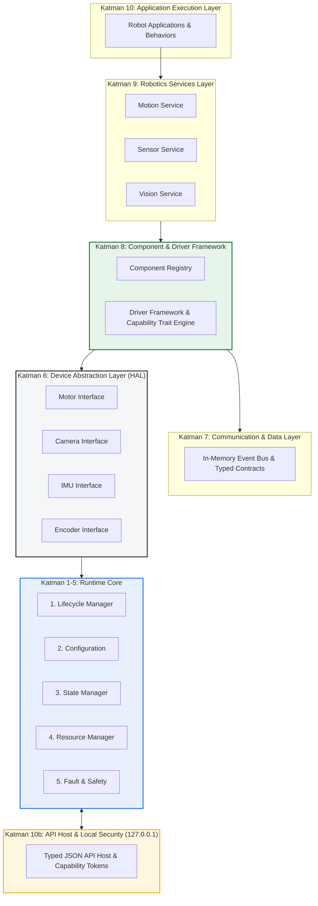
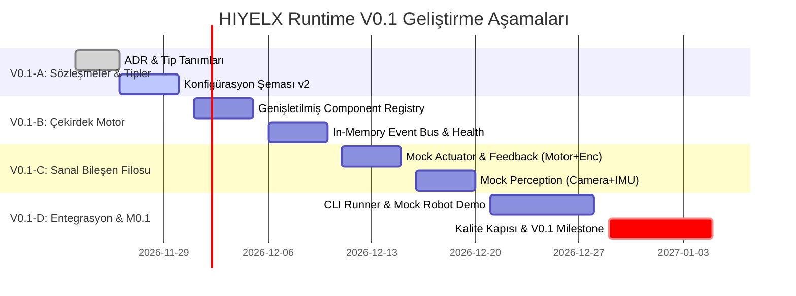

# HIYELX Runtime V0.1 Mühendislik Yol Haritası ve Kapsamlı Mimari İnceleme
**Core Product Development Plan: Foundation MVP (V0.1) → Hardware-Connected Runtime (V1.0) → Execution Platform (V2.0)**

---

## 1. Yönetici Özeti ve Temel Vizyon

HIYELX Runtime; basit bir motor/sensör kontrol kütüphanesi değil, heterojen robotik sistemlerin üzerinde güvenle koşabileceği, yerel-öncelikli (local-first) modüler bir **Robotics Execution Platform** olarak konumlandırılmıştır.

* **Studio:** Geliştiricinin robotu tanımladığı, topolojisini tasarladığı, gözlemlediği ve denetimli kontrol ettiği arayüz katmanıdır.
* **Runtime:** Robotun üzerinde (on-robot / on-edge) çalışan; donanımı soyutlayan, yaşam döngüsünü yöneten, bileşenler arası iletişimi sağlayan ve görevleri icra eden yetkili çekirdektir.

### Temel Mühendislik Tezi
> **"Donanımı değiştir, uygulamayı değil." (Change the hardware, not the application)**
Uygulama kodu belirli bir motor veya sensör markasının SDK'sına değil; HIYELX'in donanımdan bağımsız sözleşmelerine (HAL) bağlanır. Donanım değiştiğinde uygulama kodu değil, yalnızca topoloji konfigürasyonu değişir.

---

## 2. Mevcut Repository Durumu ve Gerçeklik Denetimi (Audit)

HIYELX kod tabanı üzerinde yapılan derinlemesine inceleme sonucunda mevcut durum ve hedeflenen V0.1 mimarisi arasındaki ilişki netleştirilmiştir:

### 2.1. Mevcut Kod Tabanında Tamamlanmış Olanlar (Mevcut Güçlü Temel)
1. **Deterministik Yaşam Döngüsü ve Kaynak Modeli (`hiyelx.resources`):**
   - `ResourceIdentity`, `LifecycleState` (`CREATED`, `STARTING`, `RUNNING`, `STOPPING`, `STOPPED`, `FAILED`), geçiş tablosu ve zaman aşımı politikaları dondurulmuştur.
2. **Model Registry & DAG Tabanlı Başlatma (`hiyelx.runtime.planning`, `hiyelx.runtime.manager`):**
   - Bağımlılık grafiği (DAG) Kahn algoritması ile topolojik olarak sıralanmakta, döngüsel bağımlılıklar reddedilmekte, başlatma hatasında geri alma (rollback) ve ters sırada güvenli kapatma işletilmektedir.
3. **Runtime Operations Alpha (RTO-1..4):**
   - Unix domain soketi üzerinden tek sahipli (single-owner) lokal kontrol, SQLite tabanlı olay geçmişi (`hiyelx.runtime.history`), budama ve süreç sinyalleri (`SIGINT`, `SIGTERM`) test edilmiştir.
4. **Studio P1 & P2 Entegrasyonu:**
   - 11 durumlu statik UI fikstürleri (`studio/`), ephemeral port ve capability token'lı güvenli yerel host adaptörü (`hiyelx.studio.host`), `hiyelx studio` komutu hazırdır.
5. **Modüler Sürücü SDK ve Test Altyapısı:**
   - Harici sürücü iskelesi (`hiyelx scaffold motor-driver`), uyumluluk doğrulayıcısı ve DYNAMIXEL XL430 referans sürücüsü mevcuttur.
   - **829 birim/entegrasyon testi eksiksiz geçmektedir (0 ruff, 0 pyright hatası).**

### 2.2. V0.1 Hedefi için Tespit Edilen Boşluklar (Gap Analysis)
Mevcut kod tabanı son derece sağlam bir çekirdeğe sahip olmakla birlikte, Pre-Seed aşamasında **tekil motor (`Motor`)** odağında geliştirilmiştir. Hedeflenen V0.1 Foundation MVP için şu yapısal genişletmeler gereklidir:

| Alan | Mevcut Durum (Pre-Seed) | Hedeflenen V0.1 Durumu |
|---|---|---|
| **Kaynak / Bileşen Kapsamı** | Yalnızca `Motor` API'si ve gRPC motor servisi | Çoklu bileşen taksonomisi: `Actuator` (Motor), `Vision` (Camera), `Spatial` (IMU), `Feedback` (Encoder) |
| **Konfigürasyon Şeması** | `schema_version: "1"`, düz `resources: list[ResourceDefinition]` | `robot:` metadata ve `components:` listesi içeren zenginleştirilmiş yapı (`robot.yaml`) |
| **Component Registry** | Yalnızca model adı eşleştiren `ModelRegistry` | Tip, kategori, yetenek (capability) ve bağımlılık doğrulayan `ComponentRegistry` |
| **İletişim ve Olaylar** | Yalnızca disk/SQLite RTO olay akışı | Süreç içi tipli olay ve telemetri veri yolu (In-memory typed event dispatcher) |
| **Sanal Filo (Mock Fleet)** | Yalnızca `SimulatedMotor` | 4 çekirdek sanal bileşen: `MockCamera`, `MockMotor`, `MockEncoder`, `MockIMU` |
| **Çalıştırma Deneyimi** | `hiyelx demo sim-motor` | `hiyelx run robot.yaml` ile 4 bileşenli otonom robot çalıştırma ve canlı sağlık özeti |

---

## 3. HIYELX Runtime Master Mimarisi (10 Modül Analizi)



### 3.1. Katmanların Sorumluluk ve Kapsam Matrisi

1. **Katman 1 — Lifecycle Manager:** Runtime'ın ve bileşenlerin deterministik durum makinelerini (`CREATED` → `STARTING` → `RUNNING` → `STOPPING` → `STOPPED` / `FAILED`) yönetir.
2. **Katman 2 — Configuration Manager:** Robotun topolojisini, portlarını, baudrate ve bağımlılıklarını YAML/JSON üzerinden doğrular (`Pydantic v2`).
3. **Katman 3 — State Manager:** Üçlü durum ayrımını korur:
   - **Desired State:** Algoritmanın veya kullanıcının talep ettiği durum.
   - **Actual State:** Sensörden/enkoderden okunan fiziksel durum.
   - **Health State:** Cihazın operasyonel sağlığı (`HEALTHY`, `DEGRADED`, `UNHEALTHY`).
4. **Katman 4 — Resource Manager:** Port, USB yolu, bellek ve sistem tutamaçlarının çakışmasını (`resource conflict`) engeller.
5. **Katman 5 — Fault & Safety Manager:** Hataları yakalar, zincirleme güvenli duruş (`safe_stop`) politikalarını işletir. (Yazılımsal güvenlik en iyi çaba esasıdır, donanımsal E-stop ayrı tutulur).
6. **Katman 6 — Device Abstraction Layer (HAL):** Donanıma özel protokolleri (DYNAMIXEL, V4L2, NMEA) standart Python sözleşmeleri ardına gizler.
7. **Katman 7 — Communication & Data Layer:** Süreç içi tipli mesajlaşma, pub/sub ve olay dağıtımını yürütür.
8. **Katman 8 — Component & Driver Framework:** Bileşenlerin yetenek deklarasyonu (`capabilities`), dinamik kaydı ve fabrika üretimini sağlar.
9. **Katman 9 — Robotics Services Layer:** Alt seviye bileşenleri birleştirerek üst seviye servis sunar (ör. 2 Motor + 2 Enkoder = Diferansiyel Sürüş `MotionService`).
10. **Katman 10 — Application Execution & API Host:** Robot görevlerini koşturur; Studio ve CLI için yerel `127.0.0.1` JSON API sunar.

---

## 4. Ürün Sürüm Kapsam Sınırları (V0.1 vs. V1.0 vs. V2.0)

| Fonksiyon / Yetenek | Runtime V0.1 (Foundation MVP) | Runtime V1.0 (Hardware Alpha) | Runtime V2.0 (Platform) |
|---|---|---|---|
| **Ana Odak** | **Çalışan, test edilebilir Runtime Çekirdeği** | **Gerçek donanıma bağlı çalışan robot** | **Ölçeklenebilir, dağıtık robotik execution** |
| **Bileşen Modelleri** | 4 Mock Cihaz (Motor, Kamera, IMU, Enkoder) | Gerçek DYNAMIXEL Motor + USB Kamera + Seri IMU | Çoklu robot kolları, LiDAR, Derinlik Kameraları |
| **Konfigürasyon** | `robot.yaml` Şeması (Metadata + Bileşenler + Bağımlılıklar) | Doğrulanmış donanım bağlantı ayarları & ortam profilleri | Dağıtık konfigürasyon & dinamik profiller |
| **Bağımlılık Çözümü** | DAG sıralaması, döngü engelleme, sıralı başlatma | Sıralı başlatma + dinamik hazır oluş (readiness probe) | Dinamik servis keşfi ve yeniden yapılandırma |
| **İletişim** | Süreç içi (In-memory) tipli olay dağıtıcı | Süreç içi veri yolu + Studio JSON API bağlantısı | IPC, ROS 2 köprüsü, paylaşımlı bellek (Zero-copy) |
| **Güvenlik & Hata** | Yazılımsal `safe_stop` geri alma, hata sınıflandırma | Donanım kopması algılama + Acil Durdurma UI | Donanımsal safety chain entegrasyonu, Process Isolation |
| **Gözlemlenebilirlik** | Yapılandırılmış loglar, konsol telemetrisi, sağlık raporu | SQLite olay geçmişi, Studio canlı dashboard | Dağıtık OpenTelemetry, metrik dışa aktarımı |
| **Dağıtım** | Python 3.12 wheel, `hiyelx` CLI | Paketlenmiş CLI + Studio yerel başlatıcı | Docker/OCI konteyner, gömülü Linux imajları |

---

## 5. HIYELX Runtime V0.1 Detaylı Mühendislik Yol Haritası

V0.1 sürümünün hedefi: **Fiziksel donanıma ihtiyaç duymadan, 4 bileşenden oluşan bir robotu konfigürasyondan yükleyen, bağımlılık sırasına göre ayağa kaldıran, durumunu doğrulayan ve kontrollü biçimde kapatan eksiksiz bir Runtime Motoru sunmaktır.**



---

### AŞAMA V0.1-A — Sözleşmeler, Tipler ve Mimari Kararlar (Contracts & ADRs)
* **Amaç:** Kod yazımından önce çoklu bileşen tiplerini ve veri modellerini katı tip denetimi altında dondurmak.

| İş Paketi | Sorumluluk / Fonksiyon | Teslimat / Kod Sınırı |
|---|---|---|
| **V0.1-A.1** | Component Base Contract | `Resource` sınıfından türeyen genel `Component` temel arayüzü (`id`, `type`, `capabilities`, `lifecycle`, `health`). | `src/hiyelx/core/component.py` |
| **V0.1-A.2** | Component Category Taxonomy | 4 temel bileşen kategorisi: `ACTUATOR`, `VISION`, `SPATIAL`, `FEEDBACK`. | `src/hiyelx/core/types.py` |
| **V0.1-A.3** | Configuration Schema v2 | `robot:` (id, name, version) + `components:` (id, type, model, settings, depends_on) YAML yapısı. | `src/hiyelx/config/v2/` |
| **V0.1-A.4** | Capability Trait Model | Bileşen kabiliyet bayrakları (`CAN_SET_VELOCITY`, `CAN_STREAM_FRAMES`, `HAS_ORIENTATION_QUATERNION`). | `src/hiyelx/core/capabilities.py` |
| **V0.1-A.5** | ADR-001 | Architecture Decision Record: "Transition from Motor-Centric Resource Core to Heterogeneous Component Architecture". | `docs/decisions/001-heterogeneous-components.md` |

* **Kabul Kriteri:** Pydantic v2 modelleri ile geçersiz veya tipi uyuşmayan konfigürasyonlar compile/load anında reddedilmeli (`pyright` 0 hata).

---

### AŞAMA V0.1-B — Runtime Core Engine Genişletmesi
* **Amaç:** `RuntimeManager`'ı yalnızca motorları değil, farklı kategorideki bileşenleri DAG sırasıyla yönetebilir hale getirmek.

| İş Paketi | Sorumluluk / Fonksiyon | Teslimat / Kod Sınırı |
|---|---|---|
| **V0.1-B.1** | Component Registry | Modelleri kategorilerine göre doğrulayan, dinamik arama ve fabrika sağlayan `ComponentRegistry`. | `src/hiyelx/core/registry.py` |
| **V0.1-B.2** | Heterogeneous Startup Planning | Farklı tiplerdeki bileşenlerin bağımlılık grafiğini (`depends_on`) çözüp sıralayan planlayıcı. | `src/hiyelx/runtime/planning.py` |
| **V0.1-B.3** | In-Memory Typed Event Bus | Süreç içi olay yayınlama/abone olma altyapısı (`publish_event`, `subscribe`). | `src/hiyelx/runtime/event_bus.py` |
| **V0.1-B.4** | Unified Health Aggregator | Tüm aktif bileşenlerin sağlık durumlarını özetleyen sistem sağlık motoru (`HEALTHY` / `DEGRADED` / `UNHEALTHY`). | `src/hiyelx/runtime/health.py` |
| **V0.1-B.5** | Deterministic Rollback on Failure | Herhangi bir bileşen başlatılamadığında o ana kadar açılmış tüm bileşenlerin ters sırada kapatılması. | `src/hiyelx/runtime/manager.py` |

* **Kabul Kriteri:** Eksik bağımlılığı olan (ör. IMU olmadan başlayan Navigasyon) bir konfigürasyon ayağa kaldırılmadan reddedilmeli; başlatma hatasında hiçbir kaynak askıda kalmamalıdır.

---

### AŞAMA V0.1-C — Standart Sanal Bileşen Filosu (Canonical Mock Fleet)
* **Amaç:** Donanım olmadan bütün mimariyi test edecek 4 sanal cihaz sürücüsü geliştirmek.

| İş Paketi | Mock Bileşen | Yetenekler & Veri Akışı | Simülasyon Özellikleri |
|---|---|---|---|
| **V0.1-C.1** | `MockMotor` (Actuator) | Hız/Pozisyon komutları, tork durumu, aşırı hız koruması. | Deterministik radyan/sn hesabı, zaman adımlama (`step`). |
| **V0.1-C.2** | `MockEncoder` (Feedback) | Kümülatif dönüş açısı (rad), enkoder tick sayısı. | `MockMotor` çıktısına bağlanabilir veya bağımsız dönebilir. |
| **V0.1-C.3** | `MockCamera` (Vision) | FPS, çözünürlük (640x480), sentetik test desen çerçeveleri (`frame_id`). | Sentetik kare üretimi, zaman damgası (`monotonic_ns`). |
| **V0.1-C.4** | `MockIMU` (Spatial) | 3-eksen açısal hız (rad/s), 3-eksen lineer ivme (m/s²). | Yerçekimi vektörü (0, 0, 9.81), ayarlanabilir yapay gürültü. |

* **Kabul Kriteri:** Dört sanal bileşen de gerçek donanım sürücülerinin implemente edeceği ortak HAL arayüzlerini birebir uygulamalıdır.

---

### AŞAMA V0.1-D — Entegrasyon, CLI ve M0.1 Demonstrasyon Kapısı
* **Amaç:** Geliştiricinin terminalden tek bir YAML dosyası vererek 4 bileşenli robotu çalıştırmasını sağlamak.

```text
Geliştirici Terminal Komutu:
$ uv run hiyelx run examples/configs/mock-robot.yaml

Beklenen Konsol Çıktısı:
[HIYELX] Loading configuration: examples/configs/mock-robot.yaml
[HIYELX] Robot: "ProtoBot-Alpha" (id: protobot-001, version: 0.1.0)
[HIYELX] Dependency Plan: [mock_encoder] -> [mock_motor] -> [mock_imu] -> [mock_camera]
[HIYELX] Component initialized: mock_encoder (FEEDBACK) · HEALTHY
[HIYELX] Component initialized: mock_motor (ACTUATOR) · HEALTHY
[HIYELX] Component initialized: mock_imu (SPATIAL) · HEALTHY
[HIYELX] Component initialized: mock_camera (VISION) · HEALTHY
[HIYELX] Runtime state: RUNNING (4 components active, System Health: HEALTHY)
[HIYELX] Press Ctrl+C for graceful shutdown...
^C
[HIYELX] SIGINT received. Executing reverse-order shutdown:
[HIYELX] Stopped: mock_camera
[HIYELX] Stopped: mock_imu
[HIYELX] Stopped: mock_motor
[HIYELX] Stopped: mock_encoder
[HIYELX] Runtime stopped cleanly. Exit code 0.
```

| İş Paketi | Sorumluluk / Fonksiyon |
|---|---|
| **V0.1-D.1** | Canonical Config | 4 bileşeni ve bağımlılıklarını içeren `examples/configs/mock-robot.yaml`. |
| **V0.1-D.2** | CLI `run` Komutu | `hiyelx run CONFIG_PATH` komutu (Foreground lifecycle execution + structured logs). |
| **V0.1-D.3** | Automated Regression Suite | 12 zorunlu hata senaryosunu (aşağıda listelenen) test eden entegrasyon test paketi. |
| **V0.1-D.4** | Clean Wheel Verification | `scripts/verify_clean_install.py` ile temiz ortamda V0.1 fonksiyonlarının testi. |

---

## 6. V0.1 Kalite Sözleşmesi ve 12 Zorunlu Test Senaryosu

Runtime V0.1 sürümünün kabul edilmesi için aşağıdaki 12 senaryonun tamamı otomatik testlerle (`pytest`) doğrulanmalıdır:

1. **Normal Başlatma:** 4 bileşen doğru DAG sırasıyla `RUNNING` durumuna geçer.
2. **Kontrollü Kapatma (SIGINT / Shutdown):** Bileşenler başlatma sırasının tam tersiyle (`reverse-order`) kapatılır.
3. **Geçersiz Konfigürasyon:** Boş ID, eksik model veya hatalı YAML anında fail-closed ile reddedilir.
4. **Döngüsel Bağımlılık (Circular Dependency):** `A -> B -> A` bağımlılığı tespit edilip çalıştırma engellenir.
5. **Eksik Bağımlılık:** Konfigürasyonda tanımlanmamış bir ID'ye bağımlılık varsa açıklayıcı hata verilir.
6. **Bileşen Başlatma Hatası (Rollback):** 3. bileşen hata verdiğinde, 1. ve 2. bileşenler güvenle kapatılır.
7. **Çakışan Kaynak (Duplicate Identity/Port):** Aynı ID veya port iki kez tanımlanırsa sistem başlamaz.
8. **Zaman Aşımı (Timeout Protection):** Bir bileşen belirlenen sürede `RUNNING` olmazsa `FAILED` moduna alınır.
9. **Kısmi Bozulma (Degraded State):** Bir sensör arızalandığında tüm sistem değil, yalnızca o bileşen `DEGRADED` olur.
10. **Süreç Sinyal Yakalama:** `SIGINT`/`SIGTERM` sinyallerinde bellek ve dosyalar temizlenir (`leak-free`).
11. **Çoklu Çalıştırma İzolasyonu:** İkinci bir runtime aynı soket veya kaynak üzerinde başlatılamaz.
12. **Uzun Süreli Kararlılık:** 1000 iterasyonluk simülasyon adımında bellek sızıntısı olmaksızın çalışır.

---

## 7. Hemen Uygulanacak İlk İş Listesi (Immediate Sprint Backlog)

Runtime V0.1 yol haritasını hayata geçirmek için önceliklendirilmiş ilk 12 görev:

| Sıra | Görev | Hedef Modül | Öncelik |
|---|---|---|---|
| **1** | Multi-Component Base Contract (`Component`) tanımlanması | `src/hiyelx/core/component.py` | **P0** |
| **2** | Bileşen Kategori ve Yetenek (`Capability`) tiplerinin dondurulması | `src/hiyelx/core/types.py` | **P0** |
| **3** | Robot Configuration v2 Şeması (`robot.yaml`) Pydantic modelleri | `src/hiyelx/config/v2/models.py` | **P0** |
| **4** | `ComponentRegistry` (Kategori ve yetenek doğrulamalı) yazılması | `src/hiyelx/core/registry.py` | **P0** |
| **5** | Çoklu bileşen DAG bağımlılık çözümleyicisinin uyarlanması | `src/hiyelx/runtime/planning.py` | **P0** |
| **6** | Süreç içi tipli Event Bus ve Sağlık Özetleyicinin entegrasyonu | `src/hiyelx/runtime/event_bus.py` | **P0** |
| **7** | `MockMotor` ve `MockEncoder` sanal sürücülerinin eklenmesi | `src/hiyelx/components/mock/` | **P0** |
| **8** | `MockCamera` ve `MockIMU` sanal sürücülerinin eklenmesi | `src/hiyelx/components/mock/` | **P0** |
| **9** | `examples/configs/mock-robot.yaml` kanonik robot dosyasının hazırlanması | `examples/configs/` | **P0** |
| **10** | `hiyelx run` CLI komutunun oluşturulması | `src/hiyelx/cli.py` | **P0** |
| **11** | 12 Zorunlu Test Senaryosunun entegrasyon testlerinin yazılması | `tests/integration/test_v01_runtime.py` | **P0** |
| **12** | Studio P2 API Host sözleşmesinin çoklu bileşen durumlarıyla uyumlanması | `src/hiyelx/studio/host.py` | **P1** |
